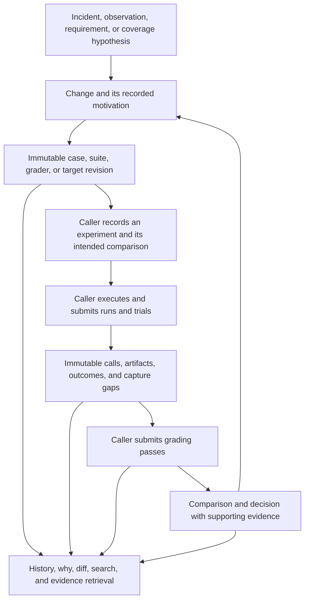

# Evaluation history in Nexus

Status: approved design, 2026-10-22. The implemented storage, CLI/MCP contract,
terminal views, and skills are specified in [the eval feature](../features/evals.md).
This document retains the research and broader design rationale; proposed
commands and future projections below are not the public API reference.

## Purpose and agreed scope

Nexus should be the durable record of what was tried, why it was tried, what evidence it produced, and how subsequent decisions changed the evaluation or the system being evaluated.

The first version must cover both single-prompt/API evaluations and agent/coding workflows. Callers own execution, scheduling, retries, sampling, grading, budgets, optimization, and decisions. Nexus accepts records and artifacts, validates their relationships, preserves their history, and makes them retrievable. It does not launch runners, wrap subprocess execution, invoke graders, choose experiments, or operate a hill-climbing loop. Optional client helpers serialize and upload evidence; they do not control the workload.

Git is assumed to accompany Nexus in normal use. Repository content should be referenced through pinned Git identities by default. Nexus stores historical relationships and new evidence without duplicating a checkout or every committed fixture on each run.

The central historical question is: **Why did this evaluation exist, and what evidence and decisions led to its current form?** A score table is a projection of this history, not its authority.

Motivating evidence explains a change. The change publishes new definitions. A caller can link its intended experiment to those definitions, then record executions and independent grading passes. Comparisons and decisions refer back to that evidence. A later change starts another link in the chain; it never rewrites the earlier one. History queries traverse this chain without executing any of it.

## Research and lessons

The exact Claude API guides are in Anthropic's public skills repository, rather than installed in this checkout. Research used revision `dbd4588f9e1033efb41dad4bef2f7947c8993d44`.

- [Build eval](https://github.com/anthropics/skills/blob/dbd4588f9e1033efb41dad4bef2f7947c8993d44/skills/claude-api/shared/evals/build-eval.md) covers task definition, representative inputs, grading, a pilot, and a baseline. Its artifacts include results, traces, and input/output evidence.
- [Eval hillclimb](https://github.com/anthropics/skills/blob/dbd4588f9e1033efb41dad4bef2f7947c8993d44/skills/claude-api/shared/evals/eval-hillclimb.md) connects hypotheses, candidate changes, measurements, and keep/revert decisions. Its mutable narrative and in-place regrading are useful local conveniences; Nexus should retain the previous narratives and grades as history.
- [Eval audit](https://github.com/anthropics/skills/blob/dbd4588f9e1033efb41dad4bef2f7947c8993d44/skills/claude-api/shared/evals/eval-audit.md) examines whether the measurement is trustworthy. [Cost hillclimb](https://github.com/anthropics/skills/blob/dbd4588f9e1033efb41dad4bef2f7947c8993d44/skills/claude-api/shared/evals/cost-hillclimb.md) separates cost reduction from quality constraints. The [report schema](https://github.com/anthropics/skills/blob/dbd4588f9e1033efb41dad4bef2f7947c8993d44/skills/claude-api/shared/evals/report/SCHEMA.md) already separates source artifacts from presentation.

Nexus should preserve these useful distinctions while giving case changes their own durable motivation, retaining all grading versions, and identifying exactly which evidence each conclusion used. Existing artifact directories remain valid caller-owned working formats.

OpenAI's [Codex skill evaluation guide](https://developers.openai.com/blog/eval-skills) shows structured execution traces, deterministic behavior checks, and separate rubric-based assessments. Its [agent evaluation guidance](https://developers.openai.com/api/docs/guides/agent-evals) distinguishes workflow traces from repeatable evaluation datasets. The useful architectural lesson is to retain execution evidence independently of its assessment.

Current [OpenAI guidance](https://developers.openai.com/api/docs/guides/promptfoo-codex) also describes Promptfoo as an evaluation option for Codex. This research did not establish a universal built-in Codex hill-climbing/history service that Nexus should depend on. OpenAI's [deprecation notice](https://developers.openai.com/api/docs/deprecations) schedules hosted Evals to become read-only on October 31, 2026 and shut down on November 30, 2026. Borrow the concepts and support portable imports; do not depend on that hosted service.

These are methodological influences, not proposed runtime dependencies. If implementation copies or adapts Anthropic source text or scripts, retain its [Apache 2.0 license and applicable notices](https://github.com/anthropics/skills/blob/dbd4588f9e1033efb41dad4bef2f7947c8993d44/skills/claude-api/LICENSE.txt), identify modifications, and record the source revision. Prefer concise original Nexus skills with source attribution over copying provider-specific defaults.

## Historical model

All identities are scoped to an existing Nexus project. Stable identities name concepts; immutable revision IDs identify their exact contents. Parent revisions permit forks and merges. Names, branches, and labels are conveniences, never the identity used by a recorded result.

| Record | Required meaning and important fields |
| --- | --- |
| Change | Motivation, intended behavior, hypothesis, reason kind, evidence links, author/agent, affected revisions, authored time, recorded time, and rationale provenance. |
| Case revision | Stable case ID, input and fixture artifact references, expected behavior, reference material, source/derivation links, tags, and change ID. A case can have multiple assertions. |
| Grader revision | Deterministic code or rubric, requested judge configuration, required inputs, legacy score interpretation where applicable, and calibration evidence. Grader executions are recorded separately. |
| Metric revision | Stable identity, parents and motivating change; name, meaning, arbitrary unit and value format, optional value-schema/interpretation text, and calculation description, optional formula, pinned source artifacts, population, aggregation, exclusions, and missing-data policy. |
| Suite revision | Exact case revisions, membership, weights, split/group assignment, pinned grader revisions, aggregation definition, sampling definition if any, and change ID. A case can occupy different roles in different suites. |
| Repository revision | Stable repository identity plus pinned commit/tree and a manifest of relevant dirty/untracked overrides. Reuse committed Git objects; preserve new bytes separately. Repository labels/locations are recorded aliases. |
| Model configuration revision | Provider, requested model/version, and inference settings. Caller-supplied model labels bind to configurations through separate versioned records; actual served identity belongs to each call. |
| Target revision | The system being evaluated: a repository/model pair or a composition of named router/agent components and their model configurations, plus prompt templates, skills, tools, harness/configuration, and dependency/environment manifests. |
| Selection / publication | The caller's adoption of an existing revision for a named scope/branch: previous/new revision, preceding selection event, reason/change reference, actor, effective time, receipt time, and source provenance. A rollback selects an older revision without changing it. |
| Experiment | The question, expected effect, parent experiment, baseline/candidate target revisions, suite revision, caller's selection/repetition/retry/budget/stop plan, and when that plan was recorded. Plans are evidence, not Nexus execution instructions. |
| Run | One caller-reported execution batch: exact revision references, selected population, external runner identity/version, invocation provenance, timestamps, reported state, and evidence completeness. A run may exist without an optimization experiment. |
| Trial | One case occurrence and repetition within a run: case revision, replicate index, seed if supplied, status, initial/final environment references, final output, and independently observed outcome evidence. |
| Attempt | Each execution attempt within a trial, with causal parent/retry reason, errors, timing, and evidence. Transport retries are distinguishable from deliberate new samples. No discarded attempt disappears. |
| Call / trace event | Per-attempt causal parent, actor/subagent, producer sequence, occurrence/receipt times, request/context/response references, exposed tool state, actual tool calls, usage, and capture gaps. |
| Grading pass / grade | Explicit assessment subject and original evidence, exact grader revision, grader execution evidence, individual assertion/aspect results, score or error, and grader identity. Human judgments use the same provenance principles. |
| Measurement | Exact metric revision, typed assessment subject including run scope, caller-reported value as exact text/artifact/unavailable, explanation, calculation input records, evidence artifacts, and optional correction of a prior measurement under the same definition and subject. |
| Comparison | Explicit runs/trials/grades/population, metric definition revision, matching/exclusions, environment differences, caller-reported calculations and uncertainty, and validity findings. |
| Decision | Accepted/rejected/inconclusive/abandoned candidate, reason, supporting comparison/evidence, actor, and time. Decisions and later corrections are retained. |
| Artifact | Content identity, media type, size, scope, origin, Git reference or stored-blob backing, availability/verification history, retention state, and associations describing its role/path in each record. |

Definitions use closed tagged domain types. Share a revision mechanism where lifecycle and invariants match; keep case, suite, grader, metric, repository, model configuration, and target/composition payloads explicitly typed. Provider-native request/response payloads may be retained as opaque artifacts at a named external-format boundary, alongside normalized typed fields. Do not make arbitrary JSON the domain model.

### Repository/model pairs and routed agent systems

A minimum supported subject is a labeled repository/LLM pair across time. A recorded result identifies the repository revision and model configuration revision, the exact suite/grader revisions, and execution time. Stable repo/model labels make its history easy to find; labels never replace the pinned identities. Changing only the repository, only the model configuration, or both remains distinguishable. This pair can be the scored target of a homogeneous evaluation; in a heterogeneous system, each participating pair is a filtering dimension unless separately evaluated at that scope.

For example, a history query can select `repo=dispatch-service, model=fast-model`, then show which repository snapshots and model configurations that label referred to at each evaluation. It can compare two models on the same repository revision, or one model configuration across repository revisions, while keeping the evaluation definition explicit. A provider alias with unknown served-version drift remains a disclosed uncertainty.

A routed system cannot always be described by one LLM. Represent the target as a versioned composition with an arbitrary number of component bindings:

| Component ID | Role | Definition reference | Model configuration reference |
| --- | --- | --- | --- |
| `router` | Dispatch incoming elements | Router code/prompt/tool revision | `router-model@config-3` |
| `extractor` | Handle extraction work | Extraction agent revision | `fast-model@config-7` |
| `reviewer` | Review dispatched work | Review agent revision | `strong-model@config-2` |
| Additional caller-defined IDs | Caller-defined responsibility | Corresponding immutable definition | Corresponding configuration |

Two agents using the same model still have separate component identities and instruction/tool contexts. Model assignments are typed as fixed configuration, versioned selection policy, or unspecified with a reason. A component can make many calls or select different models per dispatch/call; bindings record the caller's declared configuration/policy, while call records identify what was actually reported as used. Dynamically created agent instances reference their component definition and parent and have distinct instance/invocation IDs; the observed graph is not limited to the initially declared component list.

Record dispatch/handoff events linking the router decision, dispatched payload and upstream context, eligible destinations when known, requested/actual destination and model assignment, receiving agent invocation, and resulting output. Parent/child and causal edges support fan-out, concurrent work, fan-in, retries, and redispatch without requiring one linear transcript. The caller supplies these events; Nexus does not perform routing or infer unreported topology.

Each assessment declares its subject: end-to-end trial, a specific component invocation, or a routing decision, with references to the exact evidence it judged. This permits separate questions about routing quality, worker quality, and final system outcome. An end-to-end score belongs to the whole composition; listing models that participated must not assign that score as each model's individual performance or imply which component caused a regression.

History queries therefore support repository/model pairs as a simple case, component-specific histories, and full-composition histories. Useful comparisons include changing only the router model, only one worker model, only repository code, or the complete composition. Record the caller's intended difference and observed differences; uncontrolled changes remain visible.

Routed populations also matter: a worker given easier or different tasks does not demonstrate a better model merely by having a higher pass rate. Retain the dispatched input population and whether upstream context was fixed for a component evaluation or naturally produced by the router. Comparisons disclose unmatched inputs and routing-selection differences rather than attributing them to model quality.

### Motivation is a first-class record

Publishing a new case/suite/grader/target revision requires a change record. At minimum, the author supplies a concise explanation of the problem or coverage hypothesis, the desired behavior, and why this particular change addresses it. One coherent change can motivate several cases; each case still states the behavior it tests. The client automatically attaches the diff, parent revisions, actor/session, and available source references instead of requiring them to be retyped.

Reason kinds include observed failure, user requirement, new capability, coverage hypothesis, grader correction, distribution change, duplicate/removal, and maintenance. Evidence links can reference a trial, call, artifact, papercut, SOS report, user requirement, issue, or external source. An untested hypothesis is valid provenance; it must not be described as an observed failure.

Each evidence link retains its locator, source revision when available, captured time, producer, and an immutable content snapshot or artifact reference. A pinned Git artifact reference is sufficient when it identifies the exact evidence; it does not require a duplicate upload. Mutable issues or sources without such backing need a captured snapshot to preserve their original evidence. Otherwise mark the link reference-only or unavailable. A later edit, resolution, consolidation, or deletion of an issue must not silently replace the evidence that originally motivated the case. Retrieval may show current source state separately, labeled as current.

The change records both the author's claim and its source. Distinguish contemporaneous rationale, later explanation, imported rationale, and missing historical rationale. An explanation added later has its own timestamp and attribution; an as-of query must not pretend it was known earlier. Corrections append a superseding record rather than editing the original explanation.

Record proposed, accepted, rejected, and abandoned changes, including proposals that never published a revision. Attach a decision and its reason; Nexus records the caller's decision rather than approving changes itself. This preserves why plausible coverage or grader changes were not adopted.

Imports with missing motivation remain importable and searchable as historical gaps. Nexus must never manufacture an original intention from a diff or a later model summary. A model can propose a retrospective explanation, but that proposal is explicitly an inference.

Example chain:

> Trial T17 used a shell command after a discoverable tool was added mid-session. The failure motivated change C8: test whether the agent discovers and adopts that tool. C8 added cases E12 and E13 to suite S4, with one positive case and one negative control. Target P6 addressed discovery. Experiment X9 compared P5 and P6 on S4 and retained a failed candidate as well as the accepted one.

The repository can answer why E12 exists by returning C8, T17, the relevant call context, the parent/new suite membership, and X9's evidence. It should not treat C8's hypothesized mechanism as proven merely because P6 scored better.

### Versioning and time

- Adding, removing, relabeling, reweighting, re-splitting, or changing reference answers produces a new revision and a reason. Removed cases remain retrievable.
- Fixing a grader produces a new grader revision. Regrading the same outputs adds another grading pass and preserves the original scores and their old interpretation.
- Git commit, dirty diff, relevant untracked files, lockfiles, and external configuration snapshots are provenance. A Git SHA alone cannot represent all inputs to a run.
- Preserve occurrence time, producer sequence, and server receipt time separately. A late import can say what happened earlier, but cannot claim Nexus already knew it then.
- Revision creation is distinct from adoption. Append-only selection/publication events record which revision a caller adopted on each named scope/branch, including removals and rollbacks. Branch labels resolve through that history, not revision timestamps or latest-arrival order. Conflicting or missing predecessors remain explicit rather than choosing a fork silently.
- As-of queries distinguish the definitions selected at a caller-reported effective time from what the repository knew at a given recording time. Without selection evidence, return the known candidates and an unknown selection. Actual run references are authoritative even when definitions were imported later.
- Duplicate content shares artifact bytes, not identity or motivation. Similar or identical cases from different incidents retain their separate provenance unless a recorded curation decision links them.

## Per-call evidence

Each model call can reference an immutable context manifest. Reuse content-addressed manifests when unchanged, while recording availability changes before the next affected call.

Manifest entries reference shared prompt blocks, files, tools, and other artifacts rather than copying their contents into every call. Committed bytes normally use Git references. New rendered text and results are stored once and reused by reference. A complete native request/response dump is optional additional evidence, not a requirement to duplicate all shared context at every turn.

| Dimension | Evidence to retain when supplied by the caller |
| --- | --- |
| Submitted context | Ordered roles/messages/content blocks and exact rendered prompts/attachments; templates and variable bindings separately when available. |
| Context construction | Instructions and loaded skills, retrieved text, tool results, file bytes supplied to the model, and any compaction/truncation records and source links. |
| Tool surface | Exact names/descriptions/schemas, version/source, tool-choice configuration, and declared/discoverable/visible/enabled/executable state with evidence. Tool use is a separate event. |
| Model call | Provider, requested alias, actual served identity/fingerprint when exposed, request parameters, output schema, request ID, stop reason, and returned metadata. |
| Environment | Harness/SDK versions, relevant configuration, dependency locks/container digest, workspace snapshot, permissions, clock/network/fixture descriptions, and allowed environment values. |
| Result | Returned response blocks, tool arguments/results, provider-exposed reasoning summaries, generated files/diffs, actual task outcome evidence, usage, timings, and errors. |

Usage and cost records distinguish target calls, grading calls, tool services, and other caller-reported compute. Retain input/output/cached/reasoning token counts when exposed, quantity/unit/currency, pricing source/version, and whether cost is measured or estimated. Custom metrics have named definitions, units, direction, and source evidence. Preserve native metadata artifacts so later normalizers can recover fields that were not indexed initially.

Available files and files actually read into context are different. Available skills and loaded skills are different. A discoverable tool is not necessarily visible or executable at that call. A schema hash without stored schema bytes is a reference with missing content, not a complete tool snapshot.

Every dimension carries capture provenance and a state such as exact, partial, redacted, unavailable, or unsupported, with a reason and any omitted byte/item counts. Completeness of one dimension does not imply completeness of the others. Preserve the raw submitted artifact and normalized interpretation separately; normalization versions can change.

Caller adapters can submit client-visible API requests, runner traces, or workspace artifacts. A CLI transcript alone generally cannot establish all effective model instructions or all tools available at each call. Provider-hidden prompts/state and inaccessible reasoning stay explicitly unavailable. Capture records are attributed assertions by their producer, not cryptographic proof of the provider's internal execution.

Nexus validates references, digests, schemas, ordering constraints, and reported completeness. It cannot prove that a caller reported every call, every failed experiment, or every external input. Reports must distinguish a complete submitted bundle from complete real-world observation.

## Recording contract

All interfaces in this section are proposed. They record caller-owned work and return durable identities/receipts.

The main ingestion operation accepts a versioned bundle containing definitions/changes, optional experiment intent, runs/trials/attempts, ordered events, grades, comparisons/decisions, and artifact references. The same typed contract supports online append and offline import. A small client library or CLI handles serialization, chunk upload, and retrying **ingestion**, without retrying or launching evaluations.

Use producer IDs, external record IDs, and idempotency keys. Replaying the same identity and payload is a no-op; the same identity with different immutable content is an explicit conflict. Importers retain original IDs/source formats and generate a mapping to Nexus identities. Relationships are validated within the project; references are not accepted merely because their strings exist elsewhere.

Caller-reported lifecycle states are appended events. The implemented surface retains the original run/trial/attempt state and exposes subsequent typed lifecycle reports through bounded history reads. Ordinary detail reads also derive the initial state and up to 64 report frontiers, retaining competing branches and disclosing truncation. Retrieval does not choose a branch or invent a terminal state. Online producers may register planned trials before executing them. Offline imports may arrive only after execution; record that distinction. A caller crash leaves an open or incompletely reported record, not a Nexus-invented timeout. A caller may subsequently record interrupted/abandoned work with its evidence.

Execution completion, grading completion, artifact availability, and ingestion completion are independent. A successful result may have partial capture. A complete trace may describe a failed task. An upload can finish after the result record. Explicitly sealing a bundle verifies its declared references and counts; it does not imply the evaluation succeeded or that no unreported attempts occurred.

The repository records the trial selection rule: first attempt, last attempt, all samples, or a caller-defined versioned rule. Never silently select the best retry. Planned, attempted, completed, failed, canceled, skipped, excluded, ungraded, and missing counts remain distinguishable. Reports state their denominator and exclusions.

### Artifact storage and transport

An artifact is a reference to exact content, not necessarily an uploaded blob. Separate its content identity from backing locations, and keep path/role associations separate. The same bytes can appear in several runs or locations without losing their historical meaning.

| Backing | Recorded coordinates | Default use |
| --- | --- | --- |
| Git file | Stable repository ID, full commit object ID and object format, repository-relative path, entry kind/mode, and blob object ID when verified. Retain content digest/size and verification provenance when available. | Code, prompts, tools, skills, fixtures, images, and large eval files whose required bytes are already committed. No duplicate upload. |
| Git LFS payload | Repository/commit/path of the pointer plus distinct LFS payload object ID, size, and retrieval provenance. | A required payload retained in accessible Git LFS storage. Pointer bytes and payload bytes are separate artifacts. |
| Stored blob | Verified content digest and bounded chunk manifest. | Dirty/untracked/generated content, new rendered prompts, outputs/traces, external inputs, or any required bytes not recoverable exactly from Git-backed sources. Also an explicit archival copy when requested. |

Git-backed references are the normal path. A branch name, tag, `HEAD`, path alone, or mutable repository URL is not a pinned artifact identity. Retrieval locations/credentials are separate configuration. Repository snapshots can reference a committed tree plus changed-file overrides instead of uploading the whole tree. Images and large files do not require uploads merely because they are binary or large.

Use judgment about the actual evidence bytes. A committed template is not the expanded prompt, and a clean working-tree file need not equal its raw Git blob because of [Git attribute transformations](https://git-scm.com/docs/gitattributes). Verify equivalence before substituting a Git reference for captured bytes. Preserve the exact differing bytes when they matter; do not run repository-defined filters or arbitrary reconstruction code during historical retrieval. Git LFS retains [pointer and payload identities separately](https://github.com/git-lfs/git-lfs/blob/main/docs/spec.md); an accessible pointer does not establish payload availability. Submodule files reference the child repository and pinned child commit, rather than treating the parent gitlink as file contents.

Adding a verified Git or blob backing later does not change the artifact's content identity or original capture assertion. Each location must resolve to the same bytes, with timestamped verification provenance; a mismatch is an explicit error. When full bytes have not been checked, retain the caller's Git coordinates as an unverified reference instead of asserting verified equality or merging byte identities speculatively.

Keep capture exactness separate from present retrieval availability. Git object IDs remain pinned even if access is later lost or [unreachable objects are pruned](https://git-scm.com/docs/user-manual). Record externally Git-backed, stored locally, last verified, currently unavailable, and unknown states without replacing historical content with current file contents. Repository owners retain their Git/LFS history; Nexus does not automatically mirror repositories or create retention refs. An explicit archive/materialization operation may store selected required content when independent retention is desired.

For blobs, use content-addressed SQLite BLOB/PostgreSQL BYTEA chunks through Diesel. Check for existing content before uploading and deduplicate within the project. Upload uses begin, bounded chunk writes, seal/verify, and publish. A proposed raw chunk size of 256 KiB fits current 1 MiB envelopes with base64 encoding. Validate chunk identity, contiguous length, and full digest; conflicting immutable retries fail. Partial uploads remain explicitly pending or failed and can be resumed by the caller.

Large verification uses bounded reads and short store ownership, then atomically publishes the result. Do not hold the sole application store mutex while hashing an entire trace or repository artifact. Artifact listing returns backing references and small explicit previews; full bytes are fetched separately. Local source resolution happens beside the caller's checkout, or through an explicitly configured trusted Git source; the remote server never opens a caller-supplied filesystem path or interprets an arbitrary submitted URL as fetch authority. Verification records identify which producer checked the bytes.

Exports declare their dependency policy. The default reference-preserving bundle includes Git coordinates, manifests, and Nexus-stored evidence; its Git dependencies remain external. An explicitly self-contained bundle materializes only the required artifacts for its selected history, deduplicates their bytes, and either includes the full dependency closure or reports incompleteness. It must not silently claim independence from Git when LFS payloads, submodule objects, or other required evidence are unresolved. Import does not automatically fetch or copy all referenced repositories.

No cross-project content-existence oracle is exposed. Project scoping is data organization, not a new authorization claim: the current remote service secret grants trust across the endpoint. Full-content evidence is intentionally submitted for these eval records. General lifecycle analytics continues to exclude prompts, arguments, file contents, outputs, and errors.

Exclude credentials and authentication headers from recording; environment values come only from an explicit safe-value manifest. Redacted content cannot be labeled exact. Default retention preserves uploaded bytes and pinned references; externally backed bytes depend on their recorded Git source. Deleted, withheld, oversized, or unavailable content leaves an explicit gap and reason. Expiry/deletion policies and later availability changes are auditable; immutable history does not require indefinite duplication of every source artifact.

Capacity limits are reported before or during ingestion, with recoverable incomplete state rather than silent truncation. Store errors do not control caller execution; explicit recording failures return an error/receipt the caller can handle. Existing lifecycle hooks retain their advisory fail-open behavior.

## Comparisons and improvement claims

Nexus stores the caller's comparison population, calculations, metric definition, uncertainty method, and decision. It can derive transparent counts/deltas for display, but does not decide how to grade or optimize.

The implemented metric/measurement model preserves arbitrary measurement meaning and representation. A metric revision records its name, description, unit, value-format description, optional value-schema and interpretation text, and calculation description/formula, source artifacts, population, aggregation, exclusions, and missing-data policy. These are durable definitions rather than execution instructions. Accuracy, money, duration, categories, vectors, distributions, and caller-defined formats fit the same model without a universal direction or threshold policy.

A measurement names the exact metric revision, typed subject, input records, and evidence. Its value is exact inline text, an artifact, or explicit unavailability. Inline text preserves decimal precision, large integers, empty values, and serialized structured data even through JavaScript clients. Nexus does not parse the declared format, validate the optional schema, execute calculation sources, convert units, or select a better result. Legacy numeric grades and optional inline comparison metrics retain their original historical representation; new measurements do not require that float representation.

Definition changes append motivated metric revisions, including changes to units, representation, formulas, population, aggregation, exclusions, or missing-data policy. Recalculated observations reference the new revision and retained inputs. A measurement correction under an unchanged definition links its predecessor with the same subject and metric revision. Comparisons name exact metric IDs, measurement IDs, or both; measurements already resolve their definitions without a redundant list or legacy numeric metric. Comparisons preserve the caller's validity claims, tradeoffs, and uncertainty. Matching labels or units alone do not prove comparability.

A comparison references exact case revisions, grader revisions, weights/aggregation, selected attempts, target revisions, and relevant environment conditions. Validity is reported as matched, matched with disclosed differences, incompatible, or unknown. Expected treatment differences such as the target prompt are named; uncontrolled environment differences remain visible.

When a suite grows, present two views: the unchanged common-case population and the new full-suite population. Do not draw an unqualified improvement line across changed case inputs, labels, graders, or denominator weights. A corrected grader can assess old outputs in new passes to establish a common grading basis; that does not create new target executions.

Retain sample-level outcomes and repetitions, not only means. Seeds are evidence, not a determinism guarantee. Separate task failure from infrastructure failure, missing capture, and grader failure. Caller-provided confidence intervals or significance claims retain their method/configuration and source data references. Basic validity checks should not grow into a Nexus-owned statistical experimentation engine.

The experiment records hypotheses and selection/stop plans before results when the caller provides them then. A later retrospective plan remains useful, but is labeled as such. Rejected candidates, negative results, abandoned investigations, and changed conclusions are searchable alongside successes.

### Holdouts and history access

Eval authors need history. The evaluated target should receive only the information the caller intends it to receive. Record development/validation/holdout membership, case derivation families, known exposure, and contamination annotations. Do not automatically inject eval history, reference answers, grader instructions, or prior successful traces into a target's context.

Callers own execution isolation, target credentials, and holdout exposure. The current service-wide Nexus secret cannot protect holdouts from someone holding that same secret. Do not advertise query filters as access control. A target should not inherit broad repository credentials or holdout artifacts from its authoring process; scoped credentials would be a separate security feature. SDK recording helpers must not implicitly enrich target prompts with repository history.

## Retrieval and agent experience

The default response is a small evidence-backed overview with IDs, dates, revision references, reasons, and completeness. Follow-up reads expand the requested records. Search uses typed filters and text over recorded motivations/labels; semantic search is optional later, not required for trustworthy history.

Essential questions and their returned evidence:

| Question | Response |
| --- | --- |
| Why does this case exist? | Original change, source evidence, author/time, subsequent explanations, affected revisions, and unresolved provenance gaps. |
| What did this score measure? | Exact suite membership, case/grader revisions, score definition, attempts and exclusions, and source outputs. |
| What changed between these runs? | Definition/target/context differences, call-level tool/skill manifests, environment changes, and comparison validity. |
| How did this repo/LLM pair perform over time? | Runs grouped by stable labels with exact repository/model revisions, evaluation-definition changes, timestamps, and result scope. |
| Did the router or a worker regress? | Composition differences, dispatch evidence, and separately scoped routing/component/end-to-end assessments; unknown attribution when evidence is insufficient. |
| What was tried before, including failures? | Candidate/experiment lineage, all reported outcomes, decisions and reasons, and failed/abandoned branches. |
| What did this model call see? | Ordered submitted context and available-tool manifest, linked bytes, capture producer, and explicit missing dimensions. |
| Did a grader correction change our conclusion? | Old/new grader revisions, separate grading passes over the same evidence, changed comparisons, and superseding decisions. |
| What existed at this time? | Suite/revision lineage and branch selection history, with authored/effective/recorded-time distinctions and unknown adoption when evidence is missing. |

Proposed public surface: a `nexus eval` CLI for record/import/export and history/show/why/diff/compare; an MCP history tool with bounded typed queries; and a recording tool with typed mutation operations. Large content transfer stays behind artifact operations, so an LLM does not copy megabytes through ordinary tool arguments. Exact command names and wire schemas should be settled with the first implementation slice, not presented as available today.

Narrative summaries and Markdown tables are generated views with source IDs and projection versions. They can be regenerated without changing the underlying reasons or results. Complete history exports are streamed and declare whether Git dependencies remain external or have been materialized. Ordinary reads are paginated and disclose truncation. Optional read-only TUI navigation follows overview → experiments/runs/revisions → reason/evidence → explicit artifact preview, without polling entire blobs.

Retrieved prompts, transcripts, and historical instructions are labeled source evidence, not instructions for the reading agent. Imported artifacts are never executed by storage, indexing, or rendering.

## Integration with this repository

Use a dedicated future `evals` feature with a maintained feature specification and annotations when implementation begins. Do not redefine `usage-analytics` or stretch `agent-memory` to store eval payloads.

| Area | Existing integration point | Proposed responsibility |
| --- | --- | --- |
| Domain | Feature directories such as `src/memory/` and `src/sos/` | `src/evals/` owns typed records, revisions, ingestion validation, and history projections. |
| Service | `src/coordination/api.rs`, `src/coordination/service/dispatch.rs` | Add explicit eval requests outside lifecycle observation. |
| Persistence | `src/persistence/store.rs`, feature-owned persistence modules | `src/persistence/evals/`, typed Diesel queries, equivalent new migrations on both backends. |
| Transport | `src/runtime/mcp.rs`, `src/runtime/mcp/tool_definitions.rs`, `src/main.rs` | Bounded recording/query/artifact adapters and CLI import/export; no execution operations. |
| Existing analytics | `src/analytics/`, `pi-extension/src/inventory-capture.ts` | Optional links to observed call identities; existing fingerprints/exposure remain observational and are not substitutes for stored call manifests. |
| Installation | `src/installation.rs`, `skills/` | Bundle the new skills using the existing installation mechanism. |
| Transfer | `src/persistence/transfer/stream.rs` | Include all eval records/artifacts and preserve supported older formats. |

Logical persistence groups are artifacts/backing locations/verification history/chunks/associations; identities/revisions/revision edges/membership; changes/evidence links; selection/publication history; experiments; runs/trials/attempts; events/call manifests; grading passes/grades; and comparisons/decisions. Use relational keys/indexes for common history queries and immutable typed manifests for larger versioned bodies. Final physical tables follow these actual access patterns; avoid both a schema per runner and an unrestricted event bucket.

Current portable stream version 3 has a 4 GiB total ceiling, 8 MiB encoded-record ceiling, sixteen-row batches, and 27 tables tracked with a `u32` mask. Eval artifacts make those limits material. The implementation must replace fixed-width table tracking as needed, use base64 rather than JSON byte arrays for chunk transfer, and make batches respect encoded byte size as well as row count. Add a streamed eval-bundle export for histories exceeding the whole-database snapshot ceiling, or deliberately revise that ceiling with bounded transfer tests. Never claim unlimited backup capacity under the existing limit.

SQLite/PostgreSQL parity, atomic publication of immutable records, crash-safe imports, project-bound references, and complete artifact-aware export are part of the feature, not follow-up conveniences. Existing migration files remain immutable. Existing analyst/provider invocation is not an eval runner and should not be reused as one.

## Proposed Nexus skills

Implement these only after their recording/query interface exists. Keep provider-neutral guidance concise, with deeper references for case design, measurement audits, and import formats. The caller chooses its harness and owns every execution.

| Skill | Workflow and Nexus-specific behavior |
| --- | --- |
| `nexus-build-eval` | Search existing suites/cases and their motivations first. Define the intended behavior and coverage reason; reuse the caller's harness. Record case/grader/suite/metric revisions, calculation and representation definitions, rationale, and pinned Git evidence; upload only necessary new bytes. Have the caller produce a pilot/baseline, then submit exact measurements, outputs, and capture gaps. Summarize what the suite measures and why each addition exists. |
| `nexus-eval-audit` | Inspect provenance, coverage, outcome evidence, Git reference exactness/availability, grader calibration, missing capture, selection, leakage, and comparability. Record findings and proposed definition changes with evidence. It does not silently rewrite cases or grades. |
| `nexus-hillclimb` | Retrieve prior accepted and rejected experiments and their reasons. State the new hypothesis and objective/guardrails; pin the measurement definition. The caller makes changes and runs its chosen process. Record every candidate, relevant patch/files, result, grading pass, comparison, and decision. A cost mode treats quality constraints and caller-reported cost evidence explicitly. |
| `nexus-eval-history` | Answer why/as-of/what-changed/what-was-tried questions by tracing original records. Distinguish recorded facts, contemporary hypotheses, later inference, and missing evidence. Cite IDs and expand exact artifacts on demand. |

These skills teach construction and improvement discipline while making Nexus the historical repository. They do not prescribe a runner implementation or imply that Nexus executes the steps. Once built, forward-test them on one ordinary API example and one multi-call coding workflow, plus a historical investigation requiring failed candidates and an old grader version.

## Delivery slices and acceptance criteria

This pass ends with design review. The following slices are an implementation proposal, not work already performed.

1. **Durable evidence and revision history.** Add the feature spec, typed domain, equivalent database migrations, Git-first artifact references, necessary blob transport, change motivations, revisions, selection history, record/import/export, and why/show/history queries. Acceptance: repeated runs referencing the same committed file/image create no duplicate blob uploads; dirty and rendered bytes are not confused with their committed base/template; LFS payloads and submodule files retain their own identities; changing a checkout cannot change a pinned artifact; losing a Git source yields an explicit availability gap; stored evidence survives checkout deletion; editing a motivating report cannot change its captured evidence; later backing verification preserves original provenance; reference exports disclose dependencies and self-contained exports prove closure; add → remove → rollback on two forks imported later preserves effective/receipt-time answers; conflicting immutable replay fails; missing legacy reasons stay unknown.
2. **Runs, calls, assessments, and decisions.** Add caller-owned run/trial/attempt/event ingestion, repository/model pair and composition identities, per-call manifests, grading passes, experiments, comparisons, and decision history. Acceptance: API and router/multi-agent fixtures fit the same model; pair histories distinguish code changes from model changes and label rebinding; two agents sharing a model retain separate identities; router-only and worker-only changes have distinct comparison subjects; fan-out/fan-in preserves causal links; whole-system scores are not attributed to individual models; mid-run tool changes affect only subsequent manifests; regrading preserves both score sets; retries and incomplete imports retain their denominators and gaps.
3. **Caller-format adapters and useful retrieval.** Add import adapters for the researched Claude artifact layout, generic versioned bundles/JSONL, and Codex/other caller traces where useful. Preserve native payloads and disclose unsupported fields. Acceptance: missing traces never become complete capture, unknown variant directories are reported rather than silently skipped, and changed suites/graders cannot yield an unqualified comparable label. Importing data never executes it.
4. **Skills and terminal views.** Install the four skills, add evidence-linked reports and optional shared Pi/native TUI views, and forward-test historical reasoning. Acceptance: an agent can explain why a removed case existed, find a rejected candidate, reconstruct the definitions behind an old score, and distinguish a measurement change from a target improvement using only Nexus history.

Each production slice follows test-first red/green evidence, relevant SQLite/PostgreSQL and transport/transfer tests, updated feature documentation, and `./scripts/check.sh`. Documentation-only design work does not require paid model calls or an eval run.

Defer automatic case mining, experiment scheduling, model-driven optimizer policies, runner orchestration, and grading execution outside this feature. They belong to callers. Potential repository improvements such as object-store tiers, scoped credentials, signed attestations, semantic retrieval, and richer statistical reporting can be considered independently after the basic historical chain works.
