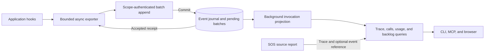

# Application agent traces

Nexus stores structured events from agents running inside a product. An agent
optimizer can find calls to a tool or skill, compare outcomes for one application,
agent, or capability version, and inspect the exact call in its conversation. An SOS report
can link directly to an event even when the application uploads it later.

Instrument the harness at the model, tool, and skill boundaries. Each boundary
emits one observation with a source timestamp and a stable event ID. Tool start
and result share an invocation ID. Parallel calls and execution retries have
distinct invocation IDs. Skill availability, instruction loading, and explicit
activation are distinct observations. Only activations contribute to skill call
counts. Application usage comes from these events. Development usage comes from
its existing host hooks.

## Ingest and projection



1. Hooks enqueue observations and return control to the harness. The exporter
   batches by bytes and time across executions. A full export can use the same
   events and IDs to fill gaps left by streaming capture.
2. `POST /api/v1/agent-traces/events` authenticates an application before reading
   its request body. It accepts at most 512 events and 1 MiB of JSON per batch.
   One event can hold up to 512 KiB of encoded content. A producer can record
   omitted or redacted content in its event payload. Keep payload capture explicit
   and redact before enqueueing.
3. Nexus bulk-appends immutable events and durable pending work in one transaction
   and returns `202 Accepted` after commit. An identical batch replay returns its
   receipt. Replaying an event in a different batch counts it once. Reusing an
   accepted ID with different content returns `409`. Retry `503`, timeouts, and
   lost responses with the same IDs and content, using jittered backoff.
4. A dedicated worker applies committed pending work in bounded transactions.
   Invocation facts merge by identity, so a start can arrive after a result.
   Source occurrence time drives analytics. A complete result is distinct
   from a missing result. `status` reports projection backlog independently of
   acceptance, and trace reads can see the original events.
5. An SOS report stores an optional `trace_ref` with `application_id`,
   `environment`, `trace_id`, and an optional `event_id`. Read it in the same
   project as the report. The reference remains pending until the events exist.
   SOS triage receives the report fields, never the linked transcript.

## Configure a producer

`nexus setup` installs the [application trace setup skill](../../skills/nexus-agent-traces/SKILL.md)
for Codex and Claude. MCP clients can discover the same guide with
`resources/list` and read it from `nexus://skills/nexus-agent-traces` as Markdown.

Set `NEXUS_TRACE_CREDENTIALS_FILE` on `nexus-server` to an owner-readable JSON
file (mode `0600`). For a container, mount the private file inside the container
and set the variable to its mounted path. Each array element binds one token to
a project, application, and environment:

```json
[
  {
    "project_id": "meridian",
    "application_id": "support",
    "environment": "production",
    "token": "<an independently generated bearer secret, at least 32 characters>"
  }
]
```

Send `Authorization: Bearer TOKEN`, `X-Nexus-Project-ID: meridian`,
`X-Nexus-Application-ID: support`, and `X-Nexus-Environment: production`.
Producer credentials grant trace upload in their configured scope. The SOS
HTTP endpoint uses the existing SOS reporter credential. Use the trusted Nexus
CLI or MCP credential for trace reads. Browser transcript content is disabled
by default and can be enabled with `NEXUS_TRACE_BROWSER_CONTENT=1` on the server.
The viewer still requests content explicitly. Payloads expire from the live
journal 30 days after first acceptance by default. Set
`NEXUS_TRACE_PAYLOAD_RETENTION_DAYS` to choose a different window. Expiry retains
event identities, timing, outcomes, references, and counts. Backups and portable
exports that contain payloads have their own retention lifecycle.

A batch has `schema_version: 1`, a stable `batch_id`, matching
`application_id` and `environment`, and an `events` array. A tool completion
can arrive on its own:

```json
{
  "schema_version": 1,
  "batch_id": "upload-17",
  "application_id": "support",
  "environment": "production",
  "events": [
    {
      "event_id": "lookup-7-result",
      "trace_id": "run-42",
      "agent_id": "order-assistant",
      "turn_id": "turn-3",
      "sequence": 12,
      "kind": "tool_finished",
      "occurred_at": "2026-11-26T15:02:04Z",
      "invocation_id": "lookup-7",
      "name": "lookup_order",
      "version": "3",
      "outcome": "timed_out",
      "duration_ms": 2000,
      "payload": {"error": "Order service timed out"}
    }
  ]
}
```

Use `model_started`, `model_finished`, `prompt`, and `message` for model and
conversation evidence. A producer can supply `conversation_id` across traces
and `parent_event_id` for explicit lineage. Use stable agent IDs for filters.
The [Koog JVM example](../../examples/koog-trace/) translates Koog hooks into
this contract. Apps using other harnesses can send the same JSON.

## Inspect and optimize

```sh
nexus traces list --application support --environment production
nexus traces usage --application support --agent order-assistant --kind tool
nexus traces calls --application support --name lookup_order --outcome timed_out
nexus traces get run-42 --application support --environment production --event lookup-7-result --include-payload
nexus traces status --application support
nexus traces schema
```

The read-only MCP tool is `nexus_traces`. Its tagged requests support the same
list, invocation, usage, detail, and backlog reads. Use the response cursor to
continue a bounded result. A trace event cursor continues after its last event
even when an earlier event arrives late. Restart the read to see events that
arrived before that cursor. Calls and usage reflect the latest available
projection. Start with metadata and fetch exact source events as needed. Compare tool execution outcomes separately from correctness judgments in
[Evals](evals.md). A tool can return successfully and still return the wrong
answer. For an Eval grade, link a small JSON evidence artifact containing the
project, application, environment, trace ID, event ID, invocation ID, and tool
version. Those coordinates identify the evidence independently of transcript
retention.

For an MCP capability query, `filter.version` accepts
`{"kind":"exact","value":"3"}` or `{"kind":"unversioned"}`. Omit it to match all
versions. Producer event versions use strings. The CLI flags are `--version`
and `--unversioned`.

In the browser, open application usage from **Skills** or **Tools**, or use
**Traces**. Select a project, filter application and agent, and follow a call to
its source event. Capture gaps and projection delay can change counts.

## Persistence and validation

The PostgreSQL deployment reserves independent ingress and projection capacity
alongside existing SOS and browser capacity. The pool can open these extra
connections on demand. On a server with uploads disabled, the projector drains
any previously accepted batches at startup and then stops. Payload expiry still
runs for retained content. Ordinary Diesel append transactions
use unique identities without taking the aggregate advisory writer lock. Typed
backend migrations provide the same event contract in SQLite for local
inspection and testing. The contract is owned by `src/agent_traces.rs`; the
authenticated HTTP boundary is in `src/runtime/server/trace_ingress.rs`.

The validation workload includes authenticated project and application isolation,
batch and event replay, a result arriving before its start, worker recovery, and
consistent CLI, MCP, and browser reads. Measure durable acknowledgement latency,
projection backlog age and recovery, and SOS/read latency during representative
bursts before establishing a production capacity target.
