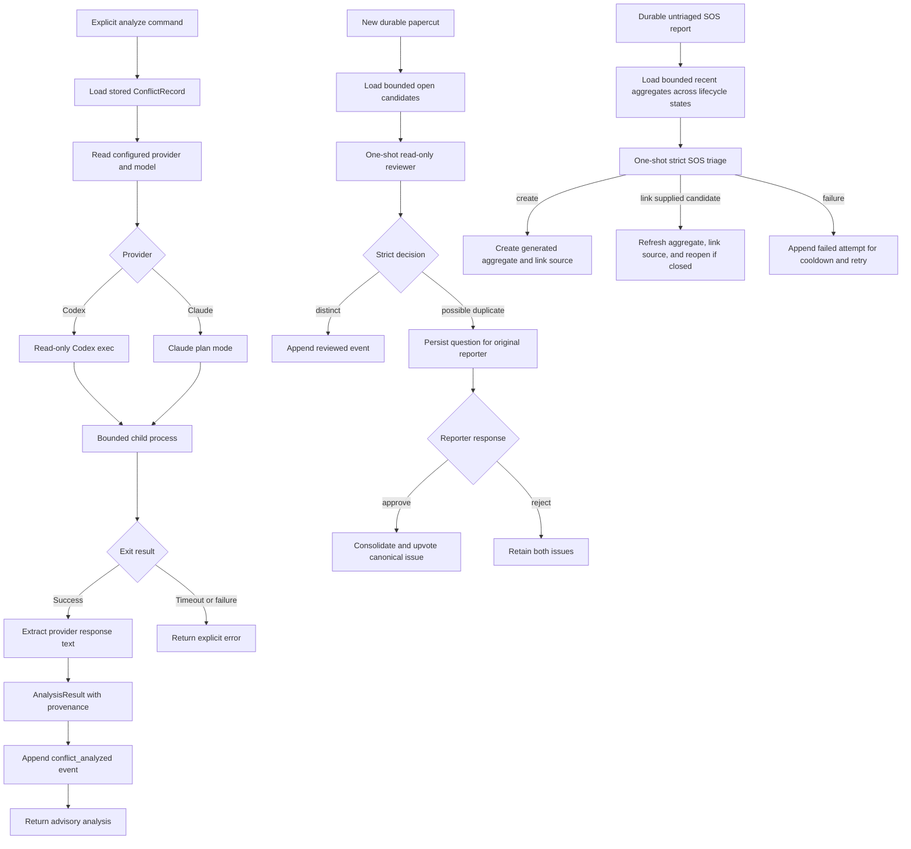

# Optional analyst processes

## What this feature does

The analyst boundary asks an explicitly configured local Codex or Claude command to summarize one stored conflict, compare a newly reported papercut with bounded active candidates, or triage one durable SOS report against bounded recent aggregate issues. It augments deterministic classification and matching; it does not classify severity, edit files, or decide whether an agent may proceed.

## Why it exists

A path-overlap rule can identify that two agents are likely to interfere, but a concise explanation may help a person or agent choose between splitting scope, sequencing work, handing off, accepting overlap, or requesting review. Likewise, deterministic normalization can collapse an exact papercut repeat, while semantically similar papercut wording needs judgment. SOS needs a model to turn heterogeneous complex-problem evidence into useful aggregate issues. Because model output is probabilistic and may consume resources, conflict analysis is explicit and background papercut/SOS work runs only after its source is durable, outside latency-sensitive lifecycle paths.

## Data flow

## Reading the flowchart

1. **Explicit analyze command** is invoked through CLI or MCP with a conflict identifier.
2. **Load stored ConflictRecord** ensures the analyst sees a typed, existing conflict rather than caller-supplied free-form context.
3. **Read configured provider and model** respects the user's provider, executable, model, reasoning effort, and timeout choices.
4. **Provider** selects exactly one configured implementation. Nexus does not silently fall back to another provider.
5. **Read-only Codex exec** uses a read-only sandbox and JSON output.
6. **Claude plan mode** invokes the print interface without edit permission.
7. **Bounded child process** accepts at most a 1 MiB prompt, supplies it over stdin inside the configured deadline, captures at most 1 MiB from each output stream, and kills and reaps the provider process group on timeout, overflow, or parent exit so descendants cannot retain capture pipes.
8. **Exit result** distinguishes usable output from timeout, startup, or non-zero-exit failures.
9. **Extract provider response text** decodes the provider's external JSON shape at the integration boundary.
10. **AnalysisResult with provenance** records provider, selected model, conflict identifier, raw output, extracted text, and time.
11. **Append conflict_analyzed event** adds the resolved configuration hash so later readers know which user choices produced the result.
12. **Return advisory analysis** gives the caller suggestions without changing claims, conflicts, or permissions.
13. **New durable papercut** is already committed with its first timestamped upvote before provider work begins.
14. **Load bounded open candidates** selects at most 64 other open canonical issues by most recent activity and supplies their upvote counts and latest encounter times. Exact normalized matches are already handled deterministically; bounding probabilistic review prevents a large historical registry from becoming an unbounded prompt or allocation.
15. **One-shot read-only reviewer** compares the new issue with that registry under the same configured provider safety boundary.
16. **Strict decision** accepts only a validated distinct result or a possible-duplicate result naming an existing, different canonical issue.
17. **Append reviewed event** records a distinct result and its provider provenance without changing the issue.
18. **Persist question for original reporter** turns a possible duplicate into durable coordination rather than pretending the provider process is a resumable conversation.
19. **Reporter response** is accepted only with the opaque token returned when the proposed source issue was created; Nexus stores and compares only its hash.
20. **Consolidate and upvote canonical issue** preserves the source as a tombstone and retains its original observations after approval.
21. **Retain both issues** closes a rejected proposal without changing either issue.
22. **Durable untriaged SOS report** exists before provider work and is rediscovered after a restart or saturated process queue.
23. **Load bounded recent aggregates across lifecycle states** supplies at most 64 project-local open, resolved, or deprecated candidates so a recurrence can reopen a closed issue.
24. **One-shot strict SOS triage** accepts only a generated create decision or a link decision naming one supplied candidate, with bounded title, summary, and rationale.
25. **Create or link** applies the model decision atomically with the source association and audit attempt; a link to a closed issue also appends a reopened lifecycle transition.
26. **Failed attempt** preserves the raw source, records provider/config provenance without exposing raw provider diagnostics, and becomes eligible again after an exponential cooldown capped at 24 hours.

## Implementation details

`src/agents/analyst.rs` owns conflict-specific prompting and result provenance. `src/agents/papercuts.rs` owns strict duplicate-review prompting, output decoding, and target validation. `src/agents/sos.rs` owns bounded SOS prompt construction, strict decision decoding, and candidate validation. The `src/agents/model/` module hides provider command and environment policy plus bounded subprocess execution behind the stable integration surface in `src/agents/model.rs`; response extraction remains at that surface for conflict analysis, memory consolidation, papercut review, SOS triage, and commit review. The crate-private `process_capture` module owns only the nonblocking, byte-bounded pipe-capture mechanism shared with Git observation; provider deadlines, prompt delivery, process-group cleanup, typed signals, and diagnostics remain model policy. `NexusService::analyze` owns conflict lookup and persistence; the papercut and SOS services own their bounded candidate lookup and durable audit workflows.

Provider children never inherit the service environment wholesale. Nexus clears it and reconstructs a common process, locale, TLS, and proxy baseline plus credentials for only the selected provider. Codex receives Codex/OpenAI and Azure OpenAI configuration but no Claude, Anthropic, AWS, or Google credentials. Claude receives Claude/Anthropic configuration but no OpenAI or Azure credentials; AWS or Google credentials are added only when the corresponding Bedrock or Vertex mode flag is enabled. Nexus database URLs, bearer secrets, secret-file paths, and every unlisted service variable remain unavailable to the child. A caller that needs another provider-specific variable must add it deliberately to this boundary instead of relying on ambient inheritance.

`NEXUS_CLAUDE_KEY` optionally selects a dedicated Claude API key. Nexus maps a nonempty value to `ANTHROPIC_API_KEY` only for Claude children, overriding an ambient Anthropic API key and removing OAuth/auth-token overrides. The Nexus-specific variable itself is never forwarded, and Codex receives neither form of the Claude key. Without it, the existing provider authentication environment applies. The key stays outside serialized configuration, command arguments, and provenance hashes.

Every provider receives an explicit working directory. Trusted local operations use the local worktree supplied by the owning workflow. Remote conflict paths and other operations without a trusted readable worktree run in a fresh empty temporary directory; persisted or client-supplied paths are never interpreted as directories on the service host. Prompts larger than 1 MiB are rejected before process launch. Accepted prompt delivery and execution share one deadline. Each stdout and stderr stream is independently capped at 1 MiB. Crossing the cap terminates the isolated provider process group, reaps its parent process, and returns only a fixed size-limit diagnostic; normal parent exit also clears descendants before joining capture readers. Remote analysis failures are reduced to `analysis failed` or `analysis timed out`, so provider stderr and internal server details cannot cross the remote protocol boundary.

Prompts explicitly limit the analyst to read-only advice and frame persisted text as untrusted data. Severity remains the deterministic classifier's output, and papercut output never has merge authority. SOS output has only the narrower authority its strict contract describes: create an aggregate or link to one supplied same-project candidate. Explicit analyst failures are ordinary command errors; after a background worker starts, workflow failures are audited when possible while leaving the source visible. The shared typed timeout sentinel produces a neutral timeout label; every other provider or persistence error uses a generic workflow-failure label so Nexus does not falsely assign blame or duplicate sensitive diagnostics. Typed attempts remain visible in complete caller-facing registries, while later automated work receives only bounded candidates. Tests use temporary fake provider executables to validate provider selection, strict output extraction, target validation, dispatch, and provenance storage without depending on an installed model client.

Provider children cannot securely share the service UID with the bearer-secret file or process environment: environment scrubbing alone does not prevent same-UID reads through the filesystem or `/proc`. `nexus-server` therefore disables all in-process provider execution by default. The explicit `--allow-local-providers` flag is reserved for deployments whose configured command crosses an externally enforced OS isolation boundary before invoking model tooling; the flag itself is not a sandbox. Local-daemon provider execution remains available with the documented process bounds.
