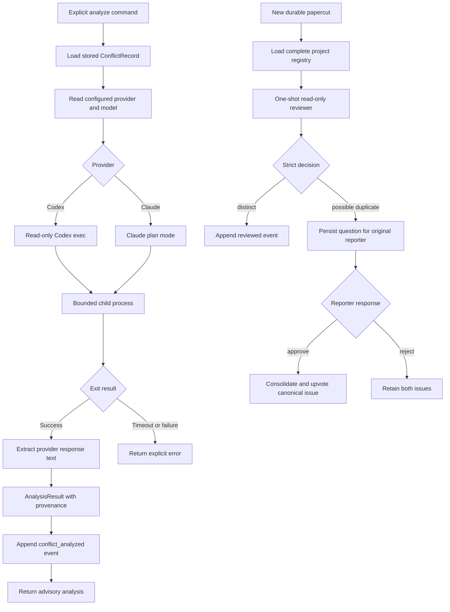

# Optional analyst processes

## What this feature does

The analyst boundary asks an explicitly configured local Codex or Claude command either to summarize one stored conflict or to compare a newly reported papercut with the complete project registry. It augments deterministic classification and matching; it does not classify severity, edit files, decide whether an agent may proceed, or merge papercuts by itself.

## Why it exists

A path-overlap rule can identify that two agents are likely to interfere, but a concise explanation may help a person or agent choose between splitting scope, sequencing work, handing off, accepting overlap, or requesting review. Likewise, deterministic normalization can collapse an exact repeat, while semantically similar papercut wording needs judgment. Because model output is probabilistic and may consume resources, conflict analysis is explicit and papercut review runs only after the report is durable, outside the latency-sensitive lifecycle path.

## Data flow

## Reading the flowchart

1. **Explicit analyze command** is invoked through CLI or MCP with a conflict identifier.
2. **Load stored ConflictRecord** ensures the analyst sees a typed, existing conflict rather than caller-supplied free-form context.
3. **Read configured provider and model** respects the user's provider, executable, model, reasoning effort, and timeout choices.
4. **Provider** selects exactly one configured implementation. Nexus does not silently fall back to another provider.
5. **Read-only Codex exec** uses a read-only sandbox and JSON output.
6. **Claude plan mode** invokes the print interface without edit permission.
7. **Bounded child process** supplies the prompt over stdin, captures output and error streams, and enforces the configured timeout.
8. **Exit result** distinguishes usable output from timeout, startup, or non-zero-exit failures.
9. **Extract provider response text** decodes the provider's external JSON shape at the integration boundary.
10. **AnalysisResult with provenance** records provider, selected model, conflict identifier, raw output, extracted text, and time.
11. **Append conflict_analyzed event** adds the resolved configuration hash so later readers know which user choices produced the result.
12. **Return advisory analysis** gives the caller suggestions without changing claims, conflicts, or permissions.
13. **New durable papercut** is already committed with its first timestamped upvote before provider work begins.
14. **Load complete project registry** supplies every issue, observation, and duplicate proposal without an implicit limit so the reviewer does not miss an older match.
15. **One-shot read-only reviewer** compares the new issue with that registry under the same configured provider safety boundary.
16. **Strict decision** accepts only a validated distinct result or a possible-duplicate result naming an existing, different canonical issue.
17. **Append reviewed event** records a distinct result and its provider provenance without changing the issue.
18. **Persist question for original reporter** turns a possible duplicate into durable coordination rather than pretending the provider process is a resumable conversation.
19. **Reporter response** is accepted only with the opaque token returned when the proposed source issue was created; Nexus stores and compares only its hash.
20. **Consolidate and upvote canonical issue** preserves the source as a tombstone and retains its original observations after approval.
21. **Retain both issues** closes a rejected proposal without changing either issue.

## Implementation details

`src/agents/analyst.rs` owns conflict-specific prompting and result provenance. `src/agents/papercuts.rs` owns strict duplicate-review prompting, output decoding, and target validation. `src/agents/model.rs` owns provider command construction, safe execution modes, timeout handling, and response extraction shared with commit review. `NexusService::analyze` owns conflict lookup and persistence; the papercut service owns complete-registry lookup, durable proposals, and reviewer audit events.

Prompts explicitly limit the analyst to read-only advice and frame persisted text as untrusted data. Severity remains the deterministic classifier's output, and papercut output never has merge authority. Explicit analyst failures are ordinary command errors; after a background papercut worker starts, workflow failures are audited when possible while leaving the report visible. The shared typed timeout sentinel produces the neutral `provider invocation timed out` label; every other provider or persistence error uses the generic `review workflow failed` label so Nexus does not falsely assign blame. Typed review attempts appear in the same complete registry supplied to later reviewers. Tests use temporary fake provider executables to validate provider selection, strict output extraction, target validation, dispatch, and provenance storage without depending on an installed model client.
