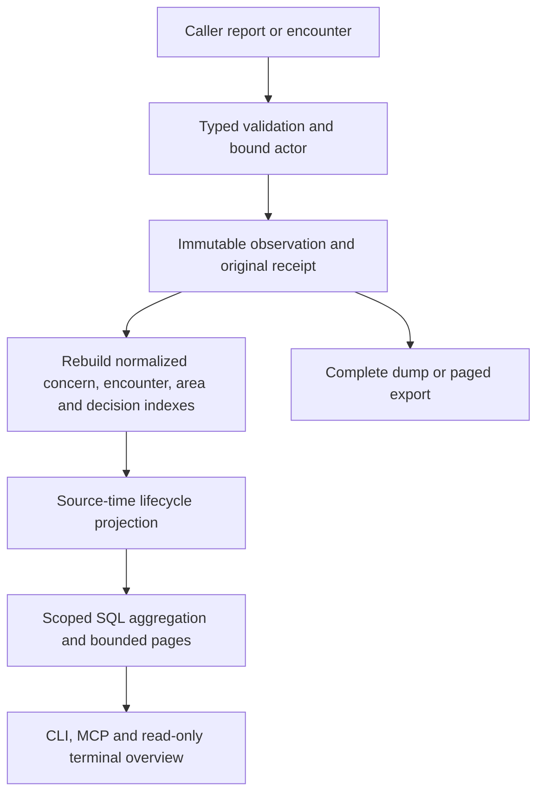

# Code concerns

Code concerns retains reported code failures and maintainability hypotheses across
sessions. It is distinct from Papercuts environment friction and SOS application
reports. Nexus records evidence and caller decisions; it does not block execution,
declare root causes, launch rewrites, or infer healthy code from absent reports.

Immutable, project-scoped observations carry stable caller event IDs, optional
source failure time, observation time, receipt time, and bound reporter provenance.
Identical retries retain their receipt; changed content conflicts. Initial reports
and encounters count as observations; evidence/remedy/review notes do not create
encounters. Known failures deduplicate by source, repository, execution attempt,
and failure identity. Unknown source and session context remain explicit counts.

Areas are independent feature/subsystem/file/declaration identities. Exact report
matching includes normalized title/description and structured area identities.
Historical encounter memberships are retained; later mappings append evidence
without silently regrouping old observations. Declaration identities require a
qualified key and discriminator. Git locators retain full object IDs, paths,
dirty state and verification; a dirty base commit is not exact file content.

Resolution requires a reason. Recurrence uses source occurrence time, not receipt
time. Known later failures reopen; late historical failures do not. Unknown source
ordering qualifies lifecycle state instead of inventing recurrence. Fix ancestry
and causal claims remain supplied or explicitly verified evidence.
An encounter sharing a resolution timestamp also qualifies ordering as unknown,
independently of event-ID ordering; it does not fabricate a return after the fix.

`ConcernAction`, `ConcernObservationInput`, and `ConcernResponse` define the closed
contract. `Store::concern_command` serves recording, imports, bounded summary and
history queries, complete dumps and paged exports. Append-only rows are authoritative;
normalized indexes are rebuildable. Application storage uses Diesel for SQLite and
PostgreSQL. Actor and original import source remain separate. The reporter token is
a one-time first-response capability; only its hash is retained and a lost token
cannot authorize semantic consolidation. Proposals never approve themselves.
Work history and concerns share the typed original-receipt primitive while
retaining their own actor validation, lifecycle and publication rules.

## Recording and attribution

`nexus concerns` and `nexus_concerns` expose this feature independently of the
Papercuts and SOS commands. Their `report` and `upvote` conveniences build the
same observations accepted by `record`. A minimal report needs a title and
description; an unlocated report is valid. Every convenience call gets a fresh
observation identity and observation timestamp unless the caller supplies them.
Retry a saved `record` payload, or retain its explicit event ID, when the operation
is delivery of the same observation. Repeating an unsaved convenience call is a
new observation. Source occurrence time remains unknown unless supplied.

Upvote means encountering the problem again. Agreement with an earlier report is
not another encounter. Use `evidence_added` to attach detail about the same
failure, and `remedy_recorded` or `review_recorded` to preserve what was tried,
why, its reported outcome, alternatives, and supporting encounter IDs. These
notes never increase encounter counts. Typed links can reference concerns,
Papercuts, SOS, eval records, work sessions/activities, external evidence, Git
locations, and content-addressed artifacts without moving lifecycle state between
features. Blob and Git backing validation reuses the existing artifact primitive;
attaching evidence does not require an eval run.

Transport binds the current actor and project outside the observation body.
Explicit host-session, logical work-session, and activity IDs remain separate.
Missing context stays unknown. Import retains the first claimed source receipt
and actor while binding the new importer separately. Source attribution is a
claim retained for audit, not impersonation of the current caller. Neither model
availability nor a provider result is required for persistence.

The first response for a new independent concern includes a reporter capability.
Identical retries preserve receipt identity/time but cannot recover that secret;
keep the original response if semantic consolidation may be needed. Dumps,
exports and stored rows contain its hash, never the token. A proposal names a
concern-typed source and target in the same project; `respond` carries the token
outside immutable evidence. One proposal has one decision. Consolidation keeps
source records and observations, redirects their canonical associations, and
qualifies redirected summary counts as belonging to the canonical concern.

## Data flow

The [typed records](../../src/code_concerns/records.rs),
[actions and responses](../../src/code_concerns/queries.rs), and
[validation](../../src/code_concerns/validation.rs) are the domain entry points.
[Store::concern_command](../../src/persistence/code_concerns/mod.rs) owns the
transactional persistence boundary. CLI and MCP bind caller context before
invoking it; terminal reads use the same response contract.

## Storage and projections

Migration V14 installs `concern_observations` as the authoritative journal.
`code_concerns` retains current canonical identities and lifecycle summaries;
`concern_encounters` indexes source, timing and session dimensions;
`concern_areas` and `concern_attributions` index supplied historical memberships;
`concern_decisions` indexes the one accepted response per duplicate proposal.
These indexes rebuild from validated observations. No Papercuts or SOS rows are
migrated or reclassified.

An observation is bounded to 16 KiB, an atomic write to 32 observations. Failed
validation, immutable conflicts or a failed index update roll back the complete
batch. Area keys resolve within repository and kind, with a discriminator for
declarations; the same explicit area ID cannot silently acquire another locator.
Dirty locations retain their base revision and dirty qualifier. Verification and
availability are explicit supplied metadata; Nexus does not fetch repositories,
infer a rename, or turn a model suggestion into a verified mapping.

Portable database format six includes authoritative concern observations and
reporter hashes, validates scalar indexes against their typed bodies, and
rebuilds projections after import. Formats two through five remain readable.
Concern-only exports retain Git/artifact coordinates and original source receipts;
they do not claim to contain external repository or artifact bytes.

## Retrieval and limits

List and dashboard queries expose the selected project, location/status/search
filters and half-open time window. The time dimension uses source occurrence
time where supplied and observation time otherwise, with unknown source-time
counts shown separately. Sorts use that selected population. Counts cover all
matching indexed encounters, including those outside the returned page.

Canonical list/dashboard status filters accept open or resolved concerns.
Consolidated source identities remain available through exact get, history,
export and dump. Repository scope includes an encounter's explicit repository
and each recorded area or membership repository; overlapping attributions count
the same encounter once.

Raw observations, distinct known failure sources, logical work sessions, host
sessions and unknown contexts are separate quantities. Each area counts an
encounter once through overlapping memberships; area totals are not additive.
Host-session counts qualify raw host IDs with the original source agent, including
after import; importer identity does not collapse or relabel those sessions.
The daily chart retains up to 366 recent UTC days and discloses truncation while
the aggregate counts continue to cover the selected population.

Ordinary lists and area pages default to 24 items and cap at 64. A list's final
encoded response is bounded to 768 KiB, with a continuation and partial qualifier
when fewer rows fit. Summary area labels cap at 32 and expose `areas_partial`.
Detail begins with eight recent source-time history entries; history pages cap
at 32. Opaque cursors retain a receipt cutoff and stable event-ID tie break.
Exports page immutable IDs in ascending order. `dump` is explicitly complete;
large script integrations should stream the paged export instead.

The terminal view starts with reported recurrence and area rankings, provides an
all-concerns fallback for unlocated reports, and shows selected histories and Git
metadata. Session names are optional current read-time enrichment on detail,
never added to immutable observations or exports. No reports means no reported
problems; these observations are not an objective defect rate, score or causal
verdict.
