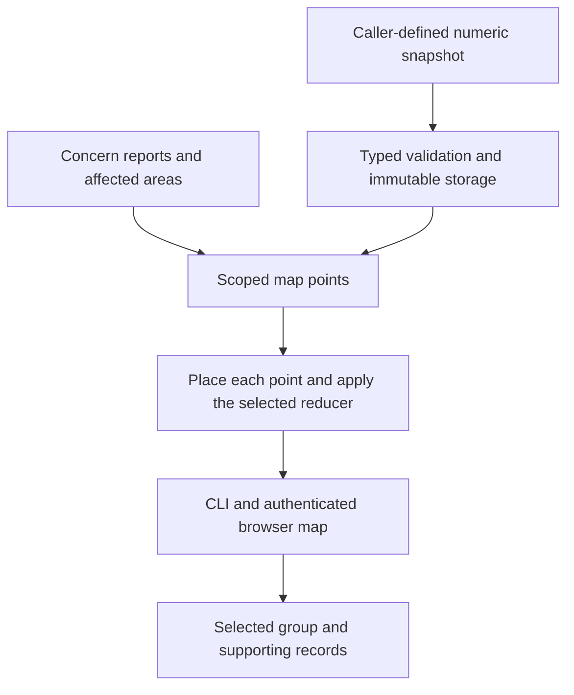

# Code map

The code map explores a project's reports and measurements by any dimension the
producer supplies. Code concerns come with the installation. A project can
publish measurements from CI, an analyzer, or an evaluation using its own
subjects, labels, and units.

## Data flow



1. **Concern reports** supply one point per recorded encounter, or one per open
   canonical concern. Structured affected areas contribute repository, feature,
   subsystem, file, and directory where available. Suspected causes and later
   mappings remain separate. Callers can include labels such as `team` or
   `component` in an encounter's `dimensions`. Nexus does not parse a project's
   code or assign ownership to records. Projects can read their own annotations
   and supply them when reporting.
2. **Numeric snapshots** describe one measure from one producer at one revision
   and observation time. Each subject appears at most once per snapshot. A
   snapshot specifies its title, unit, reducer, and samples, with optional
   evidence references and caller-defined scalar string dimensions per sample.
3. **Validation and storage** bind the snapshot to the authenticated command's
   project and retain the reporting agent. IDs are project-scoped. An identical
   payload with the same ID replays without changing provenance. A changed
   payload with that ID conflicts. V22 installs equivalent SQLite and PostgreSQL
   schemas. Portable stream v7 retains the snapshots and still imports v2–v6.
4. **Scoped points** select the latest published snapshot by observation time,
   with a stable ID tie break. CLI and MCP queries can select a specific
   `snapshot_id` for the same producer and measure. Revisions are never mixed.
   For concerns, the map reads indexed encounter attribution and does not
   replace the report journal or its recurrence logic.
5. **Placement and rollup** put a point in exactly one bucket per grouping. A
   missing label becomes Unattributed, and multiple applicable labels become
   Shared. Built-in file paths are repository-relative. Reducers are `sum`,
   `max`, and `mean`. A nonnegative sum with positive values sizes the treemap
   by the sum. Signed, all-zero, and nonadditive measurements size by sample
   count and retain the exact group value in the label. Unmeasured subjects
   have no sample, while recorded zeros remain inspectable.
6. **Reads** expose the measure catalog, available dimensions, groups, sample
   counts, and source provenance. The current grouping stays selected when the
   next measure supplies that dimension. Code concerns → Code map renders the selected
   data through the authenticated read adapter. The browser cannot publish.
7. **Drill-down** selects a group and regroups its points by file where the
   concern has one, or by subject. The browser keeps a published drill-down
   on the selected snapshot. A leaf opens its supporting concern or displays
   the producer's evidence reference as text.

The first release bounds a snapshot to 4,096 samples and 384 KiB after encoding,
with up to 32 dimension keys per snapshot. The built-in map uses up to 4,096
recent encounters and discloses partial coverage. Map responses show up to 64
groups, 64 published measure keys, and six source references per group. The
768 KiB map budget trims oversized evidence and marks the result partial.
Project filters apply before reading records. Reported encounters represent
recorded observations, including several reporters of the same known failure.

## Publish a measure

Prepare a JSON file from a producer the project already trusts. The revision
can be a Git object ID or another producer-defined snapshot coordinate.

```json
{
  "id": "branches-4dc2e91",
  "producer": "ci",
  "measure": "branch_load",
  "title": "Branch load",
  "unit": "branches",
  "reducer": "max",
  "revision": "4dc2e91",
  "observed_at": "2026-11-10T12:00:00Z",
  "samples": [
    {
      "subject": "parser::parse",
      "value": 11,
      "dimensions": { "team": "language", "file": "src/parser.rs" },
      "evidence": "build-42/branches.json#parser::parse"
    }
  ]
}
```

Run `nexus concerns publish-measure snapshot.json`. The CLI accepts a file or
`-` for standard input. MCP exposes `publish_measure` on `nexus_concerns` with
a `snapshot` field. Send the same snapshot on a delivery retry.

`nexus concerns map` returns reported encounters. Pass a JSON file containing
a map query to select a measure, dimension, or group. The MCP action is `map`
with the same fields under `query`.

```json
{
  "measure": { "kind": "published", "producer": "ci", "measure": "branch_load" },
  "group_by": "team"
}
```

See `MapSnapshot`, `MapQuery`, and `Store::code_map` for the contract and
`nexus concerns schema` for the generated command schema.
