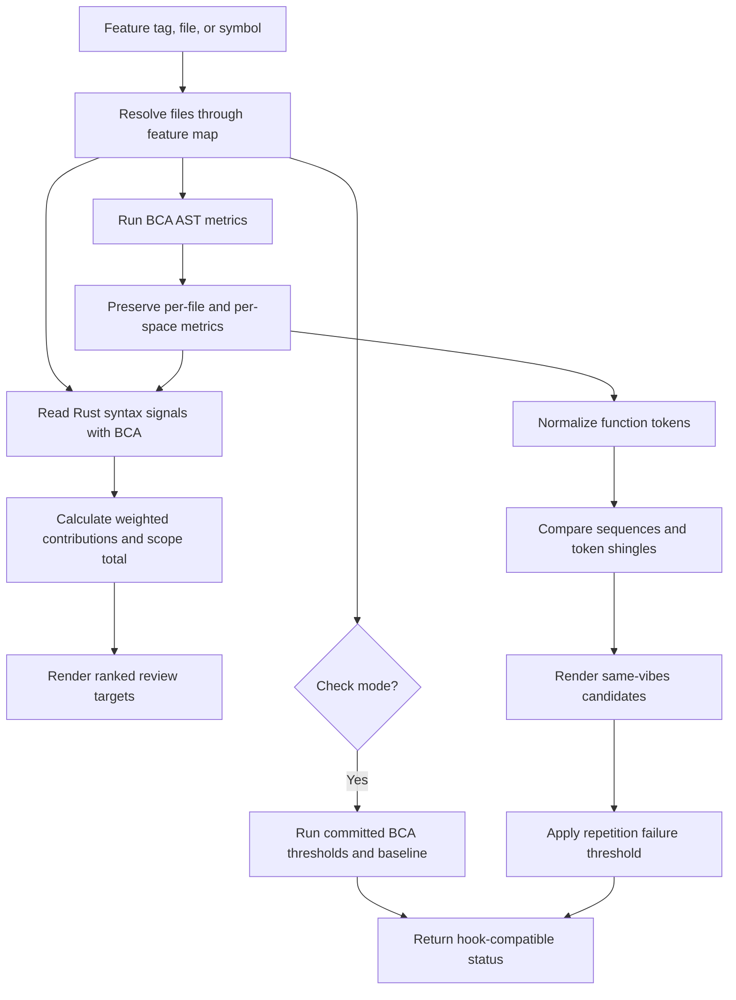

# Complexity analysis

## What this feature does

Complexity analysis turns source structure into review leads at repository, feature, file, class, and function scope. Big Code Analysis (BCA) provides AST-based metrics and Rust syntax nodes. A thin Nexus wrapper selects files from the feature map, adds an explicit preference-weighted ranking, and finds functions with strongly overlapping normalized token sequences.

## Why it exists

Complexity is difficult to see across a whole feature, especially when its implementation crosses directories. Literal copy detection also misses parallel implementations whose names differ but whose flow and policy have the same shape. A single feature-aware command lets an agent locate both kinds of pressure before introducing another implementation.

Metrics are measurements rather than architectural verdicts. Nexus values immutable transformations, explicit domain types, and deep methods that hide a coherent unit of work. The ranking makes interfaces and state more expensive than implementation lines, while leaving enumerated types and immutable bindings free of an extra declaration surcharge. A high score must not be repaired by creating shallow wrappers. Repetition is likewise a prompt to compare invariants and change pressure, not an automatic instruction to merge code.

## Data flow

## Reading the flowchart

1. **Feature tag, file, or symbol** defines the requested analysis scope.
2. **Resolve files through feature map** reuses the architecture index instead of maintaining a second ownership map.
3. **Run BCA AST metrics** invokes the installed `bca` executable and requests its maintainability-oriented metric set as JSON.
4. **Preserve per-file and per-space metrics** retains BCA's file, class or container, function, and method hierarchy.
5. **Read Rust syntax signals with BCA** identifies mutation, recognizable state containers, and dynamic type syntax without counting comments or string contents as executable code. Other languages retain BCA metrics without pretending to have equivalent Rust syntax coverage.
6. **Normalize function tokens** removes comments and literal or name differences while preserving keywords and operators.
7. **Calculate weighted contributions and scope total** applies the weights in `complexity.toml` to logical lines, named callable declarations, function arguments, branching, nesting, and Rust syntax signals. A scope total counts each selected subtree once; nested hotspot records remain available for drill-down.
8. **Compare sequences and token shingles** detects both similar ordering and large shared token regions.
9. **Render ranked review targets** shows the actual configured formula, weighted contributions, syntax counts, and raw metrics so the composite cannot conceal its causes.
10. **Render same-vibes candidates** identifies code pairs that deserve an invariant and ownership comparison.
11. **Check mode** separates read-only exploration from enforcement.
12. **Run committed BCA thresholds and baseline** uses `bca.toml` and `.bca-baseline.toml` as the shared local and CI quality gate.
13. **Apply repetition failure threshold** rejects only sufficiently large units that exceed the strict threshold in both sequence similarity and token-shingle containment, while one-signal and lower-confidence candidates remain advisory.
14. **Return hook-compatible status** makes the same command usable interactively, in Git hooks, and in CI.

## Implementation details

`scripts/complexity_analysis.py` is the project adapter; `scripts/rust_structure.py` reads Rust syntax evidence through the same BCA executable. The adapter accepts `--feature`, `--path`, and `--symbol`; without a scope it analyzes annotated authored source. `--format json` makes the enriched records available to other tools. `--check` composes BCA's threshold result with the high-confidence repetition gate.

Rust metric spaces are correlated with AST scopes in parser order and checked for matching kinds and line spans. Their UTF-8 byte columns keep same-line siblings separate in syntax evidence, repetition, and scope totals. Missing expected scopes, unrecognized output, or mismatched parser evidence is a tooling error rather than a zero-cost result. Files with no matching Rust syntax nodes can legitimately have no `find` output.

The default architectural-load objective is `LLOC + 5 × arguments + 8 × functions + 5 × branching + 2 × cognitive + 8 × mutation_sites + 12 × state_types + 16 × dynamic_types`. It charges named callable declarations and arguments more than logical implementation lines. `complexity.toml` owns the coefficients; both text and JSON reports derive their formula from the loaded policy and preserve each contribution. The score is used for ranking and before/after comparison. BCA's individual threshold rules remain the metric gate.

Immutable `let` bindings and enumerated structs, enums, traits, and aliases do not receive the callable-declaration surcharge. Ordinary iterator closures do not introduce named callable interfaces or arguments in this objective. This avoids rewarding removal of explicit types or conversion of an idiomatic iterator into a loop just to lower interface costs.

Parent BCA records include descendants. A scope total therefore selects non-overlapping outer records instead of summing every hotspot. For a repository, feature, or file selection, each file contributes once. A symbol selection contributes each outermost matching subtree once. Branch and cognitive costs include nested spaces so moving a branch into a closure cannot remove it from the enclosing operation's score. Linear Rust `?` propagation remains excluded from cyclomatic cost.

The syntax signals are review proxies, not a Rust type checker or effect system. They cannot resolve every cross-file re-export, type alias, user wrapper, macro expansion, or method effect, and a recognizable state name can belong to a different user type. A marked external JSON boundary or necessary lock can be valid despite its cost. Zero syntax findings do not prove purity or a fully enumerated domain model. Interpret the counts with their owning types and adapters.

`mutation_sites` counts explicit mutable specifiers, assignments, and compound assignments. `state_types` recognizes standard-style cell, lock, and atomic type names, including common constructors. `dynamic_types` recognizes `serde_json::Value`, `toml::Value`, `std::any::Any`, and `core::any::Any`, including direct, grouped, and renamed type imports. Full-file import context is retained during symbol analysis; lexical type declarations can shadow an imported name. Import declarations themselves do not add dynamic sites. Glob imports and cross-file name resolution remain outside this bounded analysis. A mutable binding followed by an assignment contributes two separate syntax sites. Repeated type uses contribute repeated sites. These are reproducible syntax counts, not distinct variables or proven runtime effects.

The objective is directional rather than a proof that arbitrary minimization produces good design. Keep behavior and measurement scope fixed; review cohesion, caller burden, runtime costs, and domain invariants alongside score movement. Do not improve the number by deleting domain types, hiding parameters in captured state, replacing parameters with opaque tuples, moving code to macros, compressing source lines, adding clones to eliminate `mut`, or merging unrelated operations. The bundled `functional-rust` and `code-complexity-analysis` skills explain these design decisions and comparison rules.

The wrapper analyzes authored Rust, Python, TypeScript, and JavaScript selected through the feature map. Generated dependency and build trees are excluded.

Normalized token similarity is a vibes check. Before abstraction, a reviewer must verify shared ownership, invariants, and reasons to change. Similar implementations with different invariants should remain separate and have that distinction recorded in review findings.

Check mode evaluates only the strict near-copy predicate; normal review mode retains the complete advisory comparison report. Both use the same tokenization, source-span containment rules, sequence ratio, shingle containment, and committed thresholds. Enforcement caches token shingles and rejects a pair before sequence matching when its length-ratio upper bound or shingle containment proves it cannot reach the failure threshold. This preserves every gate violation while avoiding the expensive advisory all-pairs scan in hooks and CI. JSON reports identify `comparison` as `enforce` or `review`; omit `--check` for advisory candidates.
