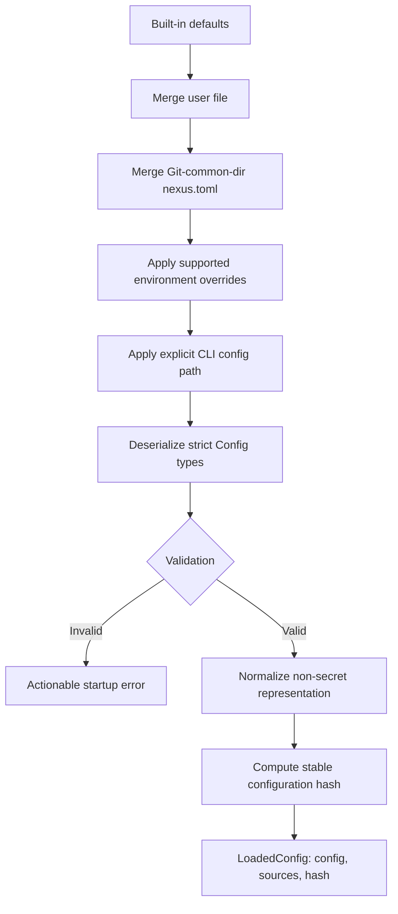

# Configuration

## What this feature does

Configuration gathers user and project decisions into one validated `LoadedConfig`. It supports defaults, a user properties file, a repository-specific file, selected environment overrides, and explicit CLI selection while retaining the source list and a stable hash. A tagged client setting selects the compatible local daemon or authenticated remote service without mixing credentials into that value.

## Why it exists

Nexus coordinates different agents and installations, so choices such as local or remote transport, remote endpoint and project identity, implementation and cross-model review providers, model names, storage paths, reconciliation timing, memory budgets, and privacy settings cannot be hard-coded. At the same time, silently accepting a misspelled property would make behavior unpredictable. Configuration therefore permits layering but rejects unknown or invalid final values while keeping bearer and database credentials outside serialized configuration.

## Data flow

## Reading the flowchart

1. **Built-in defaults** make a local installation runnable without a file.
2. **Merge user file** applies durable personal decisions from the default path or `NEXUS_CONFIG`.
3. **Merge Git-common-dir nexus.toml** lets all worktrees for one repository share project decisions.
4. **Apply supported environment overrides** handles process-specific storage, socket, client endpoint/project/secret-file location, analyst-provider, implementation-provider, and review-provider choices.
5. **Apply explicit CLI config path** gives a command or test deterministic control over its configuration source.
6. **Deserialize strict Config types** converts the temporary TOML tree into enumerated Rust records with unknown-field rejection.
7. **Validation** checks positive, safely bounded durations, supported schema versions, a valid HTTP(S) remote endpoint, a nonempty bounded control-free project ID, and internally consistent settings, including the requirement that implementation and review providers differ.
8. **Actionable startup error** stops explicit startup when configuration cannot be trusted.
9. **Normalize non-secret representation** excludes bearer and database credentials by design. A remote client's optional `secret_file` path is configuration, but the file contents and `NEXUS_SECRET` are not.
10. **Compute stable configuration hash** creates provenance for sessions and analyst events.
11. **LoadedConfig** is the only configuration object passed into runtime and coordination.

## Implementation details

`src/config.rs` owns defaults, merge precedence, environment handling, validation, project-file discovery, and hashing. Configuration sources are opened nonblocking, validated from the opened descriptor as regular files, and capped at 1 MiB before UTF-8 and TOML decoding; regular-file symlinks remain supported. The temporary `toml::Value` exists only inside this annotated configuration boundary; typed structs are used everywhere after loading. The CLI resolves either `--config` or `NEXUS_CONFIG` against its invocation working directory before loading it, which also gives setup an absolute path to retain in installed host commands. Configured second-based schedules and process timeouts are capped at one year before they reach `chrono`, Tokio, or platform timer arithmetic. The terminal refresh period is additionally capped at `2,147,483,647` milliseconds, the portable signed 32-bit timer ceiling used by the bundled JavaScript client. Terminal dashboard record-window limits remain positive. Memory configuration defaults to enabled with a 15-second consolidation interval, an eight-node batch, and 64-item/16-KiB context bounds. Context settings may lower but never raise those hard maxima, every numeric limit must remain positive, and the analyst timeout is validated even when conflict analysis is disabled because memory consolidation still uses it.

All configuration structs reject unknown fields. `ClientConfig` is a tagged enum whose default `local` case needs no additional values. The `remote` case requires `endpoint` and `project_id` and optionally names a `secret_file`. `NEXUS_ENDPOINT`, `NEXUS_PROJECT_ID`, and `NEXUS_CLIENT_SECRET_FILE` can select or override that remote record. `NEXUS_SECRET` is consumed only at the runtime client boundary and is never merged into `Config`; server-side `NEXUS_DATABASE_URL` and `NEXUS_SECRET_FILE` are likewise startup inputs rather than `LoadedConfig` values. Server and client canonicalize boundary whitespace and share one length and visible-ASCII validator before a bearer value can be persisted or placed in an HTTP header. They also share one descriptor-based secret-file policy: do not follow symbolic links, require a regular file owned by the effective process user, and reject permissions broader than `0600`. This separation prevents secret material from appearing in `nexus config show`, loaded source provenance, or the stable hash.

`ModelProvider` is an enum, and analyst and commit-review settings each select provider-specific command and model records. Memory consolidation deliberately reuses the analyst provider, timeout, and per-provider model records even when conflict analysis is disabled; only `analyst.enabled` gates conflict analysis. Review configuration also owns enablement, timeout, and an optional installed-skill root. Its built-in provider records use `xhigh` reasoning and a 600-second timeout; user properties can override either choice. A PostgreSQL service would execute model-backed work in the server process, but `nexus-server` disables in-process providers by default because same-UID children cannot be isolated from server secrets. `--allow-local-providers` is only for a configured command that crosses an externally enforced OS isolation boundary, where the command and its allowlisted credentials must be available inside the container. Deterministic coordination and raw memory and papercut operations do not require a provider.

`coordination.reconcile_seconds` has the same meaning in both transports: it schedules direct Git observation in the local daemon and bounded client-side Git evidence in a remote stdio companion. It does not make the shared server read or trust a client path as its own filesystem path. Local Git discovery and reconciliation share Nexus's crate-private nonblocking, byte-bounded process-capture mechanism, while their caller retains the Git-specific deadline and fail-open policy.

Tests verify merge precedence, local defaults, remote TOML and environment selection, secret exclusion, selected model values, cross-model validation, memory bounds, unknown-property rejection, and invalid numeric values. `config.example.toml` is annotated and should remain synchronized with the typed schema.
