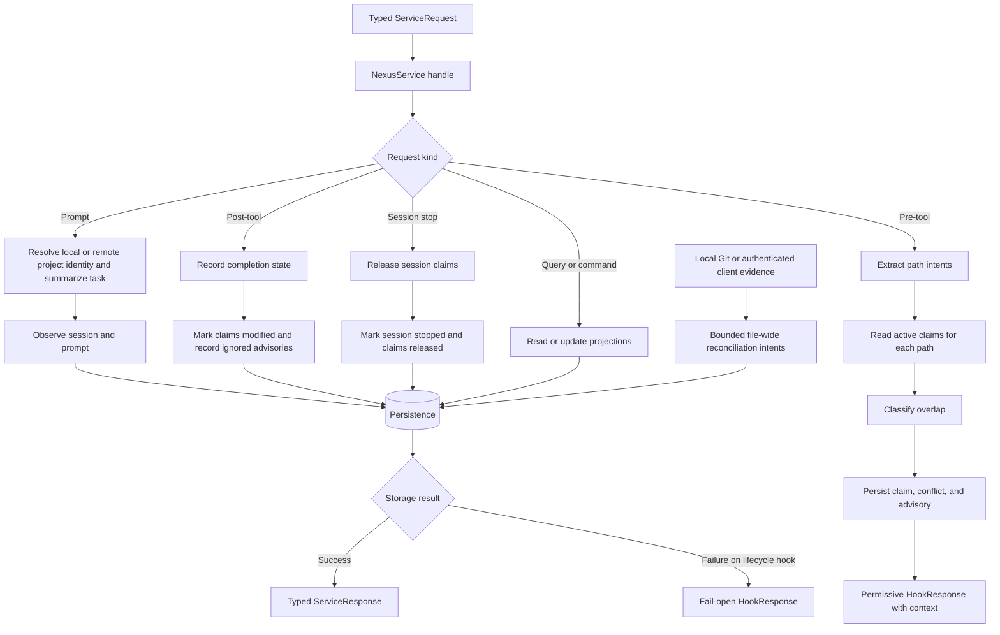

# Coordination

## What this feature does

Coordination turns an agent's lifecycle activity into useful, non-binding context for other agents. It recognizes which paths an agent intends to change, remembers those intentions as expiring claims, compares new work with existing work, and reports overlap without taking control away from either agent.

The central promise is deliberately narrow: Nexus helps an agent see concurrent work; it never decides whether the agent may proceed. Every hook response remains permissive, including malformed-input and storage-failure paths.

## Why it exists

Two capable agents can independently make reasonable changes that collide because neither can see the other's local intent. Git exposes the collision late, after work has already been duplicated or implementations have diverged. Coordination moves that information earlier while preserving each agent's responsibility for its own work product.

Path claims are therefore signals, not locks. Severity describes likely coordination cost, not permission. A destructive overlap or overlapping line range deserves stronger context than two known, disjoint hunks, but neither becomes an enforcement decision.

## Data flow

## Reading the flowchart

1. **Typed ServiceRequest** is the closed service boundary. Runtime adapters decode wire JSON before coordination begins, so the core does not dispatch on arbitrary method strings or maps.
2. **NexusService handle** is the deep entry point. It accepts one request and owns sequencing, storage locking, error translation, and the advisory-only invariant.
3. **Request kind** selects one enumerated workflow. Adding a workflow requires extending the request and response types rather than inventing another loosely shaped payload.
4. **Resolve local or remote project identity and summarize task** applies an explicit `ProjectBinding`. Local requests derive a stable opaque ID from the canonical Git common directory and retain the current worktree for filesystem reconciliation. Remote requests use the trimmed configured `project_id` across clones, retain the client root only as a lexical base for normalizing reported paths, and deliberately persist no server-readable worktree path.
5. **Extract path intents** translates tool-specific payloads into typed path, operation, and optional line-range records. Unknown tools produce no claims rather than guessed claims.
6. **Read active claims for each path** considers claims from other sessions that have not expired or been released.
7. **Classify overlap** deterministically assigns informational, warning, or critical severity based on operations and line ranges. Nexus first selects at most the advisory cap of distinct other sessions, then returns each selected session's strongest active claim on the path, so a session with many recent edits can neither flood the caller nor hide another session or its own older, stronger overlap.
8. **Persist claim, conflict, and advisory** records both history and queryable projections before returning context. A project, path, and unordered session pair identify one conflict projection. Its severity is monotonic: weaker observations cannot hide an active stronger overlap. Resolution remains stable until a later observation is strictly more severe, which reopens the projection with an explicit event. Each advisory occurrence remains in history.
9. **Permissive HookResponse with context** always reports `permitted: true`. Advisories are information for the calling agent.
10. **Record completion state** records success or failure. Successful tool calls move matching claims to `modified` only inside the resolved project; configured history can note that an advisory was knowingly crossed.
11. **Release session claims** ends a session's active coordination footprint without deleting history. Session stop and explicit release are project-qualified, so equal host-assigned session IDs in different project namespaces cannot affect one another.
12. **Read or update projections** covers status, event, session, claim, conflict, usage, memory, papercut, resolution, release, and explicit analysis commands. Capability observations, agent memory, and papercuts share the typed service boundary but remain separate features and projections from coordination history.
13. **Persistence** is a separate capability. Coordination asks for domain operations and receives typed records rather than Diesel rows or JSON maps.
14. **Local Git or authenticated client evidence** keeps filesystem observation where the checkout is readable. The local daemon reads Git directly; a remote stdio companion periodically submits an authenticated assertion for its active sessions.
15. **Bounded file-wide reconciliation intents** accept only validated repository-relative paths and operations. They renew advisory reconciliation claims without sending file content or pretending the server read the client filesystem. A local tick selects at most the 64 most recently seen eligible sessions, groups them by project and worktree, reads each distinct checkout once, caps each shared snapshot at 2,048 paths and 256 KiB of path text, and attributes it back to every selected session in that group.
16. **Storage result** preserves normal errors for explicit commands but converts lifecycle failures or contention into an immediate fail-open response, so background reconciliation cannot hold up an agent tool call.

## Implementation details

The primary entry point is `NexusService::handle` in `src/coordination/service.rs`. `ServiceRequest` and response records live in `api.rs`; domain states such as `RecordScope`, `ConflictScope`, `ToolCompletion`, `ClaimState`, and `Severity` live in `domain.rs`. Memory and papercut request handling are delegated to feature-scoped service modules and return typed feature-domain values. Memory consolidation and papercut duplicate review never run in a lifecycle request.

`classifier.rs` owns deterministic tool-payload extraction and overlap classification. One tool call can yield at most 256 distinct path intents, 256 KiB of aggregate canonical path text, and 4 KiB per path. Patch and shell parsing accepts at most 1 MiB of source text, and patch scanning stops after 8,192 lines. Inputs beyond those observation bounds contribute no additional claims rather than extending store-mutex work without limit; the underlying tool remains permitted. `usage_detection.rs` separately identifies conservative script invocations inside observed shell commands; analytics normalization and fail-open recording live in `usage.rs`. Open-ended tool input is isolated behind `ToolPayload`; these extractors may inspect that boundary value, but storage and service interfaces do not accept anonymous maps. `workspace.rs` isolates local Git process execution and the distinction between a durable project ID, an optional lexical claim root, and an optional server-readable worktree.

Ordinary projection reads are server-bounded before Diesel materializes them: sessions and claims return at most 64 rows, conflicts at most 32, and each response adds a `truncated` flag without changing its existing array field. These three reads share one typed `BoundedRecordQuery` lifecycle for project binding, store access, truncation-preserving response construction, and error translation, while their record and scope types remain explicit variants. Visible session synopses are capped at 1 KiB, including historical rows. One lifecycle request queries, persists, and returns at most 32 overlap advisories across all extracted intents; active-claim selection groups by other session before applying that remaining cap and uses a constant number of bounded lookups per selected session to preserve the exact classifier priority. Later intents still receive claims but cannot amplify conflict transactions after that global budget is exhausted. Recording remains advisory and fail open.

`NexusService::handle` selects local identity. The authenticated service calls `handle_remote` with the project ID carried outside the feature payload by the companion envelope or `X-Nexus-Project-ID`. This preserves one typed feature API while preventing a remote path from being mistaken for a path on the server. Agents in separate compute environments participate in the same claims, memory, usage, papercuts, and SOS aggregates when and only when their configured project IDs match.

SOS is another typed coordination workflow rather than a free-form event. The service commits the bounded source report before returning, emits a private triage job containing the already-resolved project and report IDs, and later applies a strict model decision through the persistence transaction. Its public list and detail reads are database-bounded, while its explicit dump action is a complete registry. Resolve and deprecate commands append lifecycle evidence; a later linked report automatically reopens the aggregate.

The wire decoder rejects control characters and bounds lifecycle identities before classification or persistence can fan one request out into claims: session and invocation identifiers are at most 512 bytes, agent and tool/skill names are at most 256 bytes, and a lexical project root is at most 4 KiB. Invalid lifecycle metadata follows the existing fail-open hook contract and creates no projections. Tool extraction independently caps one request at 256 intents, 256 KiB of aggregate path text, and 4 KiB per path. The database repeats the durable projection limits for both supported backends: session agents, worktrees, and summaries are capped at 256 bytes, 4 KiB, and 1 KiB; claim identities and paths at 512 bytes and 4 KiB; and conflict claim references, paths, and messages at 512 bytes, 4 KiB, and 8 KiB. Upgrade sanitation preserves valid UTF-8 prefixes and shared legacy associations before enforcement is installed, and its retrying allocator avoids every preexisting bounded identity or project path rather than assuming its generated namespace is unused.

Explicit conflict analysis also carries that project binding through dispatch. A local request may give the provider the service's trusted local worktree, while a remote request always uses the model boundary's empty temporary directory. The stored conflict path remains untrusted coordination data and never selects a server-side provider working directory. Remote provider failures use fixed diagnostics rather than returning stderr or internal error chains.

`client_evidence.rs` keeps remote filesystem observations distinct from ordinary service requests. The stdio companion periodically computes Git status for active local roots and attaches locally derived script/skill identities to completed tool requests. Reconciliation rotates through pages bounded to 2,048 paths and 256 KiB of path text so later paths are not permanently starved. Server validation bounds counts and byte lengths, rejects absolute and parent-traversing paths and line ranges, and requires completed-tool evidence to match the request's session and agent. The official companion drops invalid optional inferred entries rather than dropping the primary lifecycle event; independently supplied malformed envelopes remain strict errors. The supplemental envelope carries path operations and normalized identities, not file contents, diffs, environment values, outputs, or credentials. Authentication establishes the service-wide trust domain, while the caller-supplied project ID selects a namespace rather than an authorization boundary. It cannot make an untrusted client filesystem independently verifiable, so reconciled claims retain the same advisory semantics as every other claim.

Local Git observation is itself bounded and fail open. Each Git command has a five-second deadline, captures at most 4 MiB from each of stdout and stderr through in-memory pipes, and uses no unbounded output file. The crate-private `process_capture` module supplies the nonblocking, byte-bounded pipe mechanism also used by model providers, while Git retains its own timeout, process-group cleanup, overflow diagnostic, and fail-open policy. The selected snapshot shares the client-evidence ceiling of 2,048 paths and 256 KiB of aggregate path text before any per-session persistence work begins. A deadline or stream overflow terminates and reaps the command's process group; reconciliation then contributes no paths for that observation instead of delaying agent work or retaining partial evidence.

The main invariants are:

- lifecycle responses are always permissive;
- a claim never grants exclusivity;
- the classifier, not an LLM, determines severity;
- local project identity is stable across Git worktrees and remote project identity is stable across clones that share an explicit project ID;
- omitted remote read scopes default to the envelope project, while explicit cross-project inspection remains available inside the shared-secret trust domain after its project ID is trimmed and validated to the same 256-byte, control-free wire contract;
- persisted session identity is the pair of project ID and caller session ID;
- SOS project identity comes from the service binding rather than report metadata, and model-selected links cannot escape the supplied project-local candidates;
- dynamic tool shapes do not escape the extraction boundary;
- one tool request cannot expand into unbounded path claims or per-intent database work;
- each other session contributes at most one advisory per inspected path;
- one lifecycle response contains at most 32 advisories;
- Git reconciliation observes edits that bypass hooks only for active sessions: the local daemon processes at most 64 recent sessions per tick and reads Git once per project/worktree group, while the remote companion tracks lifecycle sessions and reports bounded client-side Git evidence at `coordination.reconcile_seconds`. Session stop removes a remote session from later ticks, otherwise idle sessions age out after `coordination.claim_ttl_seconds`, overlapping or missed ticks are skipped, and failures remain best effort and fail open.

Unit tests cover extraction, severity, typed request decoding, local service overlap behavior, bounded recent-session selection, grouped local reconciliation with per-session attribution, and two distinct clone roots sharing one remote project without persisting either root as a worktree. Process tests in `tests/mcp_hooks.rs` exercise the local flows through a real MCP process, daemon socket, and SQLite database. Remote runtime tests prove client-side reconciliation plus derived script/skill evidence, while the PostgreSQL integration test covers the shared project binding.
