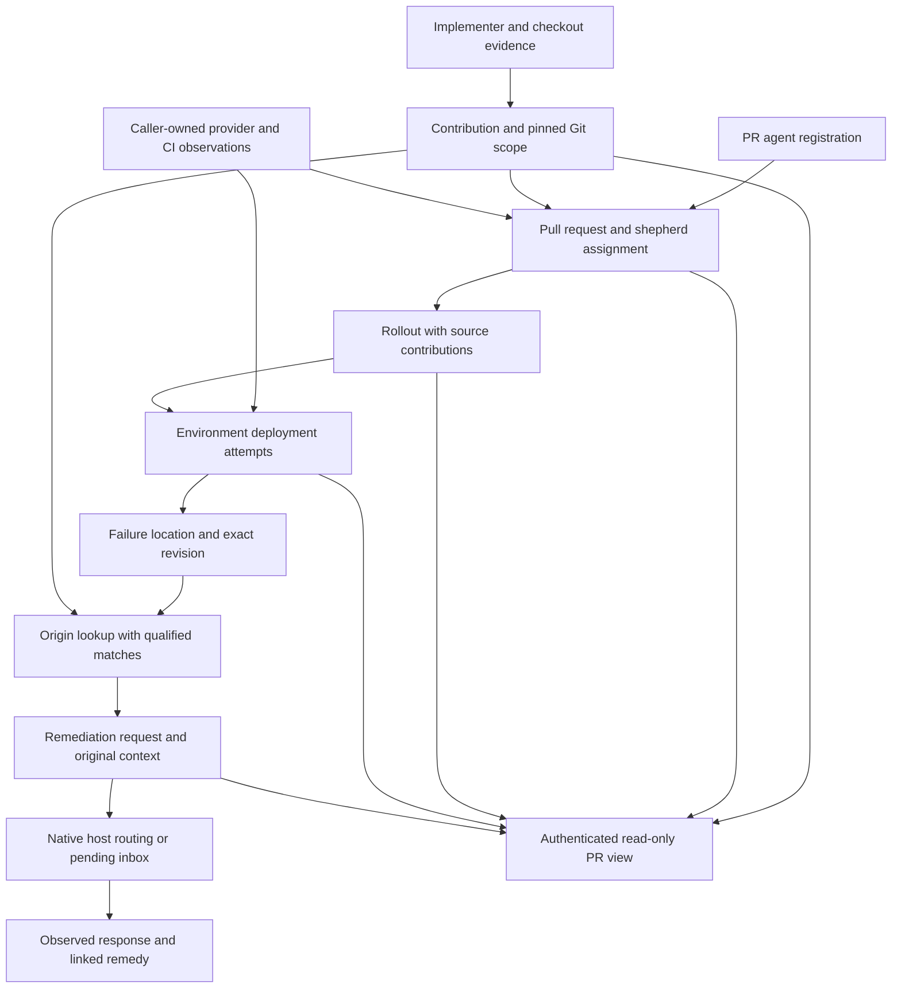

# Delivery coordination

Nexus connects pull requests and rollout evidence to the agents and implementation
work that produced their changes. A delivery agent can register responsibility,
discover existing responsibility, trace an affected revision or code area back to
its contributors, and retain a remediation handoff without losing the original
implementation context.

An agent coordinating a release often did not implement every included change.
File claims answer who recently touched a path; they expire and do not prove
authorship. Delivery coordination retains explicit contribution and responsibility
records independently of current claims, branch names, and host-session liveness.

Shepherd tasks include responsibility registration before delivery work starts
and explicit release when the requested acceptance work finishes or is canceled.
Multi-environment work uses a rollout so responsibility can span promotion PRs
and post-merge validation. A merge, paused agent, or stopped session does not
establish completion of that larger task. Release uses `shepherd_assigned` with
`agent: null` and the current assignment event ID; it preserves all prior
assignments, release evidence, and contributors. Agents reread the record to
verify cleanup and leave another agent's newer assignment intact. These actions
are performed by the caller's shepherd workflow; lifecycle hooks do not infer
delivery intent or completion from prompt text or session liveness.

## Reading the flow

1. **Contribution capture** records the actual contributor, logical work and
   rationale, immutable Git revisions, and supported file/range/feature evidence.
   A branch and worktree locate the work; neither is a permanent authorship key.
2. **PR responsibility** records a named shepherd and its host/session contact,
   distinct from the implementation contributors. Repeated observations preserve
   attribution and assignment history. Provider/repository/PR-number identity is
   unique within the project; duplicate registration identifies the existing PR.
   After a push, `pull_request_composition_recorded` replaces contribution links
   against the exact head and expected composition event. Stale heads or versions
   are rejected without changing shepherd responsibility or history.
3. **Rollouts** link contributing work across aggregate and promotion PRs. A
   rollout's explicit contribution manifest freezes its origin scope across later
   source-PR edits. PR links retain navigation and delivery context. A missing
   manifest exposes `rollout_manifest_missing` and qualifies source-PR matches as
   candidates. A deployment attempt names the environment and exact revision; retrying creates
   another attempt rather than erasing the earlier failure. `deployment_finished`
   compares `expected_outcome` with the retained outcome before moving a running
   or unknown attempt to succeeded, failed, or canceled. Its revision, artifact,
   and attempt identity remain unchanged.
4. **Provider observations** carry occurrence time and source identity. A watcher
   retains the provider snapshot and last successful observation; missing or stale
   evidence is not success. Nexus does not merge, deploy, or choose promotion policy.
   A newer `pull_request_observed` snapshot replaces current source/target branch
   discovery after a PR is retargeted; older observations remain in history.
5. **Origin lookup** accepts pinned Git/code scope and returns evidence-qualified
   candidates. Explicit contribution links are stronger than shared file or feature
   membership. A repository-qualified 64-hex hunk fingerprint can locate retained
   content across changed commit identities. Repeated content attributed to
   different contributors remains ambiguous. Unknown or incomplete history stays
   visible.
6. **Remediation** retains the failure, affected scope, requested agent, original
   rationale and work links, and the response. Recording a request does not prove
   that a host delivered it or that the implementer accepted it.
7. **Routing** uses the caller's native host transport where supported. A stopped
   or unavailable agent can leave a pending inbox item for later resumption or an
   explicit successor handoff. Nexus never invents agent availability or messages.
8. **Browser retrieval** shows the same typed records through the authenticated
   closed read API. Registration, request mutation, and host dispatch remain
   CLI/MCP operations.

## Domain boundaries

Delivery owns durable contribution, PR, rollout, deployment, and remediation
records. Coordination owns expiring sessions, claims, and overlap advisories.
Work history owns canonical executions, nesting, timing, and delivery evidence.
Code concerns own evidenced defects and remedies. These records link without
copying identities, reparenting shared CI, or treating an overlap as responsibility.

Project identity follows the configured Nexus binding. Worktree paths are
client-local evidence; a remote service never reads a path on a client's behalf.
Independent clones require a shared project binding to participate in the same
namespace. Repository identity and full Git object IDs qualify provenance across
branches, rebases, squashes, and cherry-picks. A mapping absent from the recorded
evidence remains unknown. Mapping IDs are local to their contribution: storage and
origin queries qualify each mapping with its Nexus project and contribution ID.
Independent contributions may reuse the same mapping label without sharing
revision or hunk evidence.

Immutable observations use stable IDs, retain source and receipt times, and reject
changed replay under the same ID. Typed projections and queries use Diesel on
SQLite and PostgreSQL; migrations alone contain SQL strings. Retention, transfer,
rebuild, pagination, and identity qualification must preserve the original source.
Automatic lifecycle capture stays bounded, advisory, and fail open. Deliberate
record submissions report acknowledgment failures to the requesting caller.

GitHub watch credentials are optional: public reads can run without a token;
private access uses the service's `NEXUS_DELIVERY_GITHUB_TOKEN_FILE` pointing to
a private credential file. Watch health retains attempt/success times, next poll,
and errors separately from PR/check outcomes. Enabled status alone does not prove
freshness, and a failed poll retains the last successful snapshot.

## Browser and skill

The **Pull requests** destination starts with observed PRs and their shepherds.
Rollout and Remediation tabs retain their distinct records. Selecting a record
opens its exact revision, contributors, rationale, file/feature scope, rollout
attempts, responsibility and request evidence. Deep links preserve the selected
project and record. Unknown fields are labeled rather than rendered as zeros or
inferred health. Refresh failures keep a visibly stale successful snapshot.
PR and contribution details also inspect current coordination for mapped file
paths. The panel retains source time, sampled/truncated coverage, current claims,
and open overlaps with links to their sessions. Historical contribution evidence
and current advisory claims remain separate; no match means no overlap in the
observed window. A failed supplemental refresh retains a labeled stale snapshot.

The bundled `nexus-pr-management` skill teaches contributor registration,
shepherd discovery and registration, provenance lookup, environment observations,
and explicit handoff. It routes ordinary live overlaps to `nexus-coordination`,
execution history to `nexus-work-history`, and code defects to
`nexus-code-concerns`.

## Validation

Exercise multiple implementers contributing to one PR, aggregate promotion,
exact versus candidate provenance, unavailable contacts, responsibility handoff,
provider observation freshness, failed deployment retries, and remediation
acknowledgment. Verify idempotent replay and project isolation on both persistence
backends. Browser tests cover list/detail navigation, long IDs, unknown and empty
states, cursor pagination, stale reads, and rejection of mutation actions. Check
desktop, tablet, and phone layouts against an isolated fixture service. The
canonical repository gate remains `./scripts/check.sh`.
