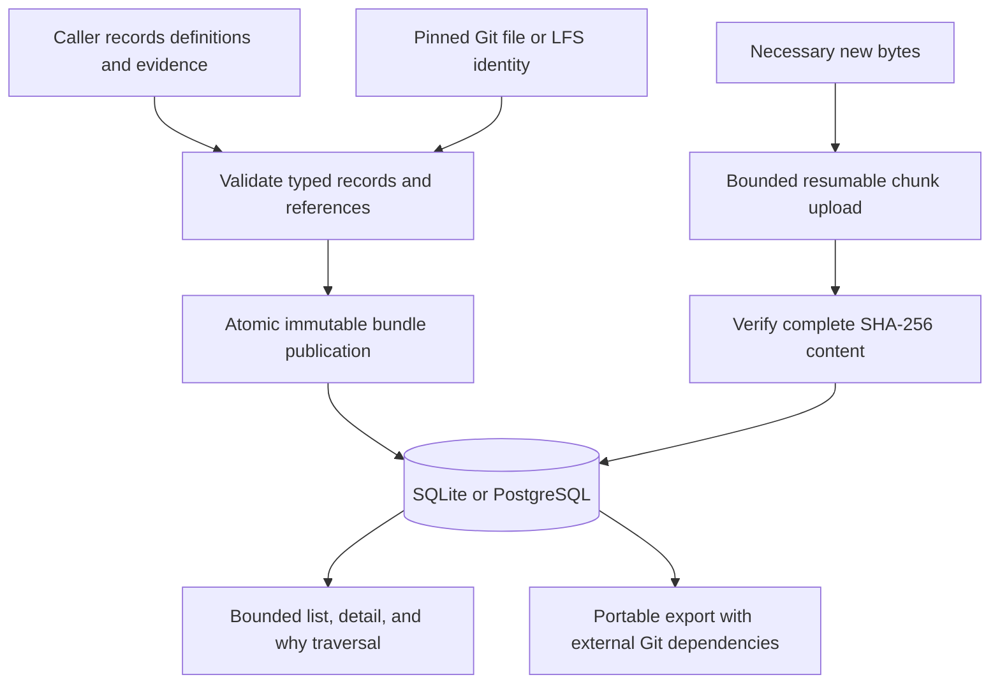

# Evaluation history

## What

Nexus retains the caller's evaluation definitions, motivations, reported executions,
assessment passes, comparisons, and decisions as immutable project-scoped records.
It stores what was tried and why it changed. Callers own execution, grading,
sampling, retries, budgets, routing, and improvement loops. Nexus never executes
an imported artifact or launches an evaluation.

## Why

A score alone cannot explain what it measured or why a case existed. Typed links
connect immutable case, suite, grader, metric, repository, model, and target revisions to
the changes that motivated them, then to runs and individual calls, grades, and
decisions. Historical missing rationale remains an explicit gap.

## Data flow

The caller supplies closed typed records and its own occurrence times. Nexus
binds project and actor provenance, validates identifiers and content bounds, and
checks every internal link before publishing the complete bundle. Existing
identical records replay without changing their original attribution; conflicting
immutable content fails the entire transaction. The selected database is the
authority for recorded facts and uploaded bytes. Query projections expose their
limits and never interpret artifact bytes as instructions.

## Implementation

`src/evals/` owns public record types, their closed variants, relationship
derivation, and validation. `Store::record_eval_bundle` publishes records and
indexed links/dimensions through Diesel's typed DSL. `Store::list_eval_records`
uses opaque ID cursors with a server receipt-time cutoff and bounded
project/kind/repository/model/text filters. Later ingestion cannot enter an
already-started traversal, including records with earlier occurrence times.
`Store::get_eval_record` returns the original typed body and provenance.
`Store::why_eval_record` follows the recorded evidence graph with a bounded
visited set, including incoming superseding explanations/decisions, regrading,
artifact verifications, and caller-reported lifecycle events. Ordinary incoming
run references are not expanded.
A truncated graph is explicitly marked.

Metric revisions retain meaning, arbitrary unit and value-format descriptions,
optional value-schema and interpretation text, and a calculation definition with
description, optional formula, pinned source artifacts, population, aggregation,
exclusions, and missing-data policy. Every revision links its motivating change.
Measurements name an exact metric revision and assessment subject (including a
whole run), explanation, input records, and artifact evidence. Their value is
opaque exact inline text, an artifact reference, or an unavailable reason. Inline
text preserves empty values, large integers, decimal precision, JSON, CSV, and
caller-defined representations without numerical coercion. Nexus neither parses
the declared format nor validates it against the optional schema, executes its
calculation, normalizes units, or enforces an optimization policy.

Comparisons may name exact metric revisions, measurement records, or both;
measurement links already resolve their definitions. Historical
inline numeric grades and comparison metrics remain supported with their original
wire representation; that float path is optional for new comparisons. Definition
changes append motivated metric revisions. Correcting a measurement appends a
replacement with the same metric revision and subject, preserving the original
value. `why` follows definitions, calculation inputs/sources, and incoming
measurement corrections. Units or names alone establish no semantic equivalence.

Git is the default backing for committed code, prompts, tool definitions, skills,
fixtures, and images. Pinned references include repository, full commit, object
format, relative path, and optional verified blob identity. LFS payload identities
remain distinct from pointer identities. Repository/model/target links preserve
pair histories and arbitrary named target components. A Git reference does not
upload a checkout, fetch a URL, execute filters, or guarantee external retention.
Capture provenance and later verification are independent records.

New bytes use SHA-256 content identities and at most 256 KiB per chunk. Begin is
idempotent by project/digest/length; chunks are immutable and conflicting retries
fail. Only a complete digest-verified upload can back a newly accepted artifact.
Chunk retrieval exposes verified bytes only. Empty content is supported. The
caller may explicitly abort an unverified upload and retry corrupt or interrupted
content. Verified evidence cannot be aborted. Each upload has a server-generated
UUID retained in portable transfer; verification must publish against that same
generation, so aborting and beginning another upload cannot reuse an older
verification result.

The per-blob limit is 1 GiB. Service verification reads each immutable chunk under
a short store guard, hashes outside the guard, and publishes only after checking
the declared count. Larger content remains Git/LFS backed or is divided into
caller-owned artifacts. This limit is explicit rather than silent truncation.

Records accept at most 64 inputs per bundle, 64 KiB per encoded record, 128 direct
links, and 64 items per ordinary page or why traversal. Histories can be retrieved
over successive pages. A record's score, attempt status, declared capture state,
and artifact availability remain separate. Regrading adds a new grade record
and retains the old grader and outputs. Selection events identify effective and
receipt time without selecting an unknown fork automatically.

Component-local grades pin their supporting call IDs. Every pinned call must name
the grade's exact attempt and runtime instance. Model filters follow only those
calls; empty pins leave the model association unknown. Target declarations,
sibling calls, later ingestion, and import order cannot assign a model to that
component's score. Repository participation remains linked through the attempt.

Revision ancestry must be acyclic and retain its stable identity. A trial's case
must belong to the run's pinned suite. Retry and call parents retain their trial
and attempt scope respectively; regrades retain their assessment subject, and a
selection predecessor must name the same selection scope. These constraints are
checked before publication and again during portable import. All temporal
predecessor chains must also be acyclic; ancestry validation is bounded to 4096
records for both temporal chains and revision graphs.

Run, trial, and attempt state changes use immutable `lifecycle` records linking
the subject and optional previous event for that exact subject. Original reported
states remain unchanged. Event occurrence and receipt times remain distinct;
Nexus records the caller's report without inferring a timeout or executing work.
Ordinary detail reads include a derived `lifecycle` view with the initial state
and up to 64 report frontiers: reports not continued by another report. A linear
history exposes its latest report, while competing branches remain separate
frontiers with their record IDs, states, occurrence and receipt times. More than
64 frontiers sets `truncated`; Nexus chooses no winner and rewrites no facts.

Portable format 4 includes records, their links and filter dimensions, upload
metadata, and chunks. Format 2 and 3 imports remain supported. Git dependencies
remain external in these reference-preserving database snapshots; export does
not claim a self-contained Git archive. Stream tables use extensible visited
tracking and encoded-byte-aware batches. Existing snapshot size limits remain
explicit. Equivalent V12 migrations support SQLite and PostgreSQL.

## Visual history reads

The `dashboard` action of `nexus_evals` supplies the native/Pi terminal overview
without client-side record fanout. Groups retain stable suite and target
identities across revisions, plus the exact indexed repository and model-label
sets of each result. Stable component/role-to-declared-model and repository
mappings distinguish compositions even when their aggregate model sets match.
The labels explicitly distinguish declared assignments from observed call
attribution.
Unknown model attribution stays unknown; component assessments use their pinned
call dimensions. A run can appear in more than one composition group.

Selecting `group_id` returns result series keyed by exact metric/grader revision
and assessment scope. Points retain the run, suite revision, target revision,
occurrence time, original value, and correction predecessor. Superseded results
are counted separately and excluded from plotted frontiers; competing correction
branches remain separate points. Distinct definition revisions never share a
series merely because their names or units match. Run status counts use current
lifecycle frontiers and show `conflicted` for branches instead of choosing one.

Charts optionally approximate values with explicit numeric formats (`number`,
`decimal`, `integer`, `float`, `numeric`, or `json number`) and legacy numeric
grades. Arbitrary formats, including numeric-looking category codes, remain
opaque. A finite scalar is plotted only when its JSON-number text
roundtrips and its magnitude is within the safe integer range. Precise decimals,
large integers, structured values, artifacts, and unavailable values retain their
exact representation and do not become zero. This is a display convenience,
not a new metric storage type or optimization policy. Metric meaning and the
caller's calculation description remain alongside the series.

The source read starts with the most recently received run/grade/measurement
records and caps at 4096 records or 8 MiB of payloads. Dependencies have a
separate 4096-record/8 MiB bound. Missing context and bounded lifecycle frontiers
are disclosed. Responses cap groups at 512/192 KiB, series at 64/448 KiB, and
points per series at 512/256 KiB, keeping recent points and pinning the selected group metadata through display
bounds. Individual group metadata arrays also have count/byte bounds.
`truncated` and notices
distinguish partial source coverage from partial display rows; counts describe
the captured source population, never an unbounded all-history claim. Ordinary
paginated immutable history retrieval remains available for complete audit work.

Lifecycle frontier reads check indexed predecessor references for each candidate
report rather than scanning every predecessor in the project. Unrelated link
history does not change the frontier population or its existing bounds.

SQLite and PostgreSQL V15 add a project-scoped receipt-order index for dashboard
source paging. Each continuation constrains the receipt-time range before the
time/identity tie-break, preserving recent-first ordering and source bounds.

Dimension reads prefetch up to 1025 ordered rows per 64 source records and
retain at most 1 MiB of encoded complete groups. A cut or uncached group falls
back to the ordinary 129-row read with its existing 128-dimension disclosure.
Prefetching does not consume dependency capacity or change grouping semantics.

A separate 64-record/4 MiB IO buffer prefetches direct execution or run-definition
dependencies per source page. Records enter the original dependency count/byte
budget only when requested, in the original traversal order. Unused prefetched
payloads do not consume dependency capacity or manufacture missing context.
