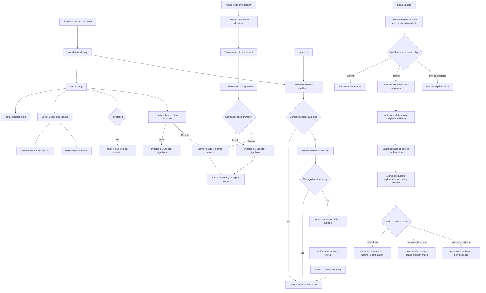

# Installation

## What this feature does

Installation reduces Nexus onboarding to one machine command and one repository command. Machine setup installs the complete feature and review skill library, registers the Nexus MCP companion with every supported coordination host already present, merges lifecycle hooks without deleting unrelated settings, installs the Pi terminal extension when Pi is present, and initializes local storage only when local transport is selected. Repository installation creates shared Git-common-directory configuration and runs local migrations or leaves storage to the configured remote service. The installed binary also bundles the standalone terminal dashboard opened by `nexus tui`; opening it never requires a separate Pi installation.

`scripts/start-docker-service.sh` is the local-to-shared-service cutover entry point. With no arguments it discovers the configured or conventional SQLite database, mounts it read-only into a one-shot staging container, gives long imports an extended startup-health window, and starts the Compose stack. `--sqlite PATH` selects another source and `--no-import` requests a fresh service. The staging container has no network, drops every capability except the read bypass needed for host databases whose permissions are owner-only, and publishes its backup in a private named volume for the unprivileged service. Import safety and backend-neutral snapshot semantics belong to the persistence feature; this script owns only discovery and Compose instantiation.

## Why it exists

Coordination is only useful when every agent is connected consistently. A checklist that asks users to copy skills, execute provider-specific registration commands, merge JSON by hand, and initialize each repository invites partial installations that appear healthy until agents overlap. Nexus should own that incidental complexity behind two stable commands.

## Data flow

## Reading the flowchart

1. **Source bootstrap command** is the only machine-facing command that depends on the source checkout.
2. **Install nexus binary** uses Cargo's locked dependency graph and places the executable on the user's Cargo path.
3. **nexus setup** owns all machine-wide Nexus integration after the binary exists.
4. **Install bundled skills** places the complete feature library alongside architecture, deletion, and TDD guidance in both Codex and Claude skill directories. The `nexus` guide routes all cataloged features to focused integration skills. Setup also installs `nexus-build-eval`, `nexus-eval-audit`, `nexus-hillclimb`, and `nexus-eval-history`, including their shared evidence reference under `nexus-eval-history/references/`. Setup refreshes bundled contents without deleting user-created files beside them. These provider-neutral skills guide existing caller-owned workflows; installing them does not run a workflow or call a model.
5. **Detect Codex and Claude** configures only hosts whose commands are executable.
6. **Register Nexus MCP server** replaces the named `nexus` registration with the installed executable path and the host's Codex-or-Claude agent identity. That stdio process remains the host-facing companion in either mode and selects its local or remote transport from configuration. When setup received a configuration path through `--config` or `NEXUS_CONFIG`, Nexus resolves it against the setup working directory and preserves the resulting absolute path as an argv pair rather than relying on the setup process's environment or a later host working directory. Direct endpoint, project, and client-secret-file environment overrides remain process-scoped and must be inherited by every host process when no durable configuration file is selected.
7. **Merge lifecycle hooks** removes earlier Nexus entries and appends the current generated entries while retaining unrelated settings and hooks. Tool coordination uses the registered MCP server. Supported work session, prompt, stop, child, and interruption/error boundaries also use advisory native command adapters; session teardown uses a command because hosts no longer expose MCP context then. Commands apply the same shell-quoted explicit configuration path as the MCP registration. The bundled host-adapter reference distinguishes source support from verified live emission.
8. **Load configured client transport** selects the default local mode or a fully specified remote endpoint and project identity before storage setup.
9. **Initialize SQLite and migrations** opens the configured local store, which applies every unseen embedded Flyway migration.
10. **Leave storage to shared service** creates no client-side database and runs no local migration. Setup reports the database as remote; `nexus doctor` is the separate authenticated reachability check.
11. **`nexus install` in repository** is the one repository-local command.
12. **Resolve Git common directory** gives all local worktrees one configuration location; local mode also derives identity from it.
13. **Create `nexus.toml` if absent** preserves existing user decisions and otherwise writes only the supported schema version.
14. **Load resolved configuration** applies normal user, repository, environment, and CLI precedence. Remote users provide a stable `client.project_id`; installation does not derive a cross-environment identity from unrelated clone paths.
15. **Repository ready for agent hooks** means the already-installed host integrations will coordinate sessions in that repository.
16. **Pi installed** is detected with the same executable probe used for supported hosts; an absent Pi installation does not affect setup.
17. **Install `/nexus` terminal extension** writes the bundled TypeScript modules to Pi's global extension directory, including the always-on fail-open analytics transport. A generated non-secret launch-context module records the absolute Nexus executable and optional absolute explicit configuration, so Pi selects the same transport from any working directory. Re-running setup replaces changed Nexus extension files and refreshes that context.
18. **Embedded terminal dashboard** is compiled into the Rust executable along with its pinned Pi TUI renderer and license notices. It does not load a Pi agent process or require model credentials for local rendering; remote mode still requires its Nexus bearer secret.
19. **Compatible Node available** accepts an executable on `PATH` whose version meets the renderer's Node 22.19+ requirement. The command uses it without altering the machine's Node installation.
20. **Acquire runtime-cache lock** serializes first-launch provisioning across Nexus processes. The runtime and content-addressed dashboard files live under `nexus/tui/` in the operating system's per-user cache directory. On Linux this honors `XDG_CACHE_HOME` and otherwise uses `~/.cache`; on macOS it uses `~/Library/Caches`. The terminal cache is independent of database storage and remains writable when a remote client's former local database is inaccessible.
21. **Managed runtime ready** permits offline reuse of an already installed runtime when no suitable Node is on `PATH`.
22. **Download pinned official runtime** fetches Node 24.21.0 over HTTPS with bounded connection and transfer timeouts. Provisioning uses the machine's `curl` and `tar`, supports Linux/macOS x64/arm64, and needs no package-manager command from the user.
23. **Verify checksum and extract** checks the compiled-in SHA-256 from Node's [official release checksums](https://nodejs.org/dist/v24.21.0/SHASUMS256.txt), extracts only the executable and license into a temporary cache directory, and confirms the executable runs before installation.
24. **Publish runtime atomically** renames the complete runtime into place while holding the cache lock. Failed downloads, checksum checks, or extraction leave no published partial runtime and remove their temporary directory; a later `nexus tui` can retry.
25. **Launch terminal dashboard** uses the shared standalone adapter documented in observability-ui and inherits the user's terminal streams.

## Implementation details

The installed `nexus` skill maps all seventeen feature IDs to focused guides:
`nexus-setup` covers installation, configuration, and runtime;
`nexus-coordination` covers coordination and analyst;
`nexus-agent-memory`, `nexus-papercuts`, `nexus-code-concerns`, `nexus-sos`,
`nexus-usage-analytics`, and `nexus-observability` cover their respective
capabilities; `nexus-development` covers architecture tooling, complexity,
commit review, and persistence. Existing eval and work-history guides retain
their contracts. References and cross-skill links resolve within the installed
library; source-development commands explicitly require a Nexus checkout.
Installation tests compare the complete source skill resource tree with both
host installations so a new reference cannot be omitted from the bundle.

Setup also installs `nexus-work-history` for Codex and Claude, including its
integration and host-adapter references and the canonical `work-capture.sh` and
`nexus-work-github.py` sources under the installed skill's `scripts/` directory.
The helpers remain maintained in the repository's top-level `scripts/`; setup
embeds those exact files rather than maintaining another implementation. The
installed skill therefore works outside a Nexus checkout. Its guidance preserves
caller-owned execution, nested identity, qualified timing, metadata privacy, and
fail-open hooks. Isolated installation tests exercise the bundled shell helper's
exactly-once fallback, preserved output/exit status, and runnable Python adapter.

`setup_machine` and `install_repository` in `src/installation.rs` are the onboarding entry points. `src/installation_assets.rs` contains the embedded skill and Pi module inventories; setup installs all eighteen named skills and their references. Setup is idempotent: skill and Pi-extension contents are replaced only when different, the named MCP registration is refreshed, and generated Nexus hook entries replace only prior Nexus entries. Repository installation never overwrites an existing `nexus.toml`. Both entry points load typed client configuration before touching persistence: local mode opens and migrates SQLite, while remote mode reports remote storage and creates no local database. The generated host integration is transport-neutral because `nexus mcp` and the session-end command both use the centralized configured client. An explicit setup configuration path is retained in both installed commands and Pi's generated launch context, and every MCP argv names its host so process-bound memory and papercut provenance remains accurate.

The source bootstrap entry point is `./scripts/install.sh`. Source builds require Rust 1.88 or newer. The script installs with Cargo's locked dependency graph into `NEXUS_INSTALL_ROOT`, `CARGO_HOME`, or the normal `~/.cargo` prefix in that order, then calls the installed binary's `nexus setup` command. Subsequent updates use verified release assets through `nexus update`; they require neither this checkout nor a Rust build.

`tests/installation.rs` exercises both commands as child processes with isolated homes and provider binaries. The ignored real-agent test exercises the packaged install plus two worktrees using authenticated Codex and Claude clients; it must be requested explicitly because it consumes model resources and requires external credentials.

`src/runtime/terminal.rs` owns the native launcher and embedded dashboard materialization; `terminal_runtime.rs` owns runtime selection and verified installation behind `ensure_node`. Runtime tests use local archive fixtures to prove verification, atomic publication, failed-install cleanup, and reuse. `tests/tui.rs` exercises the real packaged view through a pseudo-terminal with no Pi on `PATH`, then repeats offline with neither Pi nor Node on `PATH`. `tests/tui_terminal.py` also provides an explicit `download` scenario for testing official first-launch provisioning without making the deterministic test suite depend on the network.

The installed Pi extension includes the complete local TypeScript import closure
of its entry point, including analytics, capability inventory, Papercuts, and Work
modules. Setup tests resolve these imports from the actual isolated installation
so adding a pane cannot leave an installed extension with a missing dependency.
The generated launch-context module remains the installation-specific exception.

## Versioned updates

`nexus --version` identifies the human package version, full source commit, build
platform, and whether the source checkout was modified. `nexus update --check`
compares that identity with the repository's exact `main` reference and reports
`current`, `available`, `release_pending`, or `requires_force`. Check mode does
not download executable/image assets, write management files, invoke setup, or
contact the selected service. A dirty, ahead, divergent, or unknown source build
requires `--force` before replacement. The updater never fetches into or modifies
the caller's Git repository.

`nexus update` downloads the immutable `main-COMMIT` release from the fixed Nexus
GitHub repository. A size-bounded manifest binds every platform asset to its
full commit, semantic package version, byte size, and SHA-256. The updater checks
the staged executable's own `--version` before touching the live installation,
serializes updates with a private installation lock, and atomically replaces an
owned executable in its existing directory. The previous binary remains available
for rollback until setup refresh and the managed service transition succeed.
Setup refresh uses `setup --refresh`, which also works on headless machines without changing the ordinary setup requirement for an installed host. It retains the explicit absolute configuration argument and merges
host settings through the existing setup boundary. Agent applications and their
already running MCP processes are not restarted; the report asks those hosts to
reconnect their companions.

Local daemons expose a same-user control operation only on their private Unix
socket. An exact instance identity binds the resolved configuration, sources,
configuration hash, executable, and working directory. Once a stop is acknowledged, the updater waits for admitted requests and background work to finish; long drains report progress while the old binary remains installed. A managed update drains
the running instance before restarting with that same snapshot. An inactive local
mode remains inactive. A legacy daemon without verifiable control, a daemon
owned by a different executable, or an external remote service is reported as
unmanaged: client and setup assets can update, but Nexus does not claim that the
service changed or guess a process to terminate.

The Compose startup script automatically records management evidence when the
installed CLI supports updates. Source adoption must match the running
service's authoritative Compose configuration hash, with declared environment
values retained from the actual container. Physical mount and network names,
access modes, and aliases must also match. Changed or unprovable settings are
refused before the executable or service is replaced. Retained snapshots bind a
fingerprint of the running configuration; manual runtime changes require fresh,
verified adoption instead of silently applying a stale snapshot. Legacy stacks can be adopted from the exact
configured loopback endpoint, running container Compose labels, and the known
source Compose files. `--compose-file PATH` disambiguates a source file only when
it matches those recorded container labels; a caller's current directory is never
ownership evidence. A retained private resolved Compose snapshot permits future
updates after the original source checkout is gone. It preserves the running
container's environment, health and security settings, volume names, mounts,
networks, and project identity. Named resources are retained as exact external references so an update cannot recreate or reconfigure their backing stores. Compose interpolation is escaped when materializing snapshots so dollar characters in existing secrets remain literal. These files can contain secrets: they are owned
by the current user, live under the per-user `nexus/updates` data directory, use
private directory/file permissions, and are never printed in reports.

Compose updates inspect the actual local Docker server OS/architecture, verify
its matching release archive and image ID, load it, and recreate only the `nexus`
service with `--no-build --no-deps --pull never`. They do not recreate PostgreSQL,
run the importer, remove volumes, or erase persisted data. A failed setup or
service transition restores the previous executable and attempts to restore the
previous managed service image/configuration. Database contents remain in place;
this mechanism does not promise to reverse migrations or external writes.

`.github/workflows/release.yml` publishes only after the `ci` workflow succeeds
for an exact push to `main` in this repository. Four native Linux/macOS x64/arm64
executables and two Linux service-image archives must all be present before a
size/checksum manifest is generated. Publication uses a draft until the complete
asset set is uploaded, and a published commit-tagged release is never overwritten
by a retry. If main has passed CI but its release is still building, update reports
`release_pending` and leaves the installation untouched. The first release is
published by this same gate after this implementation reaches main.

The updater entry point is `src/updater/mod.rs::run`. Release identity, bounded
GitHub transport, atomic executable installation, managed service transitions,
and Compose evidence have separate typed boundaries. Tests use loopback HTTP,
private temporary installations, fake Docker commands, and private local daemon
fixtures; they never update the developer's installed binary or live service.
