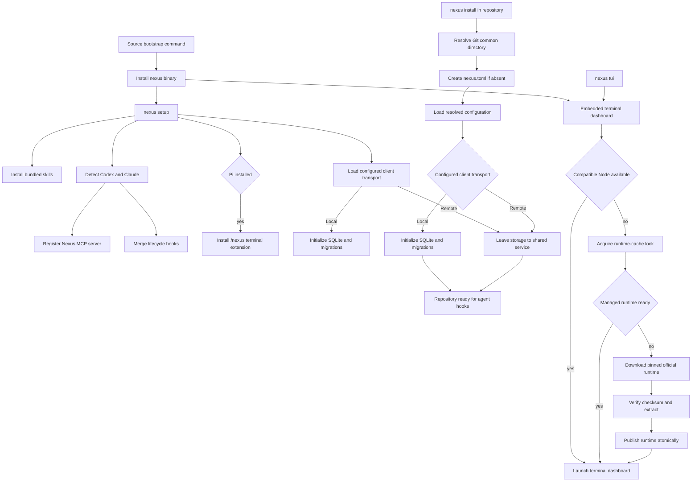

# Installation

## What this feature does

Installation reduces Nexus onboarding to one machine command and one repository command. Machine setup installs the review and eval skills, registers the Nexus MCP companion with every supported coordination host already present, merges lifecycle hooks without deleting unrelated settings, installs the Pi terminal extension when Pi is present, and initializes local storage only when local transport is selected. Repository installation creates shared Git-common-directory configuration and runs local migrations or leaves storage to the configured remote service. The installed binary also bundles the standalone terminal dashboard opened by `nexus tui`; opening it never requires a separate Pi installation.

`scripts/start-docker-service.sh` is the local-to-shared-service cutover entry point. With no arguments it discovers the configured or conventional SQLite database, mounts it read-only into a one-shot staging container, gives long imports an extended startup-health window, and starts the Compose stack. `--sqlite PATH` selects another source and `--no-import` requests a fresh service. The staging container has no network, drops every capability except the read bypass needed for host databases whose permissions are owner-only, and publishes its backup in a private named volume for the unprivileged service. Import safety and backend-neutral snapshot semantics belong to the persistence feature; this script owns only discovery and Compose instantiation.

## Why it exists

Coordination is only useful when every agent is connected consistently. A checklist that asks users to copy skills, execute provider-specific registration commands, merge JSON by hand, and initialize each repository invites partial installations that appear healthy until agents overlap. Nexus should own that incidental complexity behind two stable commands.

## Data flow

## Reading the flowchart

1. **Source bootstrap command** is the only machine-facing command that depends on the source checkout.
2. **Install nexus binary** uses Cargo's locked dependency graph and places the executable on the user's Cargo path.
3. **nexus setup** owns all machine-wide Nexus integration after the binary exists.
4. **Install bundled skills** places the architecture, deletion, TDD, and four Nexus eval workflows where Nexus and supported agents can discover them. Both Codex and Claude skill directories receive `nexus-build-eval`, `nexus-eval-audit`, `nexus-hillclimb`, and `nexus-eval-history`, including their shared evidence reference under `nexus-eval-history/references/`. Setup refreshes bundled contents without deleting user-created files beside them. These original provider-neutral skills guide caller-run evaluations and historical evidence capture; installing them does not execute an eval or call a model.
5. **Detect Codex and Claude** configures only hosts whose commands are executable.
6. **Register Nexus MCP server** replaces the named `nexus` registration with the installed executable path and the host's Codex-or-Claude agent identity. That stdio process remains the host-facing companion in either mode and selects its local or remote transport from configuration. When setup received a configuration path through `--config` or `NEXUS_CONFIG`, Nexus resolves it against the setup working directory and preserves the resulting absolute path as an argv pair rather than relying on the setup process's environment or a later host working directory. Direct endpoint, project, and client-secret-file environment overrides remain process-scoped and must be inherited by every host process when no durable configuration file is selected.
7. **Merge lifecycle hooks** removes earlier Nexus entries and appends the current generated entries while retaining unrelated settings and hooks. Per-turn events use the registered MCP server; session teardown uses the installed executable as a command hook because hosts no longer expose MCP context then. The command applies the same shell-quoted explicit configuration path as the MCP registration.
8. **Load configured client transport** selects the default local mode or a fully specified remote endpoint and project identity before storage setup.
9. **Initialize SQLite and migrations** opens the configured local store, which applies every unseen embedded Flyway migration.
10. **Leave storage to shared service** creates no client-side database and runs no local migration. Setup reports the database as remote; `nexus doctor` is the separate authenticated reachability check.
11. **`nexus install` in repository** is the one repository-local command.
12. **Resolve Git common directory** gives all local worktrees one configuration location; local mode also derives identity from it.
13. **Create `nexus.toml` if absent** preserves existing user decisions and otherwise writes only the supported schema version.
14. **Load resolved configuration** applies normal user, repository, environment, and CLI precedence. Remote users provide a stable `client.project_id`; installation does not derive a cross-environment identity from unrelated clone paths.
15. **Repository ready for agent hooks** means the already-installed host integrations will coordinate sessions in that repository.
16. **Pi installed** is detected with the same executable probe used for supported hosts; an absent Pi installation does not affect setup.
17. **Install `/nexus` terminal extension** writes the bundled TypeScript modules to Pi's global extension directory, including the always-on fail-open analytics transport. A generated non-secret launch-context module records the absolute Nexus executable and optional absolute explicit configuration, so Pi selects the same transport from any working directory. Re-running setup replaces changed Nexus extension files and refreshes that context.
18. **Embedded terminal dashboard** is compiled into the Rust executable along with its pinned Pi TUI renderer and license notices. It does not load a Pi agent process or require model credentials for local rendering; remote mode still requires its Nexus bearer secret.
19. **Compatible Node available** accepts an executable on `PATH` whose version meets the renderer's Node 22.19+ requirement. The command uses it without altering the machine's Node installation.
20. **Acquire runtime-cache lock** serializes first-launch provisioning across Nexus processes. The runtime and content-addressed dashboard files live under `nexus/tui/` in the operating system's per-user cache directory. On Linux this honors `XDG_CACHE_HOME` and otherwise uses `~/.cache`; on macOS it uses `~/Library/Caches`. The terminal cache is independent of database storage and remains writable when a remote client's former local database is inaccessible.
21. **Managed runtime ready** permits offline reuse of an already installed runtime when no suitable Node is on `PATH`.
22. **Download pinned official runtime** fetches Node 24.21.0 over HTTPS with bounded connection and transfer timeouts. Provisioning uses the machine's `curl` and `tar`, supports Linux/macOS x64/arm64, and needs no package-manager command from the user.
23. **Verify checksum and extract** checks the compiled-in SHA-256 from Node's [official release checksums](https://nodejs.org/dist/v24.21.0/SHASUMS256.txt), extracts only the executable and license into a temporary cache directory, and confirms the executable runs before installation.
24. **Publish runtime atomically** renames the complete runtime into place while holding the cache lock. Failed downloads, checksum checks, or extraction leave no published partial runtime and remove their temporary directory; a later `nexus tui` can retry.
25. **Launch terminal dashboard** uses the shared standalone adapter documented in observability-ui and inherits the user's terminal streams.

## Implementation details

`setup_machine` and `install_repository` in `src/installation.rs` are the two deep entry points. Setup is idempotent: skill and Pi-extension contents are replaced only when different, the named MCP registration is refreshed, and generated Nexus hook entries replace only prior Nexus entries. Repository installation never overwrites an existing `nexus.toml`. Both entry points load typed client configuration before touching persistence: local mode opens and migrates SQLite, while remote mode reports remote storage and creates no local database. The generated host integration is transport-neutral because `nexus mcp` and the session-end command both use the centralized configured client. An explicit setup configuration path is retained in both installed commands and Pi's generated launch context, and every MCP argv names its host so process-bound memory and papercut provenance remains accurate.

The source bootstrap entry point is `./scripts/install.sh`. Source builds require Rust 1.88 or newer. The script installs with Cargo's locked dependency graph into `NEXUS_INSTALL_ROOT`, `CARGO_HOME`, or the normal `~/.cargo` prefix in that order, then calls the installed binary's `nexus setup` command. A future hosted installer should delegate to this same boundary rather than duplicate setup policy.

`tests/installation.rs` exercises both commands as child processes with isolated homes and provider binaries. The ignored real-agent test exercises the packaged install plus two worktrees using authenticated Codex and Claude clients; it must be requested explicitly because it consumes model resources and requires external credentials.

`src/runtime/terminal.rs` owns the native launcher and embedded dashboard materialization; `terminal_runtime.rs` owns runtime selection and verified installation behind `ensure_node`. Runtime tests use local archive fixtures to prove verification, atomic publication, failed-install cleanup, and reuse. `tests/tui.rs` exercises the real packaged view through a pseudo-terminal with no Pi on `PATH`, then repeats offline with neither Pi nor Node on `PATH`. `tests/tui_terminal.py` also provides an explicit `download` scenario for testing official first-launch provisioning without making the deterministic test suite depend on the network.
