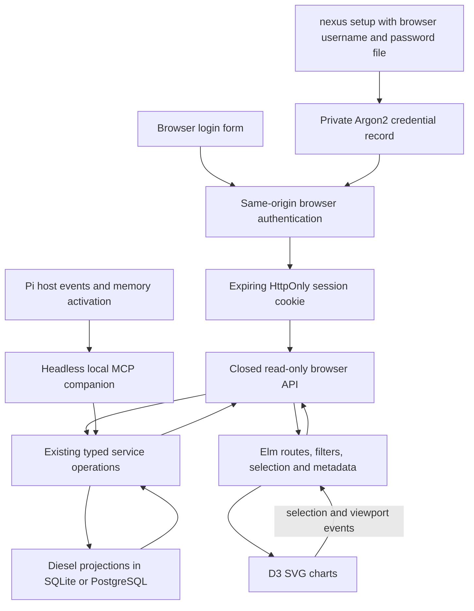

# Read-only web observability

## What this feature does

Nexus serves an authenticated browser application for Coordination, SOS, Tools,
Skills, Memory, Papercuts, Evals, Work, and Code concerns. Visual summaries come
first; selecting a session, metric, area, or record reveals its evidence. The
application replaces the native and Pi terminal dashboards. Pi retains its
headless tool/skill capture, capability inventory, and automatic memory context.

The application is read-only across all nine surfaces. Memory supports browsing,
search, summary expansion, and health inspection. Adding notes remains a CLI/MCP
operation; summary invalidation and requested consolidation remain CLI administration. Login and
logout change only browser authentication state. Viewing history never runs an
evaluation, fetches an artifact's bytes, retries work, or advances delivery.

Elm owns application state, navigation, pickers, requests, selection, and
evidence presentation. D3.js owns SVG visualizations and reports chart selection
or viewport events through Elm ports. Vite compiles and packages the application.
Static assets and a closed read API are served by the existing Nexus service and
port in Docker Compose; there is no separately versioned UI container. `nexus web`
serves the same interface using the invoking CLI's configured local SQLite daemon
or remote service transport.

The Code concerns destination includes a [code map](code-map.md). Its measure
and grouping selectors reflect project data, and a selected tile drills into
subjects or opens the contributing concern evidence.

## Developer metrics design

The browser follows the pinned Leonxlnx taste-skill's data-terminal app direction:
neutral graphite surfaces, compact panel headers, a divided metric strip,
readable tabular figures, quiet chart grids, and one thin blue selection rule.
Self-hosted Public Sans and IBM Plex Mono require no third-party font requests.
One Lucide SVG set supplies all navigation and control icons; visible text keeps
navigation understandable, and decorative SVGs are hidden from assistive naming.

Desktop navigation stays labeled. Below 1100px, a keyboard-accessible Menu control
expands the navigation; selecting a destination closes it. Duration trend and
activity summaries share a desktop row and stack where neither would be readable.
Charts and the branching session waterfall use shared semantic CSS colors; labels,
source-time axes, and exact metadata retain meaning independently of color.
Metric definitions, unknown values, bounded history and stale snapshots remain
explicit. See `web/DESIGN.md` for tokens, exceptions, and verification guidance.

## Why it exists

Humans need to recognize patterns across sessions and results: parallel work,
long-running subtasks, repeated remedies, changing metrics, and unused supplied
capabilities. A browser provides proportional timelines, scrollable branching
waterfalls, and interactive charts while retaining the domain's existing evidence
and uncertainty. Nexus remains a repository of observations; a richer view does
not change ownership of agents, runners, objectives, or deployment policy.

## Data flow

## Reading the flowchart

1. **Setup** accepts a browser username and password file or standard input. It
   writes a private credential record containing a salted Argon2 password hash.
2. **Private credential record** stays on the host or persistent service volume;
   neither its hash nor the agent API bearer secret is sent to the browser.
3. **Login form** is Elm state. A password is used for authentication and cleared
   after submission; browser storage does not retain credentials or bearer tokens.
4. **Browser authentication** verifies the configured credential under the
   selected same-origin policy and establishes a browser-only session.
5. **Session cookie** is expiring, HttpOnly, and SameSite=Strict. An externally
   configured HTTPS origin also requires Secure cookies.
6. **Closed read API** admits only explicitly enumerated reads and validates their
   scope, fields, pagination, and limits. It never forwards arbitrary service or
   MCP methods and never accepts a browser write action.
7. **Elm** requests and decodes domain responses, preserves active scope and
   selection, and presents exact metadata alongside summaries.
8. **Typed service operations** reuse existing domain validation, projections, and
   transport. A native web launcher keeps remote credentials server-side.
9. **Diesel projections** remain the only application database access path. The UI
   does not query database tables or duplicate domain aggregation.
10. **D3 charts** render data supplied by Elm. They do not fetch data, authenticate,
    make domain decisions, or mutate retained observations. Events return to Elm.
11. **Pi host events** continue to report tool/skill use and availability and obtain
    first-prompt memory context without opening an interface.
12. **Headless MCP companion** retains bounded queues, correlated responses,
    fail-open capture, configured executable/configuration, and bounded shutdown.

## Authentication and deployment

Configure a browser credential with `nexus setup --refresh --web-user viewer
--web-password-file PATH`, or use `-` to read the password from standard input.
`--web-credentials-file PATH` selects the output credential file; the default is
`nexus/web-credentials.json` under the operating system's user data directory.
Ordinary setup without credential flags preserves an existing credential.
Password text and hashes are excluded from ordinary status/configuration output.
Browser credentials are separate from the privileged agent bearer credential.

`nexus web` defaults to `127.0.0.1:7338` and supports `--listen`,
`--credentials-file`, and `--public-origin`. The Compose service reads
`NEXUS_WEB_CREDENTIALS_FILE` from its persistent service volume, conventionally
`/var/lib/nexus/web-credentials.json`; `NEXUS_WEB_ORIGIN` selects an HTTPS public
origin. Plain HTTP browser access is limited to loopback hosts. An external
installation terminates TLS at its trusted reverse proxy and configures the exact
HTTPS origin. Host and Origin checks do not trust forwarded headers to establish
that origin. Browser sessions grant inspection access to the configured service;
project IDs remain namespaces, not independent authorization boundaries.

Compose and a native launcher using a local daemon support global project reads.
A native launcher using the remote agent transport requires an explicit project
for coordination and usage reads: that transport supplies omitted scopes from
its configured project. Authenticated session metadata identifies this limit and
the configured default project. Elm selects that project and omits the misleading
All projects choice; the browser API rejects binding-dependent unscoped reads.
Project discovery, category definitions, and explicit global memory reads retain
their global meaning. The Compose browser supports global inspection directly.

The same release image serves both API and application assets. Versioned updates
therefore replace and roll back the existing `nexus` service as one unit, retaining
its credential volume and deployment configuration. Installed users need no Node,
Elm, Vite, or D3 build tools. Missing browser credentials disable browser login
without changing agent API credentials or agent capture.

## Inspection surfaces

Every screen starts from a project picker. Coordination and Work add a session
picker and Evals an agent picker; the selection is carried in the URL (`project`,
`session`, `set`), so links, reloads and the browser's Back button restore it.
Lists expand in place: selecting a row loads and shows its evidence directly
beneath it, and a second selection closes it. The browser does not render raw
response JSON, bounded-window caveats, search forms or identifier dumps; errors and
stale snapshots remain explicit, and "Show more" follows server cursors.

**Coordination** shows live sessions, live claims, and conflicts and delivered
messages over the last seven days. The session picker lists sessions by recent
coordination activity with their conflict and message counts. A picked session
reads as a chronological conversation: overlaps detected with a named other
session, the warnings Nexus delivered to this session, warnings it delivered to
the other session about this one, and overlaps that ended when a claim was
released or expired.

**Tools and Skills** retain rolling seven-day observations. Tools separates
Activities, Capabilities and Opportunities. Each activity row expands into the
commands that performed it, with one histogram of runs per six-hour bin per
command. Skills lists named skills by invocations; expanding one shows the
latest skill text a client reported, or says that none was received. Charts
distinguish invocations from operations and known zero use from unknown
availability. Opportunity matches are leads, not proof of interchangeability.

**Work** opens on where time goes: average or total elapsed time by activity
kind. The session picker lists host sessions with recorded work; Nexus's own
provider processes and host sessions holding only container spans are excluded.
A picked session draws a vertically scrollable work tree rooted at the session.
Presentation folds the agent and turn containers of each human prompt into their
parent, numbers prompts only when a session has several, and groups consecutive
repeated leaf calls under one parent into a counted node; source records are
unchanged. Time runs down a proportional UTC axis, children branch right at
source admission/start, parallel work has separate lanes, and spans end at known
source finishes. Selecting a node shows its kind, recorded elapsed time and
outcome. Zoom and horizontal pan support long or wide sessions; color, labels and
a legend distinguish subagents, tests, scripts, reviews, tools/commands and
prompts. Unknown intervals are not zero and inclusive durations are not additive.

**Evals** names each group by its recorded agent or system, then suite/target
identity, repository and model composition. Picking an agent draws one chart per
metric definition with individual results as dots over time, the definition's
calculation as readable text, and the latest exact values. Revisions remain
separate series, values keep their original representation, and Nexus chooses
no optimization direction.

**Code concerns** starts with summary counts, ranked problem areas and reports
per day. Selecting an area lists its concerns; expanding one shows its summary and
its encounters, remedies, resolutions and returns in order. Overlapping area
totals are not additive and reports are not an objective defect rate.

**Papercuts and SOS** retain their separate meaning and lifecycle. Both list the
most encountered (reported) first, then the most recent. Expanding one shows every
report in order with its reporter and time. Reporting, upvotes, resolution,
consolidation and triage remain outside the browser read contract. An open list is
not a complete registry; explicit CLI dumps preserve that role.

**Memory** shows notes, summaries, pending work and summarizer health, then the
layered context. Each row carries its aggregation level and the number of notes
it covers; levels double their coverage. Expanding a summary shows its text and
the entries it was built from, which expand in turn. Source text is historical
evidence. The browser offers no add, invalidate, or consolidate operation,
including through its read API.

Project discovery reads the persisted project catalog, which records the project
whenever an agent request (lifecycle hook, command, or agent read) resolves it, so
projects that have only work, eval, reporting, memory, or usage history appear
without a coordination session. Recording is throttled to once per minute per
project, never waits beyond the lifecycle store budget, and fails open. Browser
inspection uses a non-recording binding, so viewing a project never makes it look
recently active. The 128 most recent projects are returned with truncation.

Each project carries an optional `display_name` reported by its client: a
repository binding names its project after the repository (the parent of the Git
common directory, so linked worktrees share it), and local transport derives the
same name. The picker shows that name, then observed worktrees, then the opaque
ID. Global memory does not invent a project namespace. A failed catalog read is
reported as an error; a project named in the URL stays selectable.

## Implementation and validation

`web/src/Main.elm` owns the application; Elm wire/state modules decode responses
and reject stale request results, and `web/src/Waterfall.elm` derives the
human-rooted session tree. `web/src/charts.ts` renders D3 SVG charts through
ports, and Vite emits the tracked `web/dist` assets. The canonical gate rebuilds
and verifies them against the staged bundle. Cargo, Docker, and release builds
embed those exact CI-validated assets. All retained strings are
rendered as text, never interpreted as HTML or instructions. Source metadata and
exact metric literals survive presentation; preview omissions are labeled.

The screens above use these closed reads beyond each feature's existing list and
dashboard reads: `coordination_session_index` and `coordination_session_timeline`
(Coordination picker and conversation), `analytics_commands` (per-command
histograms), `skill_get` (latest reported skill text), `papercut_get` (every report
of a papercut), `sos_get`, `concern_get` and `memory_expand` (inline evidence).
Each is project-scoped like its feature and validated by its owning domain.

`src/runtime/server/browser/` owns credentials, sessions, origin enforcement,
and the closed mapping from browser queries to existing service reads. Scope or
filter changes invalidate obsolete responses, polling does not overlap an active
read, and failures retain the last successful snapshot with an explicit stale
notice. The browser obtains `ui.refresh_interval_ms` from an authenticated
coordination read and retains it across pages, including direct links; Refresh
retries a failed configuration read. Counts remain unavailable until a successful response. Pagination uses
server cursors rather than reconstructing IDs or treating a bounded page as an
export. Login expiry returns to authentication without widening privileges.

Validation must cover the locked Elm/Vite build and chart contracts, browser
login/logout and expiry, origin/cookie policy, unauthenticated denial, rejection
of every write family, scoped pagination and stale reads, exact eval values, and
selectable work descendants with metadata. Production Compose smoke coverage
must prove that the served assets and authenticated reads share its service
image. Retained Pi tests cover headless capture, inventory, memory activation,
and bounded MCP lifecycle; installation tests cover their full import closure
and removal of known retired UI files while preserving unrelated extensions.

## Execution flow

Time flows down; collision-spaced branches retain individual calls and observed
returns. Filled ribbons show server-qualified execution; dotted ribbons show
waiting, and hollow dashes mean unobserved state. Background workers retain their
own state and join only at observed consumption. Elm owns state and controls;
D3 owns geometry. See [work history](work-history.md#execution-flow-evidence)
for capture and qualification contracts.

Work labels use concrete operations and activity buckets from Tools when exact
invocation correlation exists. Selection retains classification provenance.
Missing execution finishes show an open marker instead of a session-long dotted
ribbon; the original source gap remains explicit. Collision packing reuses space
past these markers and keeps unobstructed children close to their parent.
The compact timeline has a 512 KiB sub-budget for enriched interval records,
within the existing 896 KiB overall dashboard cap and 1 MiB browser response cap.
Secondary lists are trimmed before the primary timeline when necessary; all
remaining truncation is disclosed.
Duration labels prefer reported elapsed nanoseconds. UTC coordinates locate the
observation; they do not independently qualify its elapsed duration.
