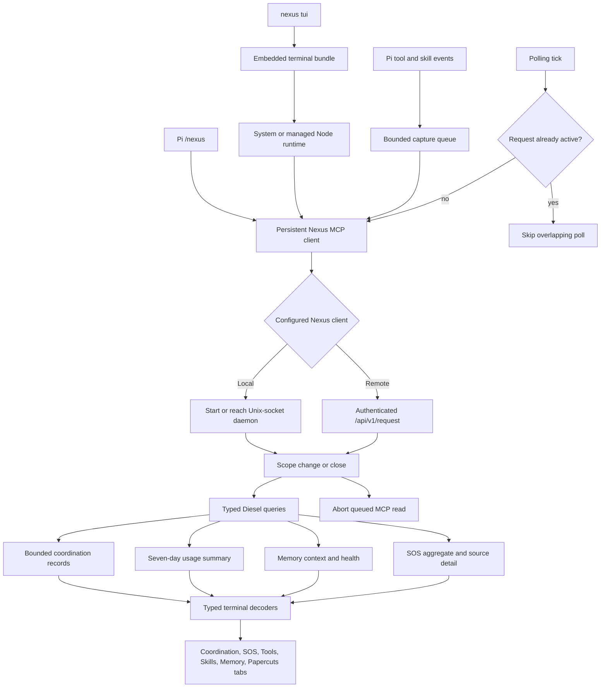

# Terminal observability UI

## What this feature does

Nexus has two entry points for one terminal interface: the bundled `nexus tui` command and `/nexus` inside Pi. Both render the same Coordination, SOS, Tools, Skills, Memory, and Papercuts tabs. Coordination progressively discloses sessions, claims, conflicts, and events. SOS presents aggregate issues by importance and last arrival, then reveals their retained source reports, triage attempts, and lifecycle history. Papercuts lists the current or selected project’s open issues with encounter counts and latest encounter times; Enter opens the full description, identifiers, and timestamps. Pressing `n` or moving down from the last loaded row fetches older open reports in bounded pages. The list exposes whether more pages remain and points to `nexus papercuts dump` for the complete historical registry. Reads are abortable when leaving the tab, stale responses cannot replace a newer scope, and refresh retains the last successful list on failure. An initial timeout tells the user how to retry. Tools and Skills show rolling seven-day horizontal bar charts. Memory browses and searches notes, adds an explicitly scoped raw note, expands or invalidates a derived summary, and requests consolidation.

All data travels through one persistent local `nexus mcp` child per interface. Coordination, SOS, Papercuts, project, usage, and memory reads use the same typed service boundary and configured client transport as the CLI. Memory requests carry correlated host context. Nexus serves an authenticated machine API and direct MCP endpoint for shared deployments, but it does not serve a web application and the repository contains no HTML, CSS, Elm, or other browser assets.

`nexus tui` embeds the terminal renderer and dashboard bundle. It uses a compatible Node runtime already on `PATH` or installs a pinned, verified runtime into `nexus/tui/` under the operating system's per-user cache directory. Dashboard files and the managed runtime do not depend on access to the configured database directory, including when a remote client retains an inaccessible local database path. It requires no Pi installation, agent login, or model credentials for rendering. Remote mode does require the Nexus bearer credential selected by `NEXUS_SECRET` or `client.secret_file`. The Pi extension uses its host's renderer and also observes tool calls and explicit skill invocations through a bounded, fail-open capture queue.

## Why it exists

Agent-facing advisories solve immediate collisions, but a person still needs a compact operational view of repositories, sessions, claims, conflicts, recurring SOS problems, tool activity, skill activity, and memory health. Keeping the interface in the terminal avoids a browser frontend toolchain and browser security surface while remaining available both inside Pi and directly from the CLI. A remote service listener is transport infrastructure shared with every other client, not a separate UI server.

Progressive disclosure keeps recent operational state first. The initial Coordination page answers whether Nexus is healthy, where work is happening, and whether conflicts are open. Full payloads and metadata appear only after a person selects a category and record. Coordination, SOS, Papercuts, and analytics are read-only; only explicit Memory-tab operations mutate state, and immutable raw notes cannot be edited or deleted.

## Data flow

## Reading the flowchart

1. **Pi `/nexus`** opens the interface inside an interactive Pi session.
2. **`nexus tui`** opens the same interface directly from the command line with inherited terminal streams.
3. **Embedded terminal bundle** packages the shared dashboard and narrow standalone host in the Rust binary.
4. **System or managed Node runtime** runs the bundle without installing Pi; first use can provision a verified runtime that later works offline.
5. **Persistent Nexus MCP client** is shared by dashboard reads, memory operations, and—inside Pi—analytics capture and first-prompt memory activation.
6. **Bounded capture queue** preserves Pi responsiveness when Nexus is slow or unavailable.
7. **Configured Nexus client** keeps transport choice behind the MCP adapter. No terminal component has a separate remote code path.
8. **Start or reach Unix-socket daemon** preserves bounded local launch and retry behavior.
9. **Authenticated `/api/v1/request`** forwards the same typed operations to the configured service and explicit project ID without starting local state.
10. **NexusService** exposes typed projects, dashboard, usage, and memory requests without presentation concerns.
11. **Typed Diesel queries** read existing projections from SQLite or PostgreSQL; terminal hosts do not duplicate persistence logic.
12. **Bounded coordination records** include exact counts and explicit truncation flags.
13. **Seven-day usage summary** contains tool, script, and skill counts plus capture health.
14. **Memory context and health** remain on the correlated MCP protocol and are delimited as untrusted data when injected into a model session.
15. **SOS aggregate and source detail** is read-only in the terminal: list shows importance and last arrival first, while detail includes source reports, triage timestamps, and lifecycle history. Reporting, resolution, and deprecation remain explicit HTTP, MCP, or CLI actions.
16. **Typed terminal decoders** reject malformed dynamic responses before they enter component state.
17. **Coordination, SOS, Tools, Skills, Memory, Papercuts tabs** present the shared keyboard-driven component in either host.
18. **Polling tick** refreshes only the active surface and never overlaps a prior polling request.
19. **Skip overlapping poll** bounds work while a previous request is active.
20. **Abort queued MCP read** removes stale scope requests before backpressure can send them.

## Implementation details

`src/persistence/dashboard.rs` owns the read model and keeps database access in Diesel's typed DSL for either backend. `DashboardRecords` returns exact scoped counts alongside bounded record windows. Configuration can request smaller windows, but the server always caps a dashboard at 32 events and 16 sessions, claims, and conflicts. Project discovery remains global but returns at most 16 recently active projects and samples at most four recent sessions for each summary. Truncation is explicit, and hard bounds cannot be raised through `[ui]` configuration.

The shared terminal UI lives under `pi-extension/`. `client.ts` maps typed dashboard, project, and usage reads onto the MCP client. `domain.ts` validates their wire shapes. `navigation.ts` owns Coordination's progressive-disclosure state. `sos.ts` validates SOS list and detail responses and `sos-pane.ts` owns its read-only summary-to-source navigation. `polling.ts` owns independent single-flight dashboard and analytics refresh lifecycles. `usage.ts` and `usage-pane.ts` render seven-day bar summaries. `component.ts` composes the six tabs.

`mcp-client.ts` owns the persistent correlated child, out-of-order response matching, bounded backpressure, request timeouts, and queued-request cancellation. The child is always a local stdio process, but the Rust `NexusClient` beneath it forwards to the configured Unix socket or authenticated HTTP endpoint. The source `launch-context.ts` defaults to `nexus` on `PATH`; machine setup replaces it in the installed Pi extension with the absolute installed executable and optional absolute explicit config, without embedding a credential. `capture.ts` owns fail-open Pi tool and skill listeners. The memory modules own strict response decoding, activation, prompts, and pane interactions. `index.ts` wires these components into Pi.

`terminal.ts` provides the standalone host using the Pi TUI package alone. `terminal-dialogs.ts` supplies focused input and selection overlays through the shared memory prompt interface, and `theme.ts` defines the small theme contract supported by either host. `pi-extension/build.mjs` bundles that host and its pinned renderer into tracked `pi-extension/dist/nexus-tui.mjs`, including third-party license notices.

All strings received from Nexus, remote peers, filenames, providers, and errors remain unchanged in typed state and storage. Presentation formatters pass them through one terminal display sanitizer immediately before rendering; it replaces C0, DEL, and C1 controls (including ESC, CSI, OSC, OSC-52, BEL, and ST), while multiline detail views preserve only normalized logical line breaks. Trusted theme styling is added after sanitization.

`src/runtime/terminal.rs` embeds the bundle, materializes a content-addressed copy outside the checkout, and replaces the launcher process with the selected runtime. `terminal_runtime.rs` owns compatible-runtime detection and verified installation. Real pseudo-terminal tests run with Pi absent, exercise navigation and memory operations, verify explicit configuration and repository paths containing spaces, and check terminal restoration. Another scenario proves cached offline startup without Node on `PATH`.

Repository validation installs the single locked Pi-extension Node tree, runs its typecheck and tests, rebuilds the tracked terminal bundle, and then runs the Rust and architecture gates. Installed users need no frontend build tools.

Papercut output, including truncation notices, wraps within the host terminal width.

`papercuts.ts` validates each MCP list page and sends the last row's update-time/ID cursor for older pages. `papercuts-pane.ts` owns project-scoped read-only list/detail navigation in both terminal hosts; it appends each page, retains loaded rows if a later request fails, and preserves selection when the user navigates while a page is loading.

The shared Tools pane offers Activities (default), Capabilities (including inventoried zero-use resources), Opportunities, and Legacy via keys 1–4. Up/down or j/k selects a row, Enter discloses implementations and provenance, n/p pages capabilities or examples, and Escape returns from detail before leaving Tools. Counts distinguish invocations from identified operations; incomplete availability and unclassified work remain explicit. Skills retain their own tab. All reads use the existing bounded poller and abortable page requests.
