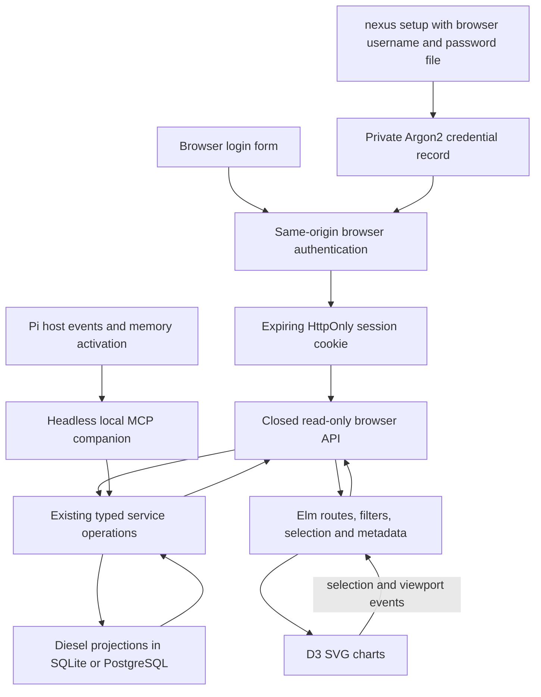

# Read-only web observability

## What this feature does

Nexus serves an authenticated browser application for Coordination, SOS, Tools,
Skills, Memory, Papercuts, Evals, Work, and Code concerns. Visual summaries come
first; selecting a session, metric, area, or record reveals its evidence. The
application replaces the native and Pi terminal dashboards. Pi retains its
headless tool/skill capture, capability inventory, and automatic memory context.

The application is read-only across all nine surfaces. Memory supports browsing,
search, summary expansion, and health inspection. Adding notes remains a CLI/MCP
operation; summary invalidation and requested consolidation remain CLI administration. Login and
logout change only browser authentication state. Viewing history never runs an
evaluation, fetches an artifact's bytes, retries work, or advances delivery.

Elm owns application state, navigation, forms, filters, requests, selection, and
metadata presentation. D3.js owns SVG visualizations and reports chart selection
or viewport events through Elm ports. Vite compiles and packages the application.
Static assets and a closed read API are served by the existing Nexus service and
port in Docker Compose; there is no separately versioned UI container. `nexus web`
serves the same interface using the invoking CLI's configured local SQLite daemon
or remote service transport.

## Developer metrics design

The browser follows the pinned Leonxlnx taste-skill's data-terminal app direction:
neutral graphite surfaces, compact panel headers, a divided metric strip,
readable tabular figures, quiet chart grids, and one thin blue selection rule.
Self-hosted Public Sans and IBM Plex Mono require no third-party font requests.
One Lucide SVG set supplies all navigation and control icons; visible text keeps
navigation understandable, and decorative SVGs are hidden from assistive naming.

Desktop navigation stays labeled. Below 1100px, a keyboard-accessible Menu control
expands the navigation; selecting a destination closes it. Duration trend and
activity summaries share a desktop row and stack where neither would be readable.
Charts and the branching session waterfall use shared semantic CSS colors; labels,
source-time axes, and exact metadata retain meaning independently of color.
Metric definitions, unknown values, bounded history and stale snapshots remain
explicit. See `web/DESIGN.md` for tokens, exceptions, and verification guidance.

## Why it exists

Humans need to recognize patterns across sessions and results: parallel work,
long-running subtasks, repeated remedies, changing metrics, and unused supplied
capabilities. A browser provides proportional timelines, scrollable branching
waterfalls, and interactive charts while retaining the domain's existing evidence
and uncertainty. Nexus remains a repository of observations; a richer view does
not change ownership of agents, runners, objectives, or deployment policy.

## Data flow

## Reading the flowchart

1. **Setup** accepts a browser username and password file or standard input. It
   writes a private credential record containing a salted Argon2 password hash.
2. **Private credential record** stays on the host or persistent service volume;
   neither its hash nor the agent API bearer secret is sent to the browser.
3. **Login form** is Elm state. A password is used for authentication and cleared
   after submission; browser storage does not retain credentials or bearer tokens.
4. **Browser authentication** verifies the configured credential under the
   selected same-origin policy and establishes a browser-only session.
5. **Session cookie** is expiring, HttpOnly, and SameSite=Strict. An externally
   configured HTTPS origin also requires Secure cookies.
6. **Closed read API** admits only explicitly enumerated reads and validates their
   scope, fields, pagination, and limits. It never forwards arbitrary service or
   MCP methods and never accepts a browser write action.
7. **Elm** requests and decodes domain responses, preserves active scope and
   selection, and presents exact metadata alongside summaries.
8. **Typed service operations** reuse existing domain validation, projections, and
   transport. A native web launcher keeps remote credentials server-side.
9. **Diesel projections** remain the only application database access path. The UI
   does not query database tables or duplicate domain aggregation.
10. **D3 charts** render data supplied by Elm. They do not fetch data, authenticate,
    make domain decisions, or mutate retained observations. Events return to Elm.
11. **Pi host events** continue to report tool/skill use and availability and obtain
    first-prompt memory context without opening an interface.
12. **Headless MCP companion** retains bounded queues, correlated responses,
    fail-open capture, configured executable/configuration, and bounded shutdown.

## Authentication and deployment

Configure a browser credential with `nexus setup --refresh --web-user viewer
--web-password-file PATH`, or use `-` to read the password from standard input.
`--web-credentials-file PATH` selects the output credential file; the default is
`nexus/web-credentials.json` under the operating system's user data directory.
Ordinary setup without credential flags preserves an existing credential.
Password text and hashes are excluded from ordinary status/configuration output.
Browser credentials are separate from the privileged agent bearer credential.

`nexus web` defaults to `127.0.0.1:7338` and supports `--listen`,
`--credentials-file`, and `--public-origin`. The Compose service reads
`NEXUS_WEB_CREDENTIALS_FILE` from its persistent service volume, conventionally
`/var/lib/nexus/web-credentials.json`; `NEXUS_WEB_ORIGIN` selects an HTTPS public
origin. Plain HTTP browser access is limited to loopback hosts. An external
installation terminates TLS at its trusted reverse proxy and configures the exact
HTTPS origin. Host and Origin checks do not trust forwarded headers to establish
that origin. Browser sessions grant inspection access to the configured service;
project IDs remain namespaces, not independent authorization boundaries.

Compose and a native launcher using a local daemon support global project reads.
A native launcher using the remote agent transport requires an explicit project
for coordination and usage reads: that transport supplies omitted scopes from
its configured project. Authenticated session metadata identifies this limit and
the configured default project. Elm selects that project and omits the misleading
All projects choice; the browser API rejects binding-dependent unscoped reads.
Project discovery, category definitions, and explicit global memory reads retain
their global meaning. The Compose browser supports global inspection directly.

The same release image serves both API and application assets. Versioned updates
therefore replace and roll back the existing `nexus` service as one unit, retaining
its credential volume and deployment configuration. Installed users need no Node,
Elm, Vite, or D3 build tools. Missing browser credentials disable browser login
without changing agent API credentials or agent capture.

## Inspection surfaces

**Coordination** starts with health, project scope, and exact summary counts,
then exposes sessions, claims, conflicts, and recent events. Dashboard windows
remain server-bounded: at most 32 events and 16 sessions, claims, and conflicts.
Project discovery returns at most 16 recently active projects with up to four
sample sessions each. Bounded windows never imply a complete historical list.

**Tools and Skills** retain rolling seven-day observations. Tools separates
Activities, Capabilities, Opportunities, and Legacy; Skills retains its own view.
Charts distinguish invocations from operations and known zero use from unknown
availability. Capability and implementation pages expose provenance, supplied
versus improvised origin, classifier/model evidence, and truncation. Opportunity
matches are leads within observed sessions, not proof of interchangeability.

**Work** starts with qualified session totals and means, activity-kind duration
summaries, and UTC-day trends. Host-owned sessions are the default overview;
source browsing retains shared logical work, standalone commands, and unlinked
activities. Selecting a session opens its vertically scrollable branching
waterfall: time runs down a proportional UTC axis, children branch right at source
admission/start, parallel work has separate lanes, and spans end at known source
finishes. Queue and execution segments remain distinct. Selecting a node
highlights its span and shows kind/category, state/outcome, timestamps, elapsed
and queue evidence, executor, parent, gaps, and conflicts immediately below.
Zoom and horizontal pan support long or wide sessions. Color distinguishes
subagents, tests, scripts, reviews, tools/commands, and sessions; labels and a
legend preserve meaning independently of color. Session titles follow captured
Codex/Claude metadata. Missing parents, unknown finishes, outliving descendants,
corrections, and conflicts stay visible. Inclusive durations are not additive
wall time or effort; unknown intervals are not zero. Attributed wall time,
unobserved time, queue wait, and worker occupancy keep their separate meanings.

**Evals** groups sets by stable suite/target identity, repository, and exact model
composition. Selecting a set exposes metric trends and their definitions,
units, formats, assessment scopes, calculation descriptions, and latest exact
values. Metric/grader revisions and scopes remain separate series. Charts use
only conservative scalar approximations; large integers, precise decimals,
structured values, categories, and unavailable values retain their original
representation. Corrections preserve immutable history while superseded results
stay outside current frontiers; conflicting branches are not silently resolved.
Nexus chooses no optimization direction. Record, rationale/history, and link
views retain why changes happened and artifact Git coordinates or blob metadata.

**Code concerns** starts with ranked areas and recurrence trends, separating raw
observations, known source occurrences, distinct work/host sessions, returns,
and unknown evidence. Select an area, concern, and timeline event to inspect
encounters, remedies and their motivations, reviews, resolutions, and returns.
Metadata retains original source/receipt times, exact session identities and
available titles, Git locations, and verification qualifications. Unlocated
concerns remain accessible. Overlapping area totals are not additive and reports
are not an objective defect rate.

**Papercuts and SOS** retain their separate meaning and lifecycle. Papercuts
browses development-friction reports with encounter counts and timestamps; older
open reports use bounded cursor pages. SOS shows importance-ranked application
situations, source reports, triage, and lifecycle history. Reporting, upvotes,
resolution, consolidation, and triage remain outside the browser read contract.
An open list is not a complete registry; explicit CLI dumps preserve that role.

**Memory** browses layered/project/global context, raw search results, summary
children, omissions, pending work, provider health, and activation metadata.
Source text is historical evidence. The browser offers no add, invalidate, or
consolidate operation, including through its read API.

Project discovery reads the persisted project catalog, which records the project
whenever an agent request (lifecycle hook, command, or agent read) resolves it, so
projects that have only work, eval, reporting, memory, or usage history appear
without a coordination session. Recording is throttled to once per minute per
project, never waits beyond the lifecycle store budget, and fails open. Browser
inspection uses a non-recording binding, so viewing a project never makes it look
recently active. The 16 most recent projects are returned with truncation.

Each project carries an optional `display_name` reported by its client: a
repository binding names its project after the repository (the parent of the Git
common directory, so linked worktrees share it), and local transport derives the
same name. The picker shows that name, then observed worktrees, then the opaque
ID. Global memory does not invent a project namespace. A truncated or failed
catalog read is labeled and permits selecting a known project ID explicitly.

## Implementation and validation

`web/src/Main.elm` owns the application; Elm wire/state modules decode responses
and reject stale request results. `web/src/charts.ts` renders D3 SVG charts through
ports, and Vite emits the tracked `web/dist` assets. The canonical gate rebuilds
and verifies them against the staged bundle. Cargo, Docker, and release builds
embed those exact CI-validated assets. All retained strings are
rendered as text, never interpreted as HTML or instructions. Source metadata and
exact metric literals survive presentation; preview omissions are labeled.

`src/runtime/server/browser/` owns credentials, sessions, origin enforcement,
and the closed mapping from browser queries to existing service reads. Scope or
filter changes invalidate obsolete responses, polling does not overlap an active
read, and failures retain the last successful snapshot with an explicit stale
notice. The browser obtains `ui.refresh_interval_ms` from an authenticated
coordination read and retains it across pages, including direct links; Refresh
retries a failed configuration read. Counts remain unavailable until a successful response. Pagination uses
server cursors rather than reconstructing IDs or treating a bounded page as an
export. Login expiry returns to authentication without widening privileges.

Validation must cover the locked Elm/Vite build and chart contracts, browser
login/logout and expiry, origin/cookie policy, unauthenticated denial, rejection
of every write family, scoped pagination and stale reads, exact eval values, and
selectable work descendants with metadata. Production Compose smoke coverage
must prove that the served assets and authenticated reads share its service
image. Retained Pi tests cover headless capture, inventory, memory activation,
and bounded MCP lifecycle; installation tests cover their full import closure
and removal of known retired UI files while preserving unrelated extensions.
