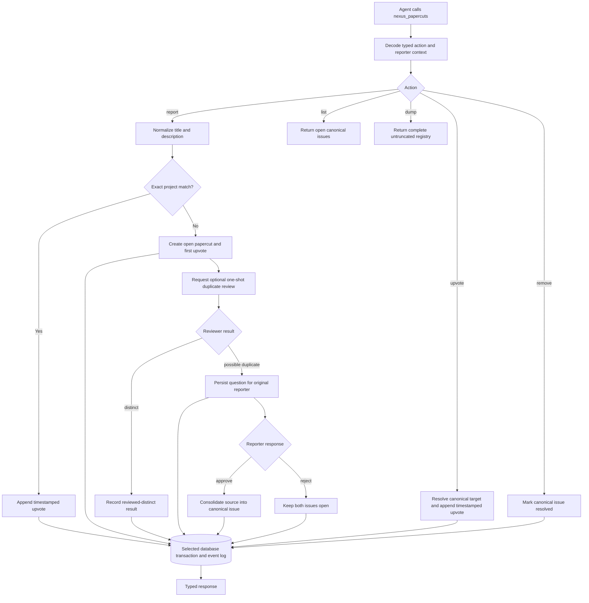

# Papercuts registry

## What this feature does

Papercuts is a durable, project-aware ergonomics log for friction that makes development slower or less reliable: flaky tests, awkward setup, slow checks, confusing tools, and similar recurring problems. Agents can report a papercut, upvote one they encounter, read the active set, dump the complete registry, soft-remove a solved issue, and consolidate duplicate reports.

Memory pressure and orphan test containers are development/environment
friction. An identified race in application code exposed by a flaky check
belongs in [Code concerns](code-concerns.md); the impediment caused by flaky
checks may remain a linked papercut. [SOS](sos.md) serves agents inside running
applications encountering unusual inputs or situations outside their expected
scope. Route by the substance of the report; these registries retain separate
identities and lifecycle policies.

Every report and upvote is retained as its own timestamped observation. Resolution, reopening, and consolidation are retained as typed timestamped lifecycle transitions with actor provenance. The canonical issue therefore shows both total impact and the most recent encounter, while a complete dump preserves the underlying history needed to decide whether an issue is stale or still actively impeding work.

## Why it exists

Small development problems are easy to work around once and easy to forget. Across many agents, the same workaround is then rediscovered repeatedly without creating a clear signal that the environment itself should improve. Papercuts turns those repeated encounters into an attributable, inspectable queue without making agents stop their current task.

Exact normalized repeats are safe to consolidate deterministically. Similar wording is not: a one-shot reviewer may propose that two issues are duplicates, but the original reporter must answer its persisted question with the opaque token returned by the original report before Nexus consolidates them. Nexus stores only a hash of that token, so approval is not coupled to one MCP process lifetime. Solved and consolidated records remain in the complete registry so history is never rewritten.

## Data flow

## Reading the flowchart

1. **Agent calls `nexus_papercuts`** through MCP or the matching CLI command. One tool owns the vocabulary, so agents do not need to discover an unrelated tool for each lifecycle step.
2. **Decode typed action and reporter context** confines open-ended JSON to the runtime boundary. MCP binds project, agent, and session provenance from the established invocation context and replaces any per-call identity fields before decoding, so a tool call cannot spoof another reporter.
3. **Action** selects a deliberately small closed operation: `report`, `upvote`, `remove`, `list`, `get`, `dump`, or `respond`. Review and duplicate proposal are service-owned orchestration, and semantic consolidation is reachable only through an approved response.
4. **Normalize title and description** trims surrounding whitespace, collapses internal whitespace, and case-folds only for a deterministic fingerprint. Display text retains normalized human-readable casing.
5. **Exact project match** compares the fingerprint only within one canonical Git project. It is a deterministic identity check, not semantic model judgment.
6. **Append timestamped upvote** records the new encounter and its reporter provenance. A report on a resolved issue reopens it because the impediment has recurred, appending a typed reopened transition before the new observation.
7. **Create open papercut and first upvote** makes the initial report count as the first occurrence.
8. **Request optional one-shot duplicate review** happens after persistence and outside lifecycle-hook latency. Runtime dispatch is best effort; the returned field describes the request, not a durable job. One worker serializes provider execution behind a 32-item queue, and pending project/papercut keys are deduplicated. Saturation retains the durable report without creating more work. The review job carries the already resolved project identity and optional reviewer working directory, so result and failure persistence do not re-identify a worktree that moved or disappeared after reporting. Daemon or service termination can lose outstanding work, there is no automatic retry, and receipt of the report never depends on a provider. The absence of a recorded attempt means that no review result exists.
9. **Reviewer result** is strict typed data from the configured read-only analyst provider. The reviewer sees at most 64 other open canonical issues ordered by recent activity, including each candidate's impact count and latest encounter time, but has no direct merge authority. The caller-facing dump remains complete and unbounded.
10. **Record reviewed-distinct result** preserves the review provenance without changing the issue.
11. **Persist question for original reporter** creates a durable mailbox record. Nexus does not pretend that the ephemeral provider process is a resumable conversation.
12. **Reporter response** supplies the opaque token returned only with the newly created source report, approves or rejects the proposed relationship, and records the answer with a timestamp. Nexus compares a hash and never persists the plaintext token.
13. **Consolidate source into canonical issue** creates a tombstone from the source to the canonical target, moves the canonical association of its observations while preserving where each was originally reported, and appends a timestamped consolidated transition with the approving actor.
14. **Keep both issues open** closes the proposal but retains both independent records.
15. **Resolve canonical target and append timestamped upvote** lets an agent skip a redundant report when it finds an existing match.
16. **Mark canonical issue resolved** is the meaning of removal. The resolution, timestamp, and actor are appended to lifecycle history; no issue, observation, transition, or review history is physically deleted.
17. **Return open canonical issues** is a bounded reading path ranked by encounter count (`upvote_count`, which includes the creating report), then most recent activity (`updated_at`), then stable ID. It returns at most 32 records plus an explicit truncation flag. A typed cursor built from the last row retrieves the next page in that ranking without loading historical upvote rows or resolved issues.
18. **Return complete untruncated registry** includes open, resolved, and consolidated issues plus every upvote, typed lifecycle transition, duplicate proposal, and timestamped automated-review outcome. It has no implicit pagination or result limit.
19. **Selected database transaction and event log** atomically maintain the registry projection and append the corresponding audit event in local SQLite or service PostgreSQL.
20. **Typed response** reports whether a record was created or matched and returns current counts and timestamps.

## Implementation details

Each open-list page is one grouped Diesel query: open papercuts left-joined to their occurrence rows, grouped by papercut ID, ordered by `COUNT` descending, `updated_at` descending and ID ascending, and limited to 33 rows to return 32 plus `truncated`. An optional cursor contains the last row's `upvote_count`, `updated_at` and `id`; the next page applies the same keyset in `HAVING`, so equal counts and equal timestamps continue without gaps or repeats. A count that changes between pages can move an item across the boundary, exactly as an update could under the former recency order. The default CLI and MCP list still return the first page. This bound does not apply to `dump`, whose complete-registry contract remains deliberately unbounded.

`get` resolves a papercut ID through consolidation to its canonical papercut and returns it with `reports`: its retained occurrences in chronological order. Every occurrence comes from `papercut_upvotes`, which also holds each creating report. An occurrence whose `reported_papercut_id` and timestamp match that papercut's creation is `kind: "report"` and carries the reported title and description; this includes duplicates consolidated into the canonical papercut, whose occurrences move with them. All others are `kind: "encounter"` and carry the optional note. Each item names the reporter agent, session and model. The newest 64 occurrences are returned, oldest first, with `truncated` when older ones exist; the oldest are also dropped until the encoded detail fits 768 KiB, inside one 1 MiB response frame.

`src/papercuts/` owns domain states and validation bounds. `src/persistence/papercuts.rs` exposes the small typed persistence inputs, while its feature directory separates atomic mutations, duplicate-review lifecycle, complete registry projection, and private Diesel row codecs over the version-five schema. The routine open-list path asks the database for typed `COUNT` and latest-timestamp aggregates joined only to open papercuts; it does not materialize accumulated resolved or consolidated upvote rows in the application. The explicit dump path separately retains and decodes every historical upvote without truncation. Automated review uses a separate slim Diesel projection containing only candidate identity, title, description, lifecycle state, activity timestamps, and aggregate vote metrics; it never loads or serializes legacy creator metadata from candidate rows. `src/coordination/api/papercuts.rs` defines the tagged command and response boundary, while `src/coordination/service/papercuts.rs` owns project resolution, token-authorized reporter responses, and reviewer orchestration. `src/agents/papercuts.rs` invokes the configured provider once with a read-only prompt and validates strict output. `src/runtime/mcp.rs` exposes `nexus_papercuts` and the complete `nexus://papercuts` project resource; `src/main.rs` mirrors those actions for people and shell pipelines such as `nexus papercuts dump | rg 'flaky|timeout'`. The remote companion assigns unbounded response collection only to the typed `PapercutCommand::Dump` variant so the complete-registry contract survives remote transport; every other remote response remains capped at 1 MiB. The V8 persistence upgrade propagates a collision-free bounded replacement for an oversized legacy session identity through creator, reporter, and reviewer provenance so registry history remains associated with the remapped coordination session.

The authoritative history is the configured database, not a separately maintained text file. `papercuts` stores current lifecycle state and the hash of its response token, `papercut_upvotes` stores individually timestamped encounters, the append-only event log stores typed resolution/reopen/consolidation history, `papercut_duplicate_reviews` stores proposals and responses, and `papercut_review_attempts` stores timestamped distinct or failed automated-review outcomes with provider provenance. A consolidated upvote retains both its canonical `papercut_id` and its original `reported_papercut_id`. The registry decodes only the closed set of papercut lifecycle event kinds into `PapercutLifecycleEvent`. Local Git worktrees share the derived project identity; remote clones share the registry selected by their explicit project ID.

Reporting, exact-match consolidation, manual upvotes, complete dumps, removal, reopening, and token-authorized responses are deterministic store operations and remain available without a model provider. Semantic duplicate review runs through a bounded process-owned worker. `nexus-server` disables providers by default because a same-UID subprocess can read service secrets; `--allow-local-providers` is safe only when the configured command enters an externally enforced OS isolation boundary. Provider absence or denial never rolls back or hides a report.

The central invariants are:

- recording an issue succeeds independently of reviewer availability;
- the first report and every later encounter have their own timestamped upvote;
- exact matching is deterministic and project-local;
- semantic review may propose but never silently consolidate;
- duplicate approval proves possession of the original report's token without storing that token;
- no public action can propose a competing duplicate or bypass reporter approval;
- a resolved issue reopens when a new encounter proves it is still active;
- removal and consolidation preserve the full audit history;
- the dump operation is complete, deterministic, and explicitly marked untruncated;
- reviewer text and stored papercut text are untrusted data, never instructions;
- actor and provider metadata fields are bounded to 256 bytes before persistence;
- automatic review is one-at-a-time with a 32-item queue and at most 64 bounded open candidates;
- review-workflow failures leave the reported issue visible; once the detached worker starts, Nexus attempts to record a typed failure without assuming whether the provider or a later persistence race caused it.

Focused tests cover normalized exact reports, timestamped upvotes, append-only resolution/reopen/consolidation history, token-authorized proposal/response consolidation, complete dumps including reviewer attempts, strict reviewer output, typed API round trips, MCP context enrichment, migration upgrades, the real daemon/MCP/SQLite path, and the PostgreSQL service backend.

The authenticated web interface includes a read-only Papercuts view. It shows open issues for the selected project, most encountered first, with encounter counts, last encounter timestamps, and full descriptions on selection. The browser `papercut_get` read (`papercut_id`) supplies the individual reports and encounters. Continuation controls fetch further reports in bounded pages until all currently open reports are reachable. The view exposes loaded counts and whether older rows remain; failed reads support retry and retain already loaded rows with a stale notice. The CLI dump remains the complete historical view, including resolved and consolidated reports. Reporting and lifecycle mutations remain MCP or CLI actions and are excluded from the browser read API.

The typed `list` and `get` actions accept an optional explicit `project_id` for project selection, and `list` accepts a closed `after` cursor (`upvote_count`, `updated_at` and `id`) for the next page. Both are advertised in the MCP schema. Project IDs use the same canonicalization and 256-byte/control-character validation as other project reads. Omission retains the invocation’s current local or remote project; unpaged requests omit `after` on the daemon wire so older daemons still accept ordinary lists. Write actions continue to bind their project from caller context.
