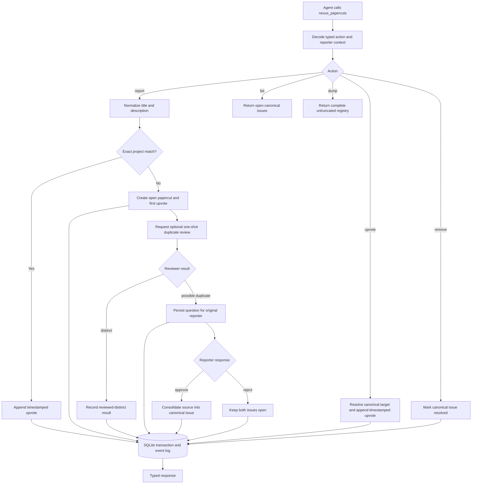

# Papercuts registry

## What this feature does

Papercuts is a durable, project-aware ergonomics log for friction that makes development slower or less reliable: flaky tests, awkward setup, slow checks, confusing tools, and similar recurring problems. Agents can report a papercut, upvote one they encounter, read the active set, dump the complete registry, soft-remove a solved issue, and consolidate duplicate reports.

Every report and upvote is retained as its own timestamped observation. Resolution, reopening, and consolidation are retained as typed timestamped lifecycle transitions with actor provenance. The canonical issue therefore shows both total impact and the most recent encounter, while a complete dump preserves the underlying history needed to decide whether an issue is stale or still actively impeding work.

## Why it exists

Small development problems are easy to work around once and easy to forget. Across many agents, the same workaround is then rediscovered repeatedly without creating a clear signal that the environment itself should improve. Papercuts turns those repeated encounters into an attributable, inspectable queue without making agents stop their current task.

Exact normalized repeats are safe to consolidate deterministically. Similar wording is not: a one-shot reviewer may propose that two issues are duplicates, but the original reporter must answer its persisted question with the opaque token returned by the original report before Nexus consolidates them. Nexus stores only a hash of that token, so approval is not coupled to one MCP process lifetime. Solved and consolidated records remain in the complete registry so history is never rewritten.

## Data flow

## Reading the flowchart

1. **Agent calls `nexus_papercuts`** through MCP or the matching CLI command. One tool owns the vocabulary, so agents do not need to discover an unrelated tool for each lifecycle step.
2. **Decode typed action and reporter context** confines open-ended JSON to the runtime boundary. MCP supplies project, agent, and session fallbacks; explicitly correlated clients may provide stronger provenance.
3. **Action** selects a deliberately small closed operation: `report`, `upvote`, `remove`, `list`, `dump`, or `respond`. Review and duplicate proposal are service-owned orchestration, and semantic consolidation is reachable only through an approved response.
4. **Normalize title and description** trims surrounding whitespace, collapses internal whitespace, and case-folds only for a deterministic fingerprint. Display text retains normalized human-readable casing.
5. **Exact project match** compares the fingerprint only within one canonical Git project. It is a deterministic identity check, not semantic model judgment.
6. **Append timestamped upvote** records the new encounter and its reporter provenance. A report on a resolved issue reopens it because the impediment has recurred, appending a typed reopened transition before the new observation.
7. **Create open papercut and first upvote** makes the initial report count as the first occurrence.
8. **Request optional one-shot duplicate review** happens after persistence and outside lifecycle-hook latency. Runtime dispatch is best effort; the returned field describes the request, not a durable job. The detached review job carries the already resolved project identity and reviewer working directory, so result and failure persistence do not re-identify a worktree that moved or disappeared after reporting. Daemon termination can lose an outstanding request, there is no automatic retry, and receipt of the report never depends on a provider. The absence of a recorded attempt means that no review result exists.
9. **Reviewer result** is strict typed data from the configured read-only analyst provider. The reviewer sees the complete registry, including observation times, but has no direct merge authority.
10. **Record reviewed-distinct result** preserves the review provenance without changing the issue.
11. **Persist question for original reporter** creates a durable mailbox record. Nexus does not pretend that the ephemeral provider process is a resumable conversation.
12. **Reporter response** supplies the opaque token returned only with the newly created source report, approves or rejects the proposed relationship, and records the answer with a timestamp. Nexus compares a hash and never persists the plaintext token.
13. **Consolidate source into canonical issue** creates a tombstone from the source to the canonical target, moves the canonical association of its observations while preserving where each was originally reported, and appends a timestamped consolidated transition with the approving actor.
14. **Keep both issues open** closes the proposal but retains both independent records.
15. **Resolve canonical target and append timestamped upvote** lets an agent skip a redundant report when it finds an existing match.
16. **Mark canonical issue resolved** is the meaning of removal. The resolution, timestamp, and actor are appended to lifecycle history; no issue, observation, transition, or review history is physically deleted.
17. **Return open canonical issues** is the compact routine reading path.
18. **Return complete untruncated registry** includes open, resolved, and consolidated issues plus every upvote, typed lifecycle transition, duplicate proposal, and timestamped automated-review outcome. It has no implicit pagination or result limit.
19. **SQLite transaction and event log** atomically maintain the registry projection and append the corresponding audit event.
20. **Typed response** reports whether a record was created or matched and returns current counts and timestamps.

## Implementation details

`src/papercuts/` owns domain states and validation bounds. `src/persistence/papercuts.rs` exposes the small typed persistence inputs, while its feature directory separates atomic mutations, duplicate-review lifecycle, complete registry projection, and private Diesel row codecs over the version-five schema. `src/coordination/api/papercuts.rs` defines the tagged command and response boundary, while `src/coordination/service/papercuts.rs` owns project resolution, token-authorized reporter responses, and reviewer orchestration. `src/agents/papercuts.rs` invokes the configured provider once with a read-only prompt and validates strict output. `src/runtime/mcp.rs` exposes `nexus_papercuts` and the complete `nexus://papercuts` project resource; `src/main.rs` mirrors those actions for people and shell pipelines such as `nexus papercuts dump | rg 'flaky|timeout'`.

The authoritative history is SQLite, not a separately maintained text file. `papercuts` stores current lifecycle state and the hash of its response token, `papercut_upvotes` stores individually timestamped encounters, the append-only event log stores typed resolution/reopen/consolidation history, `papercut_duplicate_reviews` stores proposals and responses, and `papercut_review_attempts` stores timestamped distinct or failed automated-review outcomes with provider provenance. A consolidated upvote retains both its canonical `papercut_id` and its original `reported_papercut_id`. The registry decodes only the closed set of papercut lifecycle event kinds into `PapercutLifecycleEvent`.

The central invariants are:

- recording an issue succeeds independently of reviewer availability;
- the first report and every later encounter have their own timestamped upvote;
- exact matching is deterministic and project-local;
- semantic review may propose but never silently consolidate;
- duplicate approval proves possession of the original report's token without storing that token;
- no public action can propose a competing duplicate or bypass reporter approval;
- a resolved issue reopens when a new encounter proves it is still active;
- removal and consolidation preserve the full audit history;
- the dump operation is complete, deterministic, and explicitly marked untruncated;
- reviewer text and stored papercut text are untrusted data, never instructions;
- review-workflow failures leave the reported issue visible; once the detached worker starts, Nexus attempts to record a typed failure without assuming whether the provider or a later persistence race caused it.

Focused tests cover normalized exact reports, timestamped upvotes, append-only resolution/reopen/consolidation history, token-authorized proposal/response consolidation, complete dumps including reviewer attempts, strict reviewer output, typed API round trips, MCP context enrichment, migration upgrades, and the real daemon/MCP/SQLite path.
