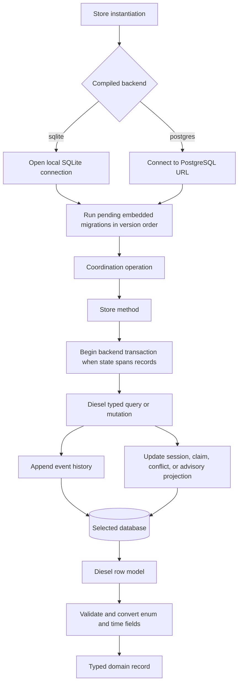

# Persistence

## What this feature does

Persistence gives Nexus a durable event history and fast, typed views of current coordination state. It stores sessions, claims, conflicts, advisories, normalized capability-use facts, explicit agent-memory streams, the papercut registry, and SOS reports and aggregates in SQLite for the local daemon or PostgreSQL for the shared service while exposing the same domain records to the rest of the application. A versioned logical snapshot moves that complete application state from an existing SQLite installation into a fresh PostgreSQL service.

## Why it exists

Coordination information must survive short-lived MCP calls and separate agent processes. An append-only history explains how the current state arose, while projections answer immediate questions without replaying every event. Diesel is used so schema-facing queries remain checked by Rust rather than being assembled as SQL strings throughout the application.

## Data flow

## Reading the flowchart

1. **Store instantiation** is the single database lifecycle entry point used by the local daemon, remote service, doctor command, tests, and direct readers.
2. **Compiled backend** selects exactly one Diesel backend. The normal `nexus` binary uses the default `sqlite` feature; `nexus-server` is built with `--no-default-features --features postgres`.
3. **Open local SQLite connection** creates the database file and its parent directory when they do not exist.
4. **Connect to PostgreSQL URL** uses the server's required `NEXUS_DATABASE_URL` or `--database-url`; database credentials do not enter `LoadedConfig` or its hash.
5. **Run pending embedded migrations in version order** creates a fresh schema or upgrades an existing database before any store method is available. `flyway-rs` records deployed versions in `flyway_migrations`, skips them on reopen, and applies each new script transactionally from the selected backend's embedded migration set.
6. **Coordination operation** supplies already validated identifiers, intents, completion states, or query scopes.
7. **Store method** is the persistence interface. Internal mutation helpers are crate-private; callers cannot depend on Diesel row layouts.
8. **Begin backend transaction** groups changes that must be observed together, such as updating a projection and appending its event. SQLite preserves its immediate/deferred distinction; PostgreSQL uses an ordinary Diesel transaction.
9. **Diesel typed query or mutation** uses generated schema columns and query combinators shared by both backends. Runtime SQL strings are not an application API.
10. **Append event history** records why a state change occurred and includes enough structured payload for inspection.
11. **Update projection** maintains the current view used by status and list commands.
12. **Selected database** provides one transactional state authority for a Nexus process.
13. **Diesel row model** mirrors storage representation, including string-backed timestamps and enums.
14. **Validate and convert** rejects unknown enum strings or malformed timestamps instead of leaking storage primitives.
15. **Typed domain record** is returned to coordination and serialized only later by a runtime adapter.

## Implementation details

`liveness.rs` owns shared typed predicates for recent sessions and live unresolved
conflicts. Counts, active lists, and dashboard records apply those predicates
before database windows, without mutating historical statuses or resolutions.
Session activity uses the configured claim TTL and any remaining live leases;
conflict liveness follows the original session pair through replacement leases.
Live-owner reads resolve the immutable original claim's session with a scalar
subquery, then probe current leases by project, path, state, and expiry. This
keeps PostgreSQL from flattening an owner/history join into repeated scans of a
session's accumulated tool-call history. The existing active-path index supports
the lookup; historical claims and lease/conflict semantics remain unchanged.
The service passes the activity window explicitly. Dashboard and list session/claim
windows share their capped readers; dashboard conflicts intentionally prioritize
recent updates while conflict history lists retain creation ordering.

Ordinary projection queries apply deterministic database windows before materialization: sessions and claims expose at most 64 rows, conflicts at most 32, dashboard events at most 32, and each dashboard projection class at most 16. Overlap lookup first selects at most 32 distinct active sessions by their most recent claim, then performs a constant number of single-row typed queries per selected session to retain its strongest relevant claim; repeated claims from one session therefore cannot consume another session's advisory slot. Project discovery exposes at most 16 project identities with four recent member sessions per summary. Usage selects at most 64 top dimensions before bounded detail and distinct-session reads. Every affected response reports truncation without changing its established array field.

`src/persistence/backend.rs` makes the selected Diesel connection and backend explicit compile-time aliases and rejects builds with both or neither feature. `store.rs` owns coordination transactions and shared Diesel queries. `usage.rs` owns idempotent capability-use upserts and typed, time-bounded usage aggregates. The `memory` persistence module owns immutable raw-note streams, disposable summary trees, activations, and provider-attempt metadata described by the agent-memory specification. The `papercuts` persistence module owns timestamped observations and their atomic audit events: `mutations.rs` handles report/upvote/remove transactions, `reviews.rs` owns proposals, responses, consolidation, and attempt history, `registry.rs` builds complete or open projections and decodes append-only resolution/reopen/consolidation events into typed lifecycle history, and `records.rs` confines private Diesel rows and storage conversion. Ordinary open projection loads current papercut rows plus database-side `COUNT` and `MAX(created_at)` metrics scoped by an open-papercut join, so historical upvote payloads are materialized only by the explicitly complete dump projection. `migrations.rs` adapts the public `flyway-rs` state and executor traits to the selected connection model. `models.rs` owns the original coordination row and insert models; feature-scoped persistence modules own their private Diesel rows. `schema.rs` contains Diesel's generated table declarations, including the migration history table. SQL appears only under `migrations/` and `postgres_migrations/`, where it defines equivalent backend-specific schema objects.

`Store::open` is the filesystem entry point for the SQLite build; `Store::connect` accepts the PostgreSQL service URL. Both run their compile-time embedded `flyway-rs` migration store before opening the application connection. A PostgreSQL service also opens one dedicated readiness connection after migrations. Readiness always executes its minimal typed query on that independent connection, so a slow or canceled health probe never owns the sole application store. A tracked guard records when the application store was acquired: a continuous hold of 30 seconds or a poisoned application-store mutex fails readiness so the container healthcheck can recover a stalled process, while shorter legitimate work remains healthy through the independent probe. Thus ordinary contention does not cause a false restart, a stuck probe cannot stall application traffic, and a permanently unusable application path cannot report ready forever. The production healthcheck also bounds the pre-ready phase: twelve consecutive failed probes send `SIGKILL` to PID 1, allowing Compose to recover even before the server installs its handled `SIGTERM` path. Migration and application SQLite connections use the same bounded two-second busy timeout, so a short commit from the daemon does not make an independent reader fail immediately. Migration files are immutable, monotonically versioned `V<version>_<description>.sql` scripts. Existing scripts are never rewritten or deleted after release; schema changes add a later file to both backend directories. Migration zero bootstraps Flyway's own typed history table. The driver applies each changelog and inserts its deployed-history row in the same transaction, so a failed script leaves neither partial schema nor an `in_progress` row that can block a later restart; the runner stops on the first failure. SQLite migration tests cover fresh installation, failure-and-retry atomicity, and historical upgrades; feature-gated PostgreSQL tests run the corresponding schema before exercising coordination, memory, papercuts, and all readiness paths.

The remote deployment has one authoritative `nexus-server` process per PostgreSQL database. The current store serializes access through one synchronous connection, and memory consolidation plus papercut review scheduling are in process; running several replicas over one database is therefore outside the supported lifecycle model. PostgreSQL exists to share one Nexus instance across compute environments, not yet to provide horizontally scaled service replicas.

### SQLite to PostgreSQL transfer

`Store::write_streamed_snapshot` reads every durable application table inside one database transaction and emits a deterministic, versioned representation. It deliberately excludes `flyway_migrations` because each backend owns its schema history, and excludes `database_imports` because that is target-side provenance rather than user state. Table rows are ordered by stable keys before encoding. Import preserves identifiers, RFC 3339 timestamps, foreign-key relationships, projection state, immutable raw memory, papercut consolidation and vote provenance, and normalized SOS reports and their aggregate issue links.

The SQLite-only `nexus-sqlite-export` helper first uses SQLite's online-backup API with a read-only source connection. Compose runs that backup in a network-isolated one-shot container and stores it in a private named volume, so the main unprivileged container never needs permission to read an owner-only host database. Pending migrations run against a second private backup, never against the original database or its staged copy. Before any application rows are exported, that backup's complete migration history must match this binary's embedded SQLite versions, names, checksums, and deployed statuses. Older supported databases become current on the private backup; a missing, divergent, unknown, or newer migration is rejected so a future table cannot be silently omitted by an older exporter.

The CLI transfer uses a version-five newline-delimited JSON record stream. A header fixes the format,
typed table batches follow in foreign-key dependency order, and a mandatory footer confirms the
application row count. Each ordinary batch holds at most sixteen rows; PostgreSQL export uses its
row-by-row cursor rather than loading a table. Papercut canonical targets precede their consolidated
sources, with only dependency identifiers retained between batches. Every table appears even when
empty. A malformed record, missing table or footer, unexpected order, or count mismatch aborts the
transaction.

The source SQLite file, consistent backup, and completed record stream each have a 4 GiB ceiling.
Individual encoded records are limited to 8 MiB. The server launches the sibling exporter with a
scrubbed environment into a mode-0600 temporary file, hashes the same open file before import, then
checks its digest again while streaming typed Diesel inserts. A changed file cannot commit partial
rows. Both import and export retain bounded batches rather than complete application history in
memory. Historical schema normalizations still apply on the private copy: preserve an immutable
pre-migration backup if original oversized event payloads must remain retrievable.

`nexus-server --mode import --import-sqlite PATH` performs the transfer and exits before starting
HTTP listeners or model schedulers. `--mode export` writes a deterministic PostgreSQL record stream
and exits, allowing an independent byte comparison against the SQLite stream before serving begins.
Default `--mode serve` retains the ordinary service lifecycle. Import mode requires an explicit
source path, so it cannot silently start an empty service when the migration source is missing.

`database_imports` makes startup idempotent without turning import into a merge operation. The first import is allowed only when every application table is empty; all rows and the content digest are committed in one transaction. A later start with the same digest is a no-op. A different digest or a nonempty unmarked database is rejected with no writes. PostgreSQL receives explicit historical event IDs, then the migration-defined typed `nexus_sync_event_identity` function advances its identity generator so the next live event cannot collide. Import logs state whether data was imported, already present, or intentionally skipped.

All application transactions share commit-failure cleanup, while keeping their deferred or immediate start mode. SQLite can reject a commit because another connection is reading the database and leave the failed transaction open. The persistence boundary explicitly rolls back a failed commit before returning the error. This prevents a later request from running inside uncommitted changes or failing because a previous transaction is still active. Cleanup failures retain the original error and report the rollback failure as additional context.

Explicit memory writes use a bounded two-second exponential retry window starting when SQLite reports a busy or locked database, after the connection-level wait has elapsed. A reader-blocked commit is rolled back before retrying the complete write, including its ordinal, frontier snapshot, and compaction queue changes. A failed lifecycle write is also rolled back, so it cannot poison subsequent memory requests or become durable through an unrelated successful write. Tests force both failure paths using a separate SQLite reader and verify committed state through that independent connection.

The event and advisory tables preserve individual observations. Event payloads have a durable 64 KiB ceiling enforced by application encoding and backend-specific migration constraints; an oversized payload is represented by its byte count and BLAKE3 digest. This ceiling accommodates every valid typed papercut lifecycle event. Ordinary event and dashboard reads return at most 64 recent rows and project payloads above 4 KiB to the same bounded metadata shape, while the explicitly complete papercut registry reads its typed lifecycle rows directly. Migration V7 safely replaces only historical payloads above the durable ceiling and bounds stored event session identifiers to 512 bytes.

Sessions, claims, and conflicts are bounded current projections at both the decoder and database boundaries. Migration V8 keeps the longest valid UTF-8 prefix for oversized human-readable history, gives oversized legacy identities a shared bounded replacement so session-to-claim and claim-to-conflict associations survive, and then installs SQLite insert/update triggers or PostgreSQL check constraints. Replacement allocation probes every existing identity or project path and retries with a bounded suffix, so a valid legacy value that happens to use the migration namespace cannot collide with a remapped row. One global mapping per oversized session string is propagated through coordination, usage, memory, and papercut provenance; event history is the exception because V7 already replaced oversized event session IDs with its documented sentinel before V8 can observe them. Session identifiers are limited to 512 bytes, agents to 256 bytes, worktrees to 4 KiB, and task summaries to 1 KiB. Claim IDs, session IDs, and tool-use IDs are limited to 512 bytes and paths to 4 KiB. Conflict claim references are limited to 512 bytes, paths to 4 KiB, and generated messages to 8 KiB. Sessions use `(project_id, session_id)` as their durable identity because host-generated session IDs are not globally unique; every completion, stop, and release mutation carries both values. A conflict has a stable identity derived from its project, path, and unordered session pair, so detecting the same overlap again updates one conflict instead of creating competing open records. Projection severity only escalates; equal or weaker observations preserve both its strongest evidence and an explicit resolution. A stronger observation reopens a resolved projection and records that transition. Claim expiration is evaluated in queries, and reconciliation only refreshes claims for recently seen sessions. Repeated observation of the same still-active Git change refreshes its projection without duplicating event history. States are converted into `ClaimState`, `SessionStatus`, and `ConflictStatus` before leaving persistence.

Capability uses form a separate normalized projection rather than being reconstructed from event payload JSON. Tool and script invocations are idempotent by project, agent, session, kind, and invocation ID. Skills additionally deduplicate by project, agent, session, turn, and name when a turn ID is available, allowing stronger evidence to promote one observation without increasing its count. The projection stores typed identity, evidence, outcome, and timestamps but has no field for arguments, environment values, output, or error text. Usage queries aggregate a caller-supplied half-open time window and optionally constrain it to one project.

Important transactional groupings include session observation plus its event, claim insertion plus its event, conflict plus advisory creation, successful completion plus claim state change, and session stop plus claim release. Default-backend tests open both in-memory and filesystem-backed SQLite databases and inspect typed projections after real hook traffic. The feature-gated PostgreSQL integration test proves that separate client roots sharing one configured project ID preserve coordination, memory, and papercut semantics through the service store.

Papercut reports atomically create or resolve a canonical record, append one timestamped upvote, refresh the issue's activity time, and append an event. A newly created issue receives a random response token; only its BLAKE3 hash is stored, and duplicate approval compares that hash so authorization survives a caller-process restart without disclosing the token in registry dumps. Resolution is a soft state transition; a later report or upvote reopens the issue. Consolidation retains the source record as a tombstone, redirects its descendants, and moves only the canonical association of its upvotes while retaining each observation's original reported issue. Complete registry reads are deterministic and deliberately unbounded, including typed resolution, reopening, and consolidation history with actor provenance as well as proposals and automated-review outcomes.

Activity analytics V11 stores exact calls, identified operations, supplied/observed resources, session exposure evidence, categories, and classification revisions separately. All reads and writes use the typed Diesel DSL. Portable stream version 3 exports these six projections; the importer continues to accept complete version-2 streams and records the source format version. No raw analytics input or classifier prompt is durable.

Primary-key reads of immutable work observations and evaluation blobs share one
typed lookup operation: callers supply the Diesel table and its complete key,
and a missing row remains `None`. Domain publication and blob-validation rules
remain in their respective feature modules.

Work history V13 adds immutable project-scoped observations and rebuildable
subject/link indexes for nested work-session activity. Portable format 5 includes
the authoritative observation rows; import validates their original identities,
hashes, typed input and receipt provenance, then rebuilds the indexes. Versions
2, 3, and 4 remain supported. Out-of-order observations and unresolved links are
preserved; no foreign key requires another producer's event to arrive first.
Optional source-clock evidence remains inside the typed immutable observation
payload, preserving existing schema and portable stream compatibility. The
shared timing projection qualifies reported elapsed time, matching OS monotonic
clock evidence, and same-producer wall time in that order. Queue durations use
the same policy. Accounting projections retain explicit missing or conflicting
evidence; they never repair the authoritative observations by inference.
Session display names are read from exact project/agent/host-session work-title
evidence without changing coordination session identity.

Evaluation history V12 adds project-scoped immutable typed records, indexed
relationships, repository/model filter dimensions, content upload metadata, and
binary chunks. Git and LFS coordinates normally retain external committed content
without duplicating repositories. Only explicitly uploaded content occupies blob
storage. Publication validates all project-local record kinds and references
before one transaction inserts a complete bundle; an identical replay preserves
original attribution, and a conflicting identity rolls back the entire bundle.
Raw typed bodies remain independent from search/filter projections.

Portable stream format 4 adds all five eval tables in dependency order. It uses
base64 for binary chunks and splits batches by encoded bytes as well as row
count. Extensible table tracking supports the expanded catalog without a fixed
integer bitmask. Imports still accept complete formats 2 and 3; the target records
the actual source version. Before committing, import revalidates eval payload
hashes, project-local relationships, blob sizes/chunks, and every verified content
digest. Reference-preserving snapshots retain Git coordinates; they do not claim
to include the repositories or LFS servers on which those references depend.

Coordination reconciliation groups each service-selected batch of at most 32 paths
into one transaction, including the active-session check, lease refreshes, new
claims and events. It does not commit once per renewed path. Ordinary claim
insertion and reconciliation share the same typed transaction-local insertion
primitive; ordinary insertion still owns its own transaction. A rejected batch
leaves neither partial claims nor partial event history.
