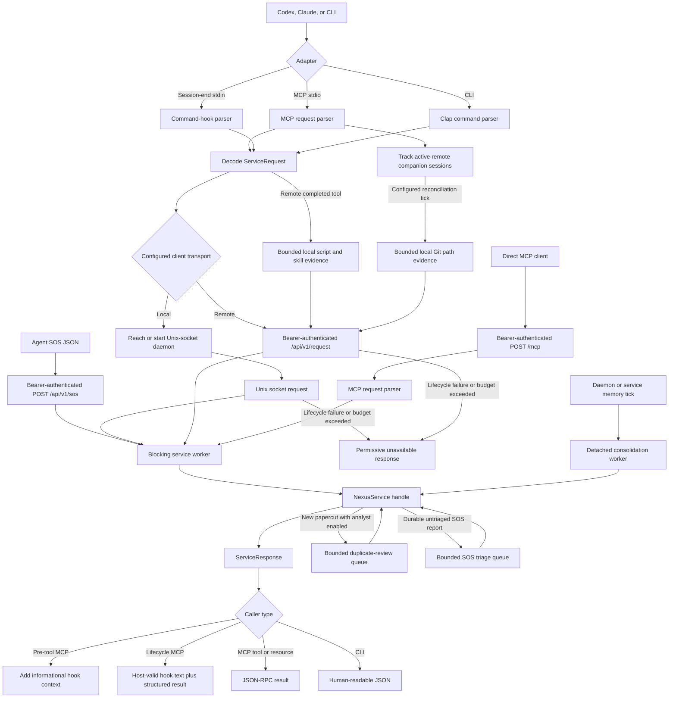

# Runtime and host integration

## What this feature does

Runtime connects agent hosts and people to the coordination core. It provides the command-line interface, a configurable local-or-remote companion client, a local Unix-socket daemon, an authenticated HTTP service, MCP stdio and Streamable HTTP servers, the bundled `nexus tui` terminal dashboard, MCP resources, generated hook configuration for Codex and Claude, the agent-memory background scheduler, asynchronous papercut review and SOS triage dispatch, and the `nexus exec -- PROGRAM [ARG ...]` analytics fallback.

## Why it exists

Agent hosts speak different lifecycle protocols and may run on another machine from the shared Nexus state. The coordination core should not know those wire formats, transports, credentials, or process lifecycles. Runtime absorbs protocol JSON, local daemon startup, authenticated remote requests, and host-specific hook shapes while presenting one typed request plus an explicit project binding to coordination.

## Data flow

## Reading the flowchart

1. **Codex, Claude, or CLI** is the external caller. Host hook files invoke MCP tools during a session and a command hook at session end; people invoke commands directly.
2. **Adapter** selects the protocol-specific edge without changing coordination semantics.
3. **MCP request parser** handles JSON-RPC initialization, tools, resources, calls, and reads. Each request is answered on its own task and responses are written in completion order, because hosts multiplex hooks from many threads and parallel tool calls over one connection; a slow explicit tool must not queue lifecycle hooks behind it.
4. **Command-hook parser** converts session-end stdin into a typed stop request and emits no hook output.
5. **Clap command parser** converts explicit CLI flags into typed command and scope values.
6. **Decode ServiceRequest** is the point where loose wire values stop. Unknown methods and invalid shapes do not enter the core.
7. **Configured client transport** is selected once from typed configuration. Local preserves the existing machine-local behavior; remote never falls back to a second local state store.
8. **Reach or start Unix-socket daemon** uses bounded retries and the configured executable for lifecycle adapters. Explicit local requests may connect without starting it.
9. **Unix socket request** sends a small method-and-params envelope locally.
10. **Bearer-authenticated `/api/v1/request`** sends the same method and params plus the configured project ID. `NEXUS_SECRET` or `client.secret_file` supplies the credential without placing it in serialized configuration. Both configuration and server ingress reject empty, oversized, or control-bearing project IDs before they can reach a database driver.
11. **Track active remote companion sessions** remembers only lifecycle sessions with a client project root and removes them at session stop. It exists in the companion process, not in the shared service's filesystem namespace.
12. **Bounded local script and skill evidence** derives repository script paths and successful `SKILL.md` reads on the client after a completed tool call, where the referenced checkout is actually readable.
13. **Bounded local Git path evidence** runs periodically at `coordination.reconcile_seconds`. The daemon selects at most 64 recent active sessions, groups them by project and checkout so Git status is read once per group, and applies one repository-relative snapshot to every selected session in that group. The remote companion similarly reads each client checkout once per tick before submitting evidence for its sessions.
14. **Direct MCP client** may bypass the companion process when it supports MCP Streamable HTTP. It does not receive the companion's client-filesystem observation automatically.
15. **Bearer-authenticated `POST /mcp`** requires a project header and MCP content negotiation, then uses the same tool catalog, resource catalog, context enrichment, and service invoker as stdio.
16. **Bearer-authenticated `POST /api/v1/sos`** accepts the seven-field SOS JSON object directly, binds its project from `X-Nexus-Project-ID`, and uses the same bounded authentication, body, execution, persistence, and asynchronous-triage path as MCP and CLI.
17. **Blocking service worker** isolates synchronous database and model-process work from the asynchronous socket or HTTP runtime, so one slow explicit command cannot starve unrelated lifecycle connections.
18. **NexusService handle** performs the feature work described in the coordination specification.
19. **ServiceResponse** is serialized only after the core has completed.
20. **Add informational hook context** transforms advisories into model-visible context without emitting deny, approval, or input-rewrite fields.
21. **Host-valid hook text plus structured result** keeps internal coordination fields in MCP `structuredContent` while returning only the JSON fields accepted by the lifecycle event. A no-op lifecycle result is `{}`.
22. **JSON-RPC result** serves explicit tools and read-only resources.
23. **Human-readable JSON** keeps CLI status and query commands inspectable and scriptable.
24. **Permissive unavailable response** preserves agent autonomy when Nexus cannot be reached, its store is busy with background observation, or the selected transport does not answer within the lifecycle response budget. The same short budget applies to local startup and remote HTTP, and remains shorter than every generated host-hook timeout.
25. **Daemon or service memory tick** selects bounded consolidation work according to memory configuration. A service-level lease makes periodic, CLI, and terminal-UI requests share one consolidation operation; overlapping requests return a typed in-progress no-op.
26. **Detached consolidation worker** performs provider calls away from the socket or HTTP accept loop and lifecycle request path.
27. **Bounded issue-work queues** receive papercut duplicate review or SOS triage only after the corresponding report is durable. Provider work stays outside request response and lifecycle paths; saturation or process termination leaves the source visible and untriaged rather than rolling it back.

## Implementation details

Work history uses one closed `WorkAction` contract through `nexus work` and the
`nexus_work` MCP tool. Explicit history actions share a typed bound caller envelope
with eval commands. Runtime supplies project and submitter provenance, while
observation payloads retain attributed initiators, executors, producers, and source
times. `list`, `get`, `timeline`, and `events` are bounded reads; recording never
launches the caller's workload. CLI convenience operations construct the same
typed observations, and work-only JSONL transfer verifies the complete checksum
and observation/source shape before replaying resumable batches. Rejected work
records expose `invalid_input` or `conflict` codes; service/storage unavailability
remains retryable by automatic capture. See [work history](work-history.md).

Evaluation history is an explicit recording/query feature through `nexus eval`
and the closed `nexus_evals` MCP tool. Its input schema is generated from the
same typed `EvalAction` and domain records used for decoding. MCP supplies a
separate bound context; repository/model query fields cannot spoof the recording
actor. Ordinary reads are bounded, and artifact bytes cross existing transport
limits in base64 chunks. Blob verification releases the store guard between
chunk reads. Runtime does not launch evaluations or graders. Reference-bundle
export/import streams caller-owned history with declared external Git dependencies,
checksums, source attribution, and idempotent incremental ingestion. See the
[eval specification](evals.md).

`src/runtime/client.rs` is the single companion transport selector used by CLI commands, generated hooks, stdio MCP, and analytics capture. Local requests retain Unix-socket behavior and lifecycle auto-start; remote requests post the same `WireRequest` to `/api/v1/request`, authenticate with a bearer secret, and include the configured project ID outside the feature payload. That envelope project supplies omitted read scopes, while an explicit project query remains available within the service-wide trust domain after the same 256-byte, control-free canonical validation; MCP schemas advertise that limit. Completed remote tool requests may also carry client-derived script/skill evidence; a private `client_reconcile` envelope carries periodic Git evidence. Remote connections have a three-second connect deadline, ordinary requests have a fifteen-second end-to-end deadline, and explicit analysis receives the configured analyst deadline plus a five-second transport margin. Every ordinary companion response is capped at 1 MiB, both by an immediate declared-length check and by bounded chunk collection. Explicit papercut and SOS `dump` actions are the only typed exceptions because their contracts are complete, untruncated registries; no lifecycle hook, routine read, reconciliation request, or other command can select unbounded response collection. Lifecycle hooks retain their stricter 2.5-second outer budget, fail open on timeout, and never fall back to local storage. `src/runtime/protocol.rs` owns that shared envelope.

`nexus doctor` follows the selected transport and verifies remote status when configured. `nexus daemon` refuses to start under remote configuration so an operator cannot accidentally create a second local state authority beside the shared service.

`src/runtime/mcp.rs` is the transport-neutral MCP entry point and tool catalog. Alongside coordination hooks it exposes typed skill observations, seven-day usage queries, the single action-tagged `nexus_papercuts` tool, the complete `nexus://papercuts` project resource, and only the caller-facing memory operations: add, search, and expand. The papercut input schema uses one closed branch per action so discovery communicates each action's required fields, and every schema backed by a request type that denies unknown fields is closed in the same way. Unknown tools and malformed non-lifecycle tool arguments return JSON-RPC invalid-params errors; malformed lifecycle hooks retain their permissive result because host hooks must fail open. Stdio JSON frames are capped at 1 MiB plus one detection byte; an oversized frame is discarded through its newline using constant additional memory and a two-second recovery deadline, so later hooks keep their MCP connection. The discarded request has no response because its correlation ID cannot safely be decoded from a truncated document; that one caller may time out. A peer that does not finish the oversized frame within the recovery deadline still loses its connection. The CLI exits on an MCP transport error without waiting for Tokio's uncancelable blocking stdin read during runtime shutdown. Process-level framing regressions in `tests/mcp_frame_recovery.rs` cover both later-hook continuity and termination while stdin remains open. Neither payload contents nor credentials appear in the diagnostic. Both terminal hosts retain one local stdio MCP process for typed project and dashboard reads; that companion follows the selected client transport. In remote mode it tracks active lifecycle sessions with a local project root and, on each configured reconciliation tick, collects Git changes once per root before making bounded best-effort submissions for each session. Expired entries are pruned both when new activity arrives and on each tick, and the companion retains at most 1,024 recent sessions, so a long tick interval cannot make client memory grow without bound. Each Git identity or status command has a five-second deadline and a 4 MiB cap on each output stream; a timed-out or overflowing child process group is killed and reaped, and observation fails open with fallback identity or no changed paths. Each evidence page contains at most 2,048 paths and 256 KiB of path text; a per-root cursor rotates through later pages when the snapshot is truncated. The tick begins after one full interval, skips missed ticks, applies the lifecycle timeout to each submission, and stops with the MCP child. Session stop removes the session from later observations, and an otherwise idle session ages out after the configured claim TTL.

SOS uses the same transport-neutral catalog through one closed, action-tagged `nexus_sos` tool and the complete `nexus://sos` current-project resource. The tool reports the seven-field source object, lists aggregate summaries, reads bounded issue detail, dumps complete history, and performs explicit resolution or deprecation.

The MCP process supplies its bound session identity, agent, and working directory so memory writes and papercut actions do not accept hidden caller-identity fields. Runtime replaces attempted per-call provenance with that established context; papercut duplicate responses instead use the opaque per-report token because process identity is neither durable nor exclusive. On the first user prompt in a session, the lifecycle path asks Nexus for bounded memory context and returns it through `additionalContext`, clearly delimited as untrusted historical data. That activation is bounded and fail open; it never invokes a provider.

SOS applies the same bound session, agent, and working-directory context without allowing tool arguments to spoof provenance. Its required report `model` remains the single wire value used for both source evidence and reporter-model provenance.

`src/runtime/server.rs` exposes unauthenticated liveness and readiness checks plus authenticated `/api/v1/request` and `/mcp` routes. Its HTTP/1.1 listener owns a 128-connection admission gate before `accept`, requires a complete header within five seconds, caps headers at 32 KiB, and disables connection reuse after each response; slow-header and idle unauthenticated peers therefore cannot bypass bounded request admission by accumulating sockets. Authentication and Origin policy are checked before body collection, missing and incorrect secrets have the same `401` response, and secret comparison is constant-time over BLAKE3 hashes. Protected bodies are capped at 1 MiB and five seconds behind a 64-request admission semaphore with a one-second capacity wait. A separate 64-slot execution gate covers synchronous service work started by both HTTP interfaces and reconciliation; each blocking worker owns its permit until it actually exits, so a timed-out or disconnected caller cannot accumulate detached work beyond that bound. Readiness database checks have an independent single-flight gate and a two-second response deadline; the blocking worker likewise owns the gate until its query actually returns, so a timeout or disconnected caller cannot fan out more stuck probes. Both MCP transports accept only string or integer JSON-RPC request IDs; null, fractional, Boolean, array, and object IDs are rejected rather than echoed. The direct MCP POST route requires JSON content, `Authorization`, `X-Nexus-Project-ID`, and an `Accept` header containing both `application/json` and `text/event-stream`. Initialization must be a request without a supplied session ID and must include a non-empty requested protocol version, an object-valued client capabilities declaration, and client implementation information with non-empty name and version; the response negotiates to Nexus's supported `2025-06-18` version and creates a session bound to the canonical project ID and initial optional root/agent context. Clients must send `notifications/initialized` before any other operation. Subsequent POSTs require both `MCP-Protocol-Version: 2025-06-18` and `Mcp-Session-Id`, and cannot change bound context. Requests receive JSON and notifications receive `202`. Authenticated GET and DELETE also reject a missing or unsupported protocol version with `400`; DELETE requires a session ID and removes it, while GET remains intentionally unsupported with `405` and an `Allow` header. Sessions expire after 24 idle hours and the registry is bounded to 4,096 entries. A request with an `Origin` header is accepted only when the origin exactly matches a repeated `--allow-origin` value.

`POST /api/v1/sos` is protected by the same bearer, origin, admission, size, and timeout boundary. It accepts only the documented seven-field JSON object, takes its canonical project identity from `X-Nexus-Project-ID`, and accepts an optional bounded `X-Nexus-Agent` provenance value (default `sos-http`) before dispatching the same typed report command used by MCP and CLI. A durable report returns `202 Accepted`; project identity and credentials never come from metadata.

`nexus-server` requires a PostgreSQL URL through `NEXUS_DATABASE_URL` or `--database-url`. Before serving, `--import-sqlite PATH` or `NEXUS_IMPORT_SQLITE` can require a one-time SQLite transfer; Compose uses `NEXUS_IMPORT_SQLITE_IF_PRESENT` for its optional read-only mount and logs a clear skip when no regular source is present. The installed image owns both backend halves by carrying a SQLite-only snapshot helper beside the PostgreSQL-only server. The offline `--mode import --import-sqlite PATH` command transfers and exits before listeners or schedulers start; `--mode export` emits a deterministic PostgreSQL stream for pre-serving verification. In the default serve mode, import must finish before the listener becomes ready, and the startup helper lengthens the pre-ready watchdog while an automatically discovered database is being transferred. It accepts a secret through `NEXUS_SECRET`, `--secret`, or a persistent `NEXUS_SECRET_FILE`/`--secret-file`; absent credentials cause it to generate a 64-character secret and publish a configured file atomically with mode `0600`. The server and companion trim source-boundary whitespace for newline-terminated files, then use one validator requiring 32–4,096 visible ASCII bytes with no embedded whitespace or controls; only canonical bytes are persisted. Both processes open secret files without following symlinks and accept them only when the opened object is a regular file owned by that process's effective UID with permissions no broader than `0600`; unsafe metadata is rejected rather than repaired. The token is never written to logs and must be retrieved from that file through an appropriately protected local or container operation. A persisted file makes later starts reuse the credential. A configured secret that disagrees with an existing file is rejected. The supplied image runs as UID `10001`, and Compose removes all Linux capabilities and enables `no-new-privileges`; its build context excludes local environment and secret files. The server runs the same memory scheduler as the daemon. Deploy exactly one server process per database because the service's scheduler and synchronous Diesel connection are process-owned. On each start the server clears its readiness marker, then owns and writes that marker only after database initialization, migrations, optional import, and listener binding succeed. PostgreSQL readiness always uses a dedicated connection, so a slow or canceled health query cannot seize the application store and stall agent traffic. The store guard records its monotonic acquisition time; once one operation has held it for 30 seconds, or if a panic has poisoned the store mutex, readiness fails instead of masking the unusable application path with a healthy dedicated probe. SQLite-backed local and test services retain the existing non-blocking `ready` or `busy` check on their one store. Before the marker exists, twelve consecutive failed health checks send `SIGKILL` to PID 1 because a container init process can ignore default-action `SIGTERM` before Nexus installs its handler; this lets the Compose restart policy recover from a connect or migration that never returns. Once the marker exists, a separate counter sends handled `SIGTERM` after three consecutive genuine readiness failures so Compose creates a fresh process and database connection. Both counters clear on success and at the phase transition.

Build-context exclusions apply recursively to SQLite `.db`, `.sqlite`, and `.sqlite3` files and to rollback-journal, WAL, and shared-memory sidecars, so `COPY . .` cannot ingest a nested local store or its transient contents.

Model-backed operations execute where `NexusService` runs. The base Docker image deliberately does not bundle or authenticate Codex or Claude. More importantly, `nexus-server` disables in-process providers by default because a same-UID subprocess can read the server's secret file or process state despite environment and working-directory scrubbing. `--allow-local-providers` is an explicit escape hatch only for a configured command that enters an externally enforced OS isolation boundary; the flag itself provides no isolation. Provider absence or denial does not disable deterministic coordination or the raw memory and papercut operations. Local-daemon provider behavior is unchanged.

SOS ingestion and inspection likewise remain available without a provider; accepted source reports stay visible as untriaged until model execution is available.

`src/coordination/client_evidence.rs` is the authenticated-client-evidence boundary. The companion may send at most 2,048 changed paths, 256 KiB of aggregate path text, and 64 derived scripts; paths must be bounded, repository-relative, and free of parent traversal, and reconciliation paths are file-wide. Session identities are capped at 512 bytes, agents at 256 bytes, and both reject control characters before standalone evidence can establish a projection. Derived names are likewise bounded and control-free. The official companion filters invalid optional inferred entries and omits an invalid evidence envelope instead of sacrificing the primary completed-tool event; the server still rejects malformed caller-supplied evidence strictly. Supplemental evidence contains path operations and normalized script/skill identities, never file bytes, diffs, environment values, command output, or credentials. Completed-tool evidence must match the lifecycle request's session and agent. Standalone reconciliation may establish its reported session because cross-environment sessions can exist only on the client. These checks constrain input shape and attribution but cannot prove that the remote filesystem observation is true: possession of the service bearer secret defines the endpoint's trust domain, `project_id` is not an authorization boundary, and every resulting claim remains advisory.

Optional companion filesystem capture is single-flight for both usage evidence and secret-file reads. A blocking worker keeps its capture permit until the underlying filesystem operation actually returns; the 250 ms evidence deadline therefore omits late evidence without allowing canceled requests to accumulate detached filesystem work.

Git porcelain output remains a bounded byte snapshot while the companion counts and selects the rotating evidence page. It does not materialize every repository record as an owned path before applying the 2,048-path and 256-KiB page limits.

`hooks.rs` decodes at most 1 MiB plus one detection byte from the host's session-end stdin and releases the session without writing hook output. Oversized or malformed hook input remains fail open and produces no hook output. `dispatch.rs` is the shared async-to-sync boundary; it sends typed requests through Tokio's blocking pool because coordination deliberately uses synchronous Diesel connections. Lifecycle operations wait up to 100 ms for the single store mutex before returning a permissive response, which absorbs short concurrent reads without letting store contention exceed the outer lifecycle budget. Memory consolidation claims its service lease before spawning, so repeated requests cannot enqueue blocking tasks behind one active run. A newly created papercut with review requested hands runtime a private typed job containing the already-resolved project id and reviewer working directory alongside the independently serialized public response. One worker executes reviews serially and deduplicates pending project/issue keys, keeping provider latency and bursts out of the report response. Queued, in-flight, and directly recovered work share one 32-item pending ceiling, so durable SOS recovery cannot bypass the live queue's bound. The worker retains only shared pending-key state rather than an internal sender, so it exits and releases the service when every scheduler handle is dropped. Candidate retrieval is limited to the 64 most recently active open issues. Review results and failures therefore persist against the original project without re-identifying a worktree that may have moved or disappeared; saturation leaves the report durable without spawning more work. If the combined provider-and-persistence workflow returns an error, runtime records a generic workflow failure when it still can rather than incorrectly assigning every race to the provider. `daemon.rs` owns local socket lifecycle, one-daemon locking, background Git reconciliation ticks, and the local scheduler. A reconciliation tick schedules its blocking worker without awaiting it in the socket accept loop; a one-slot lease skips later ticks until that worker actually exits, preventing both listener stalls and detached-worker accumulation. `script_exec.rs` runs an explicitly wrapped child with inherited stdio, reports a privacy-safe script identity after completion, and returns the child's exit status even if capture fails. `src/main.rs` owns command parsing and maps CLI memory and papercut commands to typed requests.

The same bounded issue-work scheduler dispatches SOS triage only after the raw report is durable. `src/main.rs` maps SOS list, get, complete dump, report, resolve, and deprecate commands to typed requests; `--metadata-json` crosses the named object boundary before transport.

The local Unix listener accepts at most 64 live connection tasks, closes newly accepted sockets when that capacity is occupied, and keeps each semaphore permit until its task has actually exited. Each request frame uses the shared 1 MiB-plus-sentinel JSON line reader and a five-second total read deadline, so a silent or slow local peer cannot retain a task or grow daemon memory without bound.

Daemon startup acquires its process lock, removes any stale socket, and completes database migrations and service initialization before binding the Unix listener. A published socket therefore means initialization succeeded; failed initialization leaves no misleading socket behind. Process fixtures can wait for socket publication without racing migrations against the first hook's 2.5-second response budget. A deterministic startup regression uses an invalid database path to verify that failed initialization never publishes the socket.

`src/agents/integration.rs` generates registration commands and host hook fragments. Host-specific differences remain data and small enum dispatches: Claude exposes a distinct tool-failure event. Both hosts use MCP tool hooks while their MCP client exists and an absolute-path command hook for `SessionEnd`, which cannot use MCP. Neither receives a blocking decision from Nexus. Generated successful-completion hooks send identity and tool input but omit tool results: image/base64 blocks and arbitrarily large text are unnecessary for completion, claims, timing, or usage accounting, and forwarding them can exceed the bounded MCP frame before a permissive response is possible. Explicit adapters may still supply the optional bounded `tool_output` field when their diagnostic contract requires it.

`terminal.rs` opens the embedded terminal dashboard and delegates runtime preparation to `terminal_runtime.rs`. It requires interactive stdin/stdout, forwards the invoking repository and explicit configuration, and executes the selected runtime with the exact installed Nexus path for its MCP child. The standalone host uses the same MCP transport as Pi, restores the terminal, and closes its polling and MCP lifecycle on quit or interruption. Closing the shared client rejects pending calls, ends stdin, and terminates its dedicated MCP child with a bounded SIGTERM-to-SIGKILL grace period so a stalled daemon response cannot keep either host alive.

The runtime boundary intentionally handles `serde_json::Value`, because JSON-RPC and MCP are open wire protocols. That dynamic data is annotated as a boundary and decoded into typed requests before service execution. The built-in listener is plain HTTP with a private pre-shared bearer secret, not a public identity service or encryption layer. Same-host Compose binds to loopback by default. Cross-host deployments must select only a protected private bind address or terminate TLS and access control at a trusted reverse proxy; clients should use HTTPS whenever traffic leaves the host. Source and image builds require Rust 1.88 or newer. Process-level tests launch the real daemon and MCP binaries, verify auto-start and fail-open behavior, prove first-prompt memory activation is once per session, and inspect the resulting database state. Remote tests also prove bearer enforcement, project binding outside the feature payload, bounded reconciliation and derived usage evidence, strict Streamable HTTP initialization/session teardown, atomic private secret persistence, and rejection of symlinked, non-regular, over-permissive, or differently owned server secret files.

The `nexus_papercuts` MCP list schema accepts an optional bounded `project_id`, allowing the shared terminal dashboard to read its selected project over either transport. Mutating papercut actions remain bound to invocation context.

The stdio/local companion performs bounded, fail-open activity enrichment in memory and reports labels through `nexus_analytics`. Its classifier has no operational tools or service secrets and runs outside the shared service. The shared service validates subject fingerprints and daily reservations; it never opens client paths or invokes providers. Queues expire on exit or after two minutes; observed work has priority over tool-catalog enrichment.
