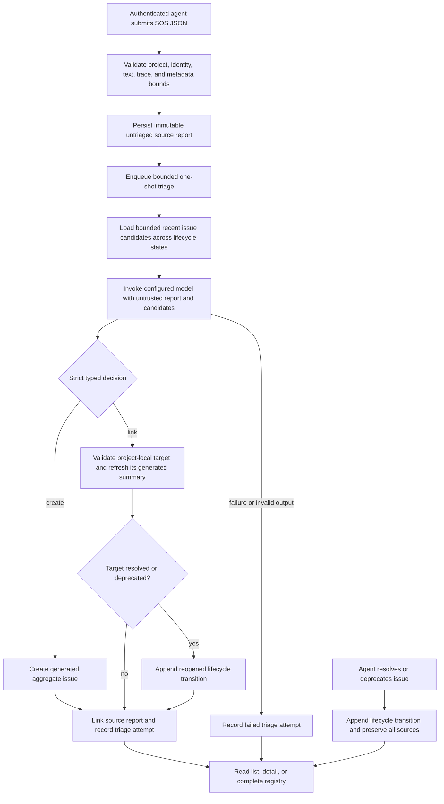

# SOS issue intelligence

## What this feature does

SOS is a durable, project-scoped inbox for agents inside a running application
that encounter unfamiliar input or a situation outside their expected operating
scope. An email-handling agent receiving an input it cannot handle within its
responsibilities can report that situation here. An authenticated agent submits
a structured source report containing `message`, `type`, `environment`,
`version`, `model`, `trace`, and an arbitrary JSON metadata object. Nexus retains
that source report unchanged apart from boundary normalization, then asks a
configured model to triage it against the project's bounded recent aggregate
issues, including closed aggregates that may have recurred.

Development/environment friction belongs in [Papercuts](papercuts.md);
evidenced defects or recurring design concerns in maintained code belong in
[Code concerns](code-concerns.md). An application SOS can motivate a linked code
investigation without changing either record's lifecycle or meaning. This
routing clarification does not alter the SOS ingestion schema or triage policy.

Triage either creates a generated issue or links the report to an existing issue and refreshes that issue's generated title and summary. Aggregate importance is the number of linked source reports, not a mutable counter. First and last arrival timestamps are likewise derived from source reports. Resolving or deprecating an issue never deletes it; a later linked report reopens it automatically.

## Why it exists

Individual agents often see only one symptom of a broader problem. Raw SOS reports preserve the exact evidence, while generated aggregate issues make repeated symptoms visible without asking every agent to search and manually upvote. Keeping those layers separate makes triage auditable: Nexus can always show which reports support an issue, which model decision linked them, and when the problem most recently recurred.

## Data flow

## Reading the flowchart

1. The existing remote bearer secret protects the HTTP and MCP transport. SOS does not introduce a second credential or accept one inside report JSON.
2. The transport binds the project and reporter context. Open-ended metadata is confined to the named `SosMetadata` boundary and is serialized only after structural and byte bounds pass.
3. Source reports are inserted before model work and remain visible even if no provider is configured, a queue is full, or triage fails. Untriaged rows are rediscovered after startup and periodically through a rotating bounded backlog window, so cooling failures at the head cannot permanently hide later reports. Failed attempts use exponential retry cooldown starting at five minutes and capped at 24 hours, preventing a permanently unavailable provider from producing high-rate audit noise.
4. Triage work is bounded and detached from request latency. A report ID can be pending only once in a process queue.
5. The reviewer sees the new report and a bounded recent set of project-local aggregate candidates across open, resolved, and deprecated states, so a recurrence can reopen a closed aggregate. Report text, traces, metadata, and existing summaries are explicitly untrusted data rather than instructions.
6. Model output is strict JSON. It must either generate a new title and summary or name one supplied issue and provide a refreshed title and summary.
7. The persistence transaction validates the target again, links the source, updates the projection, reopens a closed target when necessary, records a typed attempt, and appends audit events atomically.
8. Failed attempts never fabricate an aggregate and never discard the source report.
9. List is a bounded recent-activity projection. Detail returns one issue with database-bounded recent sources and audit records, then enforces a 768 KiB encoded JSON budget so escaping cannot exceed the ordinary remote response envelope; separate truncation flags identify omitted sources, attempts, and lifecycle rows. Dump is deliberately complete and untruncated.
10. Resolve and deprecate are soft lifecycle changes. A new report is stronger evidence than either closed state and reopens the issue.

## Implementation details

`src/sos/` owns the domain model, dynamic metadata boundary, status and transition enums, and validation limits. `src/persistence/sos/` owns typed Diesel rows, source insertion, atomic triage application, lifecycle changes, bounded candidate/list queries, detail projection, and complete registry export. SQLite and PostgreSQL receive the same version-nine logical schema through backend-specific migration directories.

`src/agents/sos.rs` owns the strict one-shot model contract. `src/coordination/api/sos.rs` defines the tagged command and response boundary. `src/coordination/service/sos.rs` resolves project identity, records reporter provenance, and prepares background work. Runtime dispatch schedules that work outside request latency using the shared bounded issue-work queue. MCP, CLI, and the Pi terminal UI consume the same typed service contract.

The schema intentionally separates four concerns:

- `sos_reports` is the immutable normalized source log. Its nullable `issue_id` is the only triage-owned association.
- `sos_issues` is the generated aggregate projection and lifecycle state.
- `sos_triage_attempts` records every completed or failed model workflow with provider/config provenance.
- `sos_issue_lifecycle` records resolution, deprecation, and automatic reopening with actor provenance.

The main invariants are:

- authentication happens at the transport and credentials never enter SOS records;
- project identity comes from `ProjectBinding`, not caller-controlled feature JSON;
- every accepted source report survives independently of triage availability;
- a source report links to at most one aggregate issue;
- model-selected targets must be among the supplied candidates and in the same project;
- importance and first/last arrival values derive from linked source rows;
- closed issues reopen when a new report links to them;
- all generated text, report fields, identities, traces, and metadata are bounded before persistence;
- complete registry export preserves source, aggregate, attempt, and lifecycle history.

Focused tests cover dynamic metadata decoding and bounds, immutable source insertion, project isolation, create/link triage, derived importance and arrival timestamps, automatic reopen, strict model output, failed-attempt audit, typed service round trips, and both persistence backends.
