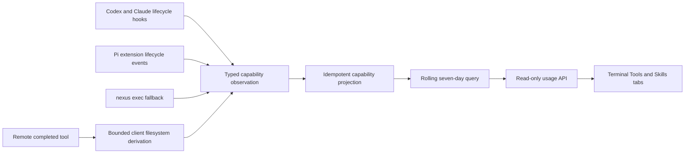

# Usage analytics

## What this feature does

Usage analytics records the tools, skills, and repository scripts that Nexus observes agent hosts using. It presents a rolling seven-day summary in the Pi `/nexus` and native `nexus tui` interfaces so a person can assess whether installed tools and skills are changing agent behavior.

The metrics are explicitly observational. Nexus captures client-side lifecycle events exposed by Codex, Claude, and Pi whether the companion uses a local daemon or shared service, but does not claim visibility into hosted tools or processes launched beneath an opaque command.

## Why it exists

Installing agent tools and skills does not show whether agents actually use them. Generic coordination events are bounded for display, may contain private output, and cannot reliably deduplicate completion hooks, so they are not a sound analytics source. A typed fact projection gives each observed invocation a stable identity and keeps privacy-sensitive arguments and output out of aggregate reporting.

## Data flow

## Required behavior

- Tool starts and completions upsert one invocation keyed by project, host, session, kind, and invocation ID. A completion received without a start still creates the invocation.
- Script executions are child capability uses derived conservatively from shell commands. The outer shell tool remains visible, and wrapper-backed observations do not create a second inferred script row.
- Skill uses retain their evidence method. Explicit Pi `/skill:name` input is authoritative; successful direct reads and conservative read-only shell commands targeting `SKILL.md` provide inferred evidence for hosts without a skill lifecycle hook. Stronger evidence promotes an existing same-turn observation rather than incrementing the count.
- In remote companion mode, filesystem-derived script paths and successful skill-manifest identities are computed beside the checkout, bounded, and authenticated with the completed lifecycle request. The server never opens a client path.
- Stored analytics contain typed identity, source, outcome, timestamps, and optional model metadata, but never raw arguments, environment values, tool output, or error text.
- Queries use a server-defined rolling seven-day window, support global and project scope, return deterministic count ordering, and expose whether the bounded result was truncated.
- Local mode scopes facts by derived Git identity; remote clients configured with the same explicit project ID contribute to one shared project summary across clones.
- Lifecycle capture is advisory and fail open. Charts are labeled as observed by Nexus, and capture health exposes received, recorded, and dropped observations without claiming visibility into events that never reached Nexus.
- The Pi extension captures events whenever loaded, independently of whether `/nexus` is open. Capture uses a bounded asynchronous queue and cannot change a tool result.
- `nexus exec -- PROGRAM [ARG ...]` is an exact fallback for scripts that automatic shell-command inference cannot identify. It preserves child stdio and exit behavior.

## Implementation details

Persistence owns the normalized capability projection and typed Diesel aggregates. Coordination converts host lifecycle input into observations and performs deterministic script and skill evidence extraction. Explicit skill and wrapped-script reports enter one typed `ExplicitUsageInput` lifecycle that resolves project identity, touches the session, records the capability, and translates storage failures into the same fail-open hook response; each variant still constructs its own evidence and outcome. Script detection rejects source text beyond 1 MiB, examines at most 256 shell segments, and stops after 64 repository-relative results before performing more filesystem work. Skill inference opens only regular manifests without following symlinks and reads at most 64 KiB. With a local daemon that derivation runs beside the service. With a remote service, the companion applies a separate 250-millisecond capture budget and omits optional evidence rather than delaying the primary completed-tool request, then includes successful bounded evidence in the bearer-authenticated request. The server requires the evidence session and agent to equal the lifecycle caller and stores only the same privacy-safe normalized capability facts; the supplemental evidence contains no file contents, manifest contents, commands, environment values, output, or credentials. Because the shared secret authenticates a client assertion rather than proving filesystem state, the metrics remain explicitly observational.

The usage read first selects the 64 highest-count `(kind, name)` dimensions in deterministic order. It then loads only bounded aggregate detail and at most 4,096 distinct session-identity rows for those dimensions. If dimension or session-identity capacity is exceeded, the response is marked `truncated` instead of allocating an unbounded history.

Runtime exposes lifecycle ingestion and typed usage reads through MCP. Direct Streamable HTTP clients do not receive filesystem-derived evidence automatically because the remote service never opens `X-Nexus-Project-Root`; they must use or reproduce the companion-side observation contract if they need it. The Pi extension modules own automatic host-event forwarding, independent analytics polling, shared tab state, and terminal bar rendering for Pi and the bundled native host.

Existing dashboard event windows are not an analytics source. Usage aggregation runs separately and less frequently so the high-frequency coordination dashboard does not increase lifecycle-store contention.
