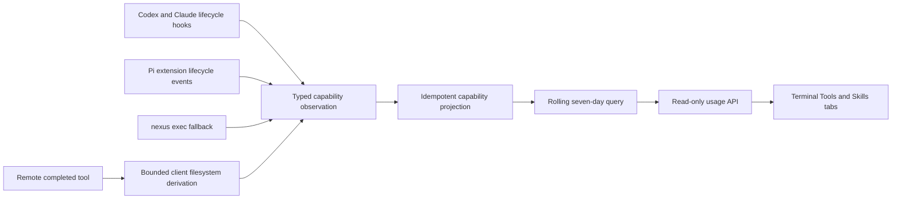
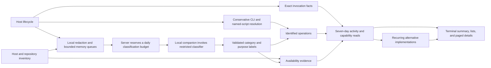

# Usage analytics

## What this feature does

Usage analytics records the tools, skills, and repository scripts that Nexus observes agent hosts using. It presents a rolling seven-day summary in the Pi `/nexus` and native `nexus tui` interfaces so a person can assess whether installed tools and skills are changing agent behavior.

The metrics are explicitly observational. Nexus captures client-side lifecycle events exposed by Codex, Claude, and Pi whether the companion uses a local daemon or shared service, but does not claim visibility into hosted tools or processes launched beneath an opaque command.

## Why it exists

Installing agent tools and skills does not show whether agents actually use them. Generic coordination events are bounded for display, may contain private output, and cannot reliably deduplicate completion hooks, so they are not a sound analytics source. A typed fact projection gives each observed invocation a stable identity and keeps privacy-sensitive arguments and output out of aggregate reporting.

## Data flow

## Required behavior

- Tool starts and completions upsert one invocation keyed by project, host, session, kind, and invocation ID. A completion received without a start still creates the invocation.
- Script executions are child capability uses derived conservatively from shell commands. The outer shell tool remains visible, and wrapper-backed observations do not create a second inferred script row.
- Skill uses retain their evidence method. Explicit Pi `/skill:name` input is authoritative; successful direct reads and conservative read-only shell commands targeting `SKILL.md` provide inferred evidence for hosts without a skill lifecycle hook. Stronger evidence promotes an existing same-turn observation rather than incrementing the count.
- In remote companion mode, filesystem-derived script paths and successful skill-manifest identities are computed beside the checkout, bounded, and authenticated with the completed lifecycle request. The server never opens a client path.
- Stored analytics contain typed identity, source, outcome, timestamps, and optional model metadata, but never raw arguments, environment values, tool output, or error text.
- Queries use a server-defined rolling seven-day window, support global and project scope, return deterministic count ordering, and expose whether the bounded result was truncated.
- Local mode scopes facts by derived Git identity; remote clients configured with the same explicit project ID contribute to one shared project summary across clones.
- Lifecycle capture is advisory and fail open. Charts are labeled as observed by Nexus, and capture health exposes received, recorded, and dropped observations without claiming visibility into events that never reached Nexus.
- The Pi extension captures events whenever loaded, independently of whether `/nexus` is open. Capture uses a bounded asynchronous queue and cannot change a tool result.
- `nexus exec -- PROGRAM [ARG ...]` is an exact fallback for scripts that automatic shell-command inference cannot identify. It preserves child stdio and exit behavior.

## Implementation details

Persistence owns the normalized capability projection and typed Diesel aggregates. Coordination converts host lifecycle input into observations and performs deterministic script and skill evidence extraction. Explicit skill and wrapped-script reports enter one typed `ExplicitUsageInput` lifecycle that resolves project identity, touches the session, records the capability, and translates storage failures into the same fail-open hook response; each variant still constructs its own evidence and outcome. Script detection rejects source text beyond 1 MiB, examines at most 256 shell segments, and stops after 64 repository-relative results before performing more filesystem work. Skill inference opens only regular manifests without following symlinks and reads at most 64 KiB. With a local daemon that derivation runs beside the service. With a remote service, the companion applies a separate 250-millisecond capture budget and omits optional evidence rather than delaying the primary completed-tool request, then includes successful bounded evidence in the bearer-authenticated request. The server requires the evidence session and agent to equal the lifecycle caller and stores only the same privacy-safe normalized capability facts; the supplemental evidence contains no file contents, manifest contents, commands, environment values, output, or credentials. Because the shared secret authenticates a client assertion rather than proving filesystem state, the metrics remain explicitly observational.

The usage read first selects the 64 highest-count `(kind, name)` dimensions in deterministic order. It then loads only bounded aggregate detail and at most 4,096 distinct session-identity rows for those dimensions. If dimension or session-identity capacity is exceeded, the response is marked `truncated` instead of allocating an unbounded history.

Runtime exposes lifecycle ingestion and typed usage reads through MCP. Direct Streamable HTTP clients do not receive filesystem-derived evidence automatically because the remote service never opens `X-Nexus-Project-Root`; they must use or reproduce the companion-side observation contract if they need it. The Pi extension modules own automatic host-event forwarding, independent analytics polling, shared tab state, and terminal bar rendering for Pi and the bundled native host.

Existing dashboard event windows are not an analytics source. Usage aggregation runs separately and less frequently so the high-frequency coordination dashboard does not increase lifecycle-store contention.

## Activities, availability, and opportunities

The Tools tab starts with **Activities**, with separate **Capabilities**, **Opportunities**, and **Legacy** views. Skills retain their own tab. Activities answer what work was attempted; capabilities retain the concrete host tool, CLI operation, or repository script. The legacy projection stays available for older observations. Historical shell arguments were deliberately never saved, so Nexus cannot reconstruct their intent or fabricate historical availability.

The invocation fact keeps the original host tool name and caller namespace, outcome, parent relationship, and timestamps. Starts remain visible if completion never arrives. A completion identifies at most 64 operations. Deterministic CLI rules use bounded, known verbs rather than private arguments. Standard commands remain CLI capabilities even when their precise purpose needs inference; unknown executables keep unknown origin. Native named tools retain their identity when they accept code or command arguments. Inline-program provenance is reserved for generic execution tools, and a repository script that shadows a standard CLI is counted once. A named repository script keeps its relative identity. A pre-execution snapshot of `scripts/`, `tools/`, and `.githooks/` distinguishes scripts already supplied from scripts introduced during that session; incomplete snapshots or paths outside that coverage yield unknown origin. Repository scans visit at most 1,024 entries, return at most 256 resources, and stop after 25 milliseconds. Metadata fingerprints invalidate a named script's classification after edits.

Calls and operations are different denominators. A call may identify multiple operations and occur in multiple categories. Parents with observed children retain their exact capability use but do not add activity operations. The API never computes a misleading adoption percentage. A capability with zero uses and observed exposure is distinguishable from one whose availability is unknown. Exposure counts mean the resource was offered or discoverable at some point in that session; they do not prove availability at each invocation. A later inventory change does not erase earlier exposure evidence.

Pi reports its configured tool catalog, active tools, descriptions, and definition fingerprints at session start and when changed, with periodic retries during subsequent tool calls. SDKs that do not provide this inventory keep unknown host-tool availability. Codex and Claude still contribute concrete observed tool identities, deterministic CLI activity, script provenance, and semantic classification through the stdio companion; their host-wide inventories are not invented. Direct HTTP lifecycle clients contribute facts but need the companion (or the explicit inventory/classification reporting contract) for local enrichment. `nexus exec` observations remain in Legacy.

The local companion owns classification so a shared service never acquires filesystem access or executes model providers. It removes outputs and errors before normalization. It redacts literals, comments, absolute paths, URLs, environment assignments, and opaque tokens from bounded input, retaining safe known CLI operation names embedded in programs. Redaction is conservative best effort; custom identifiers may still reach the configured provider. Named-script source is read only beside the checkout, within the checkout, and bounded to 8 KiB. No source, command, argument, environment value, output, error text, or classifier prompt is stored in the analytics projection or transmitted by the classification-report API. Only validated generic category labels, short purpose descriptions, fingerprints, and provenance persist.

Classification uses the analyst provider/model configuration independently of `analyst.enabled`. It runs from an isolated temporary working directory with the CLI's operational tools, child-agent delegation, MCP integrations, hooks, web access, and session persistence disabled. The Codex classifier ignores unrelated user configuration and execpolicy rules while preserving authentication and the explicit Nexus provider/model settings. It receives no Nexus service secrets. A model result describes inferred intent, not proof that a branch in an inline program executed. Unclear, failed, expired, or dropped work remains explicitly unclassified. Queue saturation and model failures never change a lifecycle response. Actual observations have a separate bounded queue and priority over catalog enrichment. Transient inputs expire after two minutes and disappear when the companion exits; they are never queued on disk.

The server reserves at most one attempt per project/pattern/policy/day and enforces a global daily budget (default 128). Classification defaults to a 30-second timeout and can be disabled under `[analytics]`. A report must match a reserved subject and source fingerprint. Repeated matching actions reuse labels. Known tool definitions supply categories to later calls without another per-call model call; these carry separate definition evidence. Deferred enrichment only fills invocations from the matching definition version, preserving earlier unknown observations after a definition changes. Classification revisions retain the classifier model and policy version; facts remain independent of taxonomy. Categories are automatically created as needed; `nexus_analytics` also supports category rename and merge. Merged IDs redirect future observations and supplied-tool comparisons.

`nexus_analytics` exposes summary, catalog, opportunities, examples, categories, inventory, classification reservation/reporting, rename, and merge actions. Reads respect authenticated project binding. The catalog pages 32 resources by default (maximum 64), including zero-use entries; implementations page 32 records. Summaries expose their top-64 truncation. Opportunity matching uses up to 4,096 session/category memberships and offered-resource memberships and marks truncation. Suggestions compare categories only in matching observed sessions; a category match is a lead, not a guarantee of suitability. A CLI is identified as a standard CLI, not mislabeled as an agent-written program.

Migration V11 adds separate call, operation, resource, exposure, category, and revision projections on SQLite and PostgreSQL. Portable stream version 3 includes all six tables and still accepts complete version-2 streams. Both terminal hosts share the same browser and polling lifecycle, abort scope changes and superseded requests, preserve successful data on errors, sanitize terminal text, and disclose provenance/model metadata on demand.

The initial built-in category catalog is seeded in one database transaction. Concurrent readers cannot observe a partially seeded taxonomy, and the first lifecycle hook pays for one catalog commit rather than one durable commit per category.
