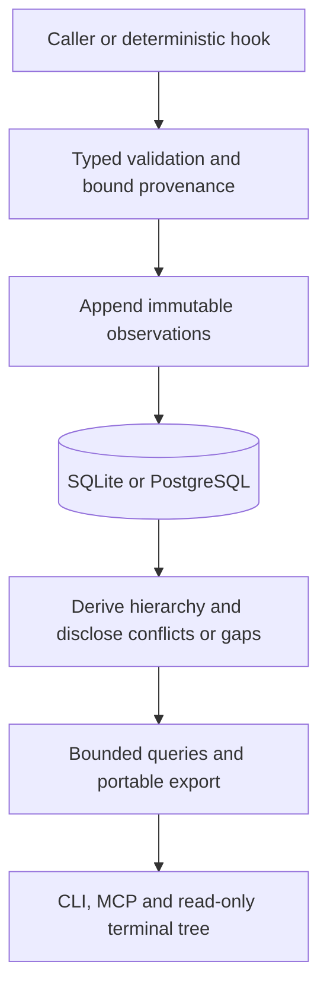

# Work history

Nexus records caller-owned work sessions and nested activity attempts through
immutable observations. A logical work session spans prompts, host sessions,
repositories, PRs, and delivery environments. The caller owns execution and
completion criteria. No recording action runs a command or promotes a release.

## Why

Host sessions, tool counts, and final CI conclusions do not explain which tests,
reviews, retries, and descendants contributed to delivery or where elapsed time
went. Durable parentage and source boundaries let callers reconstruct that
history without assigning invented durations to missing observations.

## Data flow

`src/work_history` defines the closed typed event, relationship, query, and
response contracts. `Store::work_command` publishes bounded atomic batches and
serves list, detail, child timeline, events, and reference-preserving export.
Nexus binds project and submitter provenance, distinguishes occurrence and receipt
times, and accepts out-of-order events and unresolved references. Identical event
IDs replay with the original receipt; changed immutable content is rejected.

The hierarchy has one structural parent, with separate membership/dependency,
retry, delegation, evidence, Git revision, and external links. Descendants inherit
work-session membership without adopting the host session's lifetime. Shared
executions retain one activity identity and can join multiple work sessions.
Internal links resolve within the bound Nexus project. Repositories configured
with the same project can share the tree; distinct Nexus projects retain external
references until a caller explicitly imports evidence into the chosen scope.
Conflicting parents, timing reports, and correction branches stay explicit.
Corrections must retain subject and event family and have acyclic ancestry.
Missing boundaries, late links, and history limits never imply a finish.
The default list contains work-session roots. The separate `activities` query
provides a secondary flat search with kind, environment, repository, host-session, and
outcome filters on the same invocation, retaining parent and work-session links
for drill-back. A root list rejects activity-kind filters rather than presenting
a misleading empty result. Other root filters match recorded root attributes;
they do not claim to search descendant metadata.

Timing preserves exact decimal nanosecond text plus measurement method and clock
identity. UTC source timestamps and server receipt timestamps remain distinct.
Nexus does not subtract unrelated process clocks, clamp negative wall-clock
durations, infer unobserved work, or sum nested activity durations as total effort.
An optional typed source clock can establish a shared OS monotonic clock domain
across native hook processes while each producer retains its own identity.
When an exact reported duration is absent, matching producer identities can
provide a qualified `wall_clock` interval. Different producer identities retain
unknown elapsed time with a clock-domain gap. Original UTC boundaries remain
available regardless of whether a numeric duration can be derived.

SQLite and PostgreSQL V13 migrations retain authoritative observations plus
rebuildable subject/link indexes using Diesel's typed DSL. Portable format five
adds observations; versions two through four remain readable. Import rebuilds and
validates indexes from the original observations. Work-only imports preserve the
original source receipt and bind a new importer receipt separately.
Imported source reports retain previously accepted late graph conflicts rather
than rejecting history because all endpoints now arrive in one batch. Input and
receipt validation, immutable identity conflicts, and conflicted projections
remain in force; source provenance is a reported assertion, not impersonation of
the current authenticated submitter.

Ordinary pages have at most 64 items and retain a receipt-time cutoff that
excludes newly observed subjects. Session/activity metadata, derived hierarchy,
and filter results are live projections: later reports and corrections to an
existing subject can change subsequent pages. Raw event/export pages freeze the
immutable event population at their receipt cutoff. Time-window filters use the
currently known source start, or the first received observation's source time
when no start is known. Missing host-session context is attributed to the active
declaration's submitter, never an arbitrary later reporting actor.
Imports use that declaration's retained original source actor for this fallback,
while keeping the current importing actor separately in the receipt. Individual
observations have a 16 KiB bound; atomic submissions contain at most 64 records.
Detail exposes bounded original observations with explicit truncation. Projection
limits are disclosed as gaps rather than selecting an outcome from partial data.
Names, arbitrary environment labels, and bounded metadata describe observed work;
automatic capture does not retain raw arguments, prompts, outputs, or environment
values. Intentional evidence links use the existing Git-first eval artifact policy.

See [design and acceptance criteria](../design/workflow-history.md) for delivery,
instrumentation, and terminal behavior.

## Automatic capture and caller integration

`nexus setup` installs the `nexus-work-history` skill and integration reference
for Codex and Claude. They explain this feature's intent and caller-owned
execution boundary, identity/lineage, direct versus automatic recording,
script/Git-hook wiring, provider import, and inspection of gaps. Setup packages
the canonical shell and GitHub helpers with that skill, so an integrating repo
does not need a Nexus source checkout. See
[the skill source](../../skills/nexus-work-history/SKILL.md).

The companion records prompt, pre/post-tool, and session-end callbacks beside the
caller. Native command adapters additionally capture supported request/turn,
stop/interruption/error, and child-agent boundaries. Source methods identify
callback observation rather than exact model execution. Tool IDs and parent IDs
retain host identity. A dispatch response is distinct from child execution;
polling an asynchronous execution does not start another attempt. Session end
closes an automatically host-owned root with unknown task success; explicitly
shared logical roots and descendants retain their own lifecycles. The installed
[host adapter reference](../../skills/nexus-work-history/references/host-adapters.md)
defines supported fields, explicit context handoff, verification, and remaining
source gaps. Script classification does not manufacture execution intervals.

`runtime::work_capture` owns metadata-only delivery and `nexus exec` reuses the
existing process wrapper. `exec --kind NAME --name LABEL --work-session ID
--parent ID -- COMMAND` records a named interval, preserves child stdio/status,
and measures elapsed time before attempting telemetry delivery. It propagates
work/parent/host/agent/model context to child processes. Optional
`NEXUS_WORK_ENVIRONMENT` is an explicit caller environment label.

The local outbox lives beside the configured SQLite database; remote clients use
an endpoint/project-keyed directory under the user's local data directory.
`NEXUS_WORK_OUTBOX_DIR` can explicitly select another directory. Directories and
files use owner-only permissions. Pending, rejected, and recent acknowledged
metadata share a 256-entry/8 MiB payload cap; individual entries are at most
64 KiB. Producers within one process share a writer ownership lane so a slow
durable file sync cannot make sibling producers exhaust the external lock
deadline. Flush and health observers return busy instead of waiting for that
lane; filesystem lock acquisition against another process remains bounded at
50 ms. The host callback still returns within its foreground capture budget.
Capture admission uses a bounded process worker instead of silently skipping
concurrent callbacks. The foreground wait is bounded; receipts distinguish
durable enqueue, pending persistence, rejection, and loss. Hook permission remains
independent of capture receipt. Offered/queued/duplicate/lost boundaries, rejection
reasons, source identity, and latest capture/delivery timestamps have a separate
bounded metadata ledger; process fallback counters disclose failures to persist
that ledger. Invalid adapter transport increments a separate metadata-only
rejection counter; it is not an accepted observation or a retained quarantined
record. Recent acknowledged boundaries are evicted first, followed by the oldest
quarantined entries; pending observations are never evicted. Retained quarantine
entries keep owner-only permissions. The recent acknowledgment journal
allows duplicate host callbacks without inventing new occurrence timestamps;
transport retries always reuse the exact original bytes. A very late duplicate
outside that journal is reconciled with an exact project-scoped observation
lookup. A pending reconciliation phase survives companion restarts, allowing
slow services to perform the conflict response and lookup in separate bounded
flush attempts. Body-identical automatic callbacks reuse accepted evidence; changed
terminal outcomes remain conflicts, including while the original local receipt
is still cached. Outbox keys include the canonical Nexus project binding;
different projects can retain the same host observation ID without colliding.
Existing pending payloads remain deliverable without filename migration.
Explicit historical `host_source_boundary` timestamps remain authoritative:
after receipt eviction, replay the original canonical observations rather than
regenerating an earlier container from a later source event.
Corrupt/permanently invalid/conflicting entries are quarantined, while
retryable service failures remain pending. The workload always continues.

`work health` exposes queued/rejected/recent counts, byte size, oldest queued
observation, known capacity losses, and the persistent cumulative
`rejected_evicted` count. Eviction limits local rejection retention; it does not
change accepted historical facts or retry an executed workload. `work flush`
attempts a bounded batch; active clients retry every 30 seconds and cancel that retry worker on client
close. No background client means no automatic delivery. These health facts
cannot prove that every external host event reached the companion.
Short-lived `exec`, `review-commit`, and Git-hook producers wait up to 1.5 seconds for their
admitted local capture jobs before final delivery and exit. This prevents normal
pending jobs from being killed by immediate process teardown. The wait occurs
after the measured workload finishes, preserves its status/output, and does not
extend the generic lifecycle callback budget; a timed-out wait still makes no
durability promise.
The `nexus_capture_health` MCP tool exposes this local companion's capture health
even when the history service is remote. A direct service MCP connection reports
local capture as unavailable. The TUI labels these counters separately from the
selected project's accounting; one producer's health cannot prove global coverage.

Repository validation has named check intervals and concurrent review workers
retain their review-group parent. A wrapped `git commit` passes a generated
operation ID through `NEXUS_COMMIT_OPERATION_ID`; pre-commit records candidate
Git metadata and post-commit attaches the resulting full revision to that exact
attempt. A bare Git invocation does not provide this enclosing ID, so its hook
intervals remain observable without fabricating the commit association. Hook
failures never convert an otherwise successful workload to a telemetry failure.
Invoke the Git-hook command synchronously so its bounded persistence drain runs
before the hook process exits; backgrounding it provides no capture guarantee.

The local GitHub snapshot adapter preserves exact run/attempt/job/step identity
and source timing, with status observations where exact boundaries are absent.
Canonical activity declarations retain provider identity; separate membership
links attach shared CI work to multiple work sessions. Names, URLs, status, and
other metadata observed later remain timestamped metadata milestones instead of
conflicting declarations. Missing source boundaries use an explicitly labeled
metadata observation time and never manufacture a start or finish. Completion
reports remain stable when a start arrives later; exact source UTC boundaries
allow Nexus to derive a qualified wall-clock duration. The workflow head SHA is
labeled as provider-reported metadata, not proof of the checked-out revision.
Snapshots exceeding 64 observations use `--output-directory` to write complete
record files bounded to 64 observations and 768 KiB each. Default stdout mode
fails clearly when more than one file is needed; it never silently drops work.
It does not poll providers or control CI. See the
[caller integration examples](../../examples/work-history/README.md) for scripts,
Git handoff, arbitrary environments, and later source reconciliation.

## Recording and retrieval

`nexus work open`, `start`, `finish`, `milestone`, and `link` record caller facts;
`record FILE` accepts `{format_version:1,observations:[...]}` with `-` for stdin.
`list`, `activities`, `show`, `timeline`, and `events` retrieve bounded history.
`export FILE` and `import FILE` exchange checksummed work-only JSONL bundles;
these differ from the database-wide portable format-five stream. `schema` prints
the `WorkAction` contract used by the `nexus_work` MCP tool. CLI `show` maps to
MCP `get`; recording conveniences submit the corresponding typed observations.

The native and Pi Work tab defaults to a visual overview: qualified session
counts, total/mean observed session durations, activity-kind inclusive-duration
bars, and UTC-day means/totals across time. Selecting a parent session shows its
own interval, qualified accounting, and a vertically scrollable waterfall of
all retained descendants. Time runs down one proportional axis, and children
branch to the right at their source start. Its labeled UTC origin is the earliest
retained source boundary, including tasks queued before the session. Parallel siblings occupy separate
lanes; completed spans terminate, and unknown finishes use dotted continuations.
Queue admission and execution start are separate markers on the same task lane;
dotted queue segments do not create another execution or worker.
Zoom and pan preserve source boundaries. Missing parents stay visibly unresolved,
including when a child outlives its parent. Root and task selection follows the recorded
hierarchy, reveals its span in both axes, and highlights it on the graph. A panel
immediately below shows kind/category, state/outcome, source and elapsed/queue
timing, executor, parent, gaps, and conflicts without opening a separate record.
Colors group recorded kind families as subagents, tests, scripts, reviews,
tools/commands, or generic work/sessions. Custom kinds remain Other; titles do not
drive classification. The legend and textual labels also work with `NO_COLOR`.
The same view is available with `g`
from a session reached through ordinary paginated source browsing. The
secondary record list preserves hierarchy, filters, details, links, and immutable
observations for audit work. See [terminal UI](observability-ui.md) for keys.

## Visual duration reads

The `dashboard` action of `nexus_work` reads project history without treating the
first ordinary 64-item page as the population. It returns duration statistics,
daily session statistics, daily activity-kind statistics, selectable session
summaries, and optional `work_session_id` descendants. Means divide by
`known_count`, with all sampled records separately counted. Conflicted or
unavailable durations do not become zero. Valid reported durations retain their
source method/clock in the accompanying summaries; derived intervals use the
shared qualified source-clock or same-producer timing rules.

Session interval sums and activity inclusive interval sums have different
meanings. Nested and parallel activity intervals overlap; their sum is neither
effort nor a reconstructed prompt-to-production duration. Shared activities are
counted once per identity within the selected scope. Source dates use UTC start,
or first source occurrence when no start is known. Repository/environment and
other legacy list filters remain in the secondary audit view.

Project scans select the most recently received 4096 subjects and at most 8 MiB
of projected summary payloads. Selecting a session separately traverses its
resolved descendants with the same count/byte bounds and at most 64 candidate
pages of 64 rows (including stale/corrected links), so unrelated newer work
does not hide an older session's tasks. Existing 1024-observation/lineage projection
limits still apply and remain visible as gaps. Display lists cap at 512 sessions
(192 KiB) and 512 activity summaries (128 KiB). The separate compact waterfall
retains up to 4096 interval nodes within 384 KiB; daily/session-kind charts have separate
encoded-byte bounds. `truncated` and notices disclose source versus display
limits, and aggregate counts retain the scanned population when rows are
omitted for display. A final serialized response bound protects the remote 1 MiB
transport limit. No bounded read claims complete capture of external work.

Selected-session accounting uses one shared projection for CLI/MCP and both
terminal hosts. `occupied_wall` is the clipped union of qualified queue intervals
and intervals explicitly labeled `nexus.accounting.role=execution` or `wait`; containers and unknown roles
cannot make work look fully attributed. `unobserved` is the remaining qualified
session interval, with exact UTC gap boundaries. It is not inferred idle, model
response, reasoning, or CPU time. `inclusive_execution` retains exact decimal
nanoseconds across all timed activity identities, including nested containers.
`worker_occupancy` unions intervals per explicitly declared executor and then
sums workers, preserving parallel occupancy and background work beyond the root.
`queue_wait` sums qualified queue-to-start durations separately; parallel queues
can overlap, so this sum is neither occupied wall time nor worker occupancy.
Summaries retain `queued_at` and qualified `queue_elapsed`, and coverage counts
queued and timed queues separately. These measures have separate definitions
and cannot substitute for one another.
Missing starts/finishes, clock/graph conflicts, unknown roles/executors, unresolved
parentage, source/display limits, and unavailable capability inventory qualify
the results. Missing inventory never becomes a claim of complete capture.

Session-title milestones preserve the host's actual display name and rename
history in source-time order. Automatically owned roots follow that host name;
shared logical work titles remain caller-owned. Coordination session rows resolve
the same exact project, host agent, and full session ID. Codex title reads use
metadata-only `thread/read` without resuming; Claude title reads use bounded
exact-session title metadata. Unavailable names retain an explicit host/ID label.
