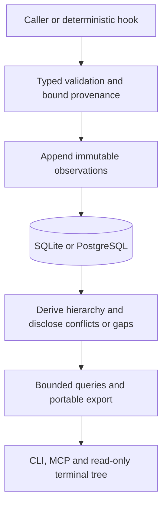

# Work history

Nexus records caller-owned work sessions and nested activity attempts through
immutable observations. A logical work session spans prompts, host sessions,
repositories, PRs, and delivery environments. The caller owns execution and
completion criteria. No recording action runs a command or promotes a release.

## Why

Host sessions, tool counts, and final CI conclusions do not explain which tests,
reviews, retries, and descendants contributed to delivery or where elapsed time
went. Durable parentage and source boundaries let callers reconstruct that
history without assigning invented durations to missing observations.

## Data flow

`src/work_history` defines the closed typed event, relationship, query, and
response contracts. `Store::work_command` publishes bounded atomic batches and
serves list, detail, child timeline, events, and reference-preserving export.
Nexus binds project and submitter provenance, distinguishes occurrence and receipt
times, and accepts out-of-order events and unresolved references. Identical event
IDs replay with the original receipt; changed immutable content is rejected.

The hierarchy has one structural parent, with separate membership/dependency,
retry, delegation, evidence, Git revision, and external links. Descendants inherit
work-session membership without adopting the host session's lifetime. Shared
executions retain one activity identity and can join multiple work sessions.
Internal links resolve within the bound Nexus project. Repositories configured
with the same project can share the tree; distinct Nexus projects retain external
references until a caller explicitly imports evidence into the chosen scope.
Conflicting parents, timing reports, and correction branches stay explicit.
Corrections must retain subject and event family and have acyclic ancestry.
Missing boundaries, late links, and history limits never imply a finish.
The default list contains work-session roots. The separate `activities` query
provides a secondary flat search with kind, environment, repository, host-session, and
outcome filters on the same invocation, retaining parent and work-session links
for drill-back. A root list rejects activity-kind filters rather than presenting
a misleading empty result. Other root filters match recorded root attributes;
they do not claim to search descendant metadata.

Timing preserves exact decimal nanosecond text plus measurement method and clock
identity. UTC source timestamps and server receipt timestamps remain distinct.
Nexus does not subtract clocks from different processes, clamp negative wall-clock
durations, infer unobserved work, or sum nested activity durations as total effort.
When an exact reported duration is absent, matching producer identities can
provide a qualified `wall_clock` interval. Different producer identities retain
unknown elapsed time with a clock-domain gap. Original UTC boundaries remain
available regardless of whether a numeric duration can be derived.

SQLite and PostgreSQL V13 migrations retain authoritative observations plus
rebuildable subject/link indexes using Diesel's typed DSL. Portable format five
adds observations; versions two through four remain readable. Import rebuilds and
validates indexes from the original observations. Work-only imports preserve the
original source receipt and bind a new importer receipt separately.
Imported source reports retain previously accepted late graph conflicts rather
than rejecting history because all endpoints now arrive in one batch. Input and
receipt validation, immutable identity conflicts, and conflicted projections
remain in force; source provenance is a reported assertion, not impersonation of
the current authenticated submitter.

Ordinary pages have at most 64 items and retain a receipt-time cutoff that
excludes newly observed subjects. Session/activity metadata, derived hierarchy,
and filter results are live projections: later reports and corrections to an
existing subject can change subsequent pages. Raw event/export pages freeze the
immutable event population at their receipt cutoff. Time-window filters use the
currently known source start, or the first received observation's source time
when no start is known. Missing host-session context is attributed to the active
declaration's submitter, never an arbitrary later reporting actor.
Imports use that declaration's retained original source actor for this fallback,
while keeping the current importing actor separately in the receipt. Individual
observations have a 16 KiB bound; atomic submissions contain at most 64 records.
Detail exposes bounded original observations with explicit truncation. Projection
limits are disclosed as gaps rather than selecting an outcome from partial data.
Names, arbitrary environment labels, and bounded metadata describe observed work;
automatic capture does not retain raw arguments, prompts, outputs, or environment
values. Intentional evidence links use the existing Git-first eval artifact policy.

See [design and acceptance criteria](../design/workflow-history.md) for delivery,
instrumentation, and terminal behavior.

## Automatic capture and caller integration

The companion records prompt, pre/post-tool, and session-end callbacks beside the
caller. The source method is `companion_callback_wall_clock`: it means when the
companion received the callback, not an exact model execution boundary. Tool IDs
and available parent IDs retain host identity. An observed host session forms an
agent activity under its logical work root; stopping it reports unknown task
success and does not finish its descendants. Unsupported child-agent internals
remain missing. Script classification does not manufacture execution intervals.

`runtime::work_capture` owns metadata-only delivery and `nexus exec` reuses the
existing process wrapper. `exec --kind NAME --name LABEL --work-session ID
--parent ID -- COMMAND` records a named interval, preserves child stdio/status,
and measures elapsed time before attempting telemetry delivery. It propagates
work/parent/host/agent/model context to child processes. Optional
`NEXUS_WORK_ENVIRONMENT` is an explicit caller environment label.

The local outbox lives beside the configured SQLite database; remote clients use
an endpoint/project-keyed directory under the user's local data directory.
`NEXUS_WORK_OUTBOX_DIR` can explicitly select another directory. Directories and
files use owner-only permissions. Pending, rejected, and recent acknowledged
metadata share a 256-entry/8 MiB payload cap; individual entries are at most
64 KiB. Producers within one process share a writer ownership lane so a slow
durable file sync cannot make sibling producers exhaust the external lock
deadline. Flush and health observers return busy instead of waiting for that
lane; filesystem lock acquisition against another process remains bounded at
50 ms. The host callback still returns within its foreground capture budget.
Recent acknowledged boundaries are evicted first, followed by the oldest
quarantined entries; pending observations are never evicted. Retained quarantine
entries keep owner-only permissions. The recent acknowledgment journal
allows duplicate host callbacks without inventing new occurrence timestamps;
transport retries always reuse the exact original bytes. A very late duplicate
outside that journal can expose an immutable conflict rather than move accepted
timing. Corrupt/permanently invalid/conflicting entries are quarantined, while
retryable service failures remain pending. The workload always continues.

`work health` exposes queued/rejected/recent counts, byte size, oldest queued
observation, known capacity losses, and the persistent cumulative
`rejected_evicted` count. Eviction limits local rejection retention; it does not
change accepted historical facts or retry an executed workload. `work flush`
attempts a bounded batch; active clients retry every 30 seconds and cancel that retry worker on client
close. No background client means no automatic delivery. These health facts
cannot prove that every external host event reached the companion.

Repository validation has named check intervals and concurrent review workers
retain their review-group parent. A wrapped `git commit` passes a generated
operation ID through `NEXUS_COMMIT_OPERATION_ID`; pre-commit records candidate
Git metadata and post-commit attaches the resulting full revision to that exact
attempt. A bare Git invocation does not provide this enclosing ID, so its hook
intervals remain observable without fabricating the commit association. Hook
failures never convert an otherwise successful workload to a telemetry failure.

The local GitHub snapshot adapter preserves exact run/attempt/job/step identity
and source timing, with status observations where exact boundaries are absent.
Canonical activity declarations retain provider identity; separate membership
links attach shared CI work to multiple work sessions. Names, URLs, status, and
other metadata observed later remain timestamped metadata milestones instead of
conflicting declarations. Missing source boundaries use an explicitly labeled
metadata observation time and never manufacture a start or finish. Completion
reports remain stable when a start arrives later; exact source UTC boundaries
allow Nexus to derive a qualified wall-clock duration. The workflow head SHA is
labeled as provider-reported metadata, not proof of the checked-out revision.
Snapshots exceeding 64 observations use `--output-directory` to write complete
record files bounded to 64 observations and 768 KiB each. Default stdout mode
fails clearly when more than one file is needed; it never silently drops work.
It does not poll providers or control CI. See the
[caller integration examples](../../examples/work-history/README.md) for scripts,
Git handoff, arbitrary environments, and later source reconciliation.

## Recording and retrieval

`nexus work open`, `start`, `finish`, `milestone`, and `link` record caller facts;
`record FILE` accepts `{format_version:1,observations:[...]}` with `-` for stdin.
`list`, `activities`, `show`, `timeline`, and `events` retrieve bounded history.
`export FILE` and `import FILE` exchange checksummed work-only JSONL bundles;
these differ from the database-wide portable format-five stream. `schema` prints
the `WorkAction` contract used by the `nexus_work` MCP tool. CLI `show` maps to
MCP `get`; recording conveniences submit the corresponding typed observations.

The native and Pi Work tab defaults to work-session roots. Enter opens the
hierarchy; Right/Space expands descendants, `t` toggles the relative time axis,
and Enter opens an activity. `s` opens session detail, `l` browses attributable
links, and `e` pages immutable observations. `f` switches to activity search;
`w` in activity detail lists containing sessions for navigation back to a tree.
Filters cover title text, repository, host session, environment, outcome, and
occurrence-time bounds; applying a kind filter selects activity search. Views
show individual inclusive intervals and known gaps, with no aggregate effort
or revision/PR filter. See [terminal UI](observability-ui.md) for key bindings.
